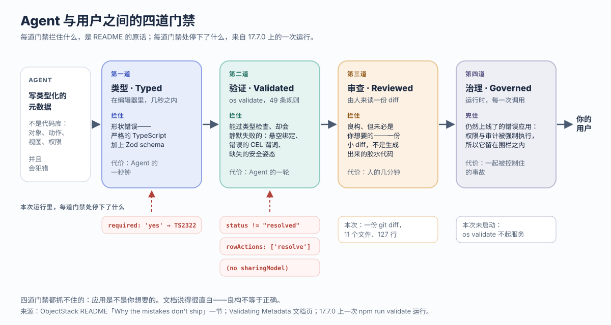
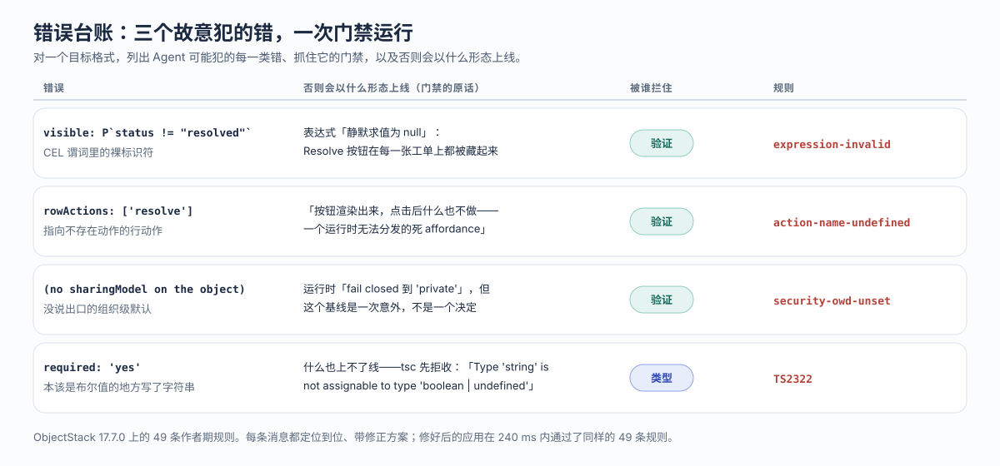

---
# @generated zh-Hant from zh-Hans (s2twp) — edit the zh-Hans file; delete this line to hand-maintain.
title: 什麼樣的業務應用是 AI 可編寫的？四道門禁：型別、驗證、審查、治理
description: AI 可編寫是目標格式的屬性，不是模型的屬性。四道門禁、一次真實執行：三個故意犯的錯、49 條規則、三條定位到位的報錯，然後一次乾淨通過。
author: ObjectStack Team
date: 2026-10-23
status: published
topic: ai-agents
audience: developer
solutions: []
industries: []
cover: ./cover.svg
tags:
  - AI 智慧體
  - AI 可編寫
---

一個業務應用是「AI 可編寫」的，當且僅當 Agent 必然會犯的錯誤在觸達使用者之前有地方可死。這是目標格式的屬性，不是模型的屬性。ObjectStack 的 README 點名了四個這樣的地方，稱之為門禁：**型別（Typed）**、**驗證（Validated）**、**審查（Reviewed）**、**治理（Governed）**。型別錯誤死在編輯器裡。驗證錯誤死在 `os validate` 上——它拒收那些能通過型別檢查、卻會在執行時靜默失敗的後設資料。審查錯誤死在一份人能整個讀完的 diff 裡。治理錯誤即使上線了，也留在執行時的權限與審計圍欄之內。下面是在 ObjectStack 17.7.0 上、用腳手架生成的支援臺跑的一次真實執行，覆蓋前兩道門禁：按 README 列出的三類各故意犯一個錯，49 條規則的門禁把每一個都定位到位、附帶修正方案地拒收，修好之後一次乾淨通過。

## 兩件本來就成立的事

講門禁之前，先替對立面把話說足，因為這篇文章的論證不需要它們中的任何一個是錯的。

**Vibe coding 做出來的應用是能用的。** 你可以向模型描述一個支援臺，一個下午就拿到一個能跑的版本，有介面、有資料庫、有 API，用的是模型最拿手的任何語言。做原型、做一次性工具、做用完即棄的演示，這是正確的取捨，下文沒有一句是反對它的。模型早已不是瓶頸。

**手寫程式碼是可審查的，而且工具鏈已經成熟。** 一位資深工程師讀 pull request、一套型別系統、一套測試、一個程式碼評審流程，每天都在抓真實的缺陷。對於新穎的邏輯沒有替代品，ObjectStack 自己也這麼說：「程式碼不會消失：它搬進了執行時，成為鉤子、動作體、CEL 和受限 JSX」——而那些程式碼仍然要由人來讀。

兩者都沒有回答的，是一旦由 Agent 來寫、真正要緊的那個問題：*寫錯的那一行去了哪裡？* 在一個自由形式的程式碼庫裡，一處錯誤的鑑權檢查就是成千上萬個 `if` 裡的一個，審查面是整個倉庫，執行時自身對權限什麼也不強制。腳手架生成的專案裡，CI 檔案用一句話（說的是後設資料，但對任何沒有門禁的格式都成立）概括了這件事：一個錯誤「什麼都不拋，只是對第一個碰上它的人表現得不對」。AI 可編寫，意思就是這句話不再成立。

## 四道門禁，按 README 的表述

README 的那一節叫「Why the mistakes don't ship」（錯誤為什麼上不了線），表格短到可以整個譯出來：

| 門禁 | 攔住什麼 |
| :--- | :--- |
| **型別（Typed）** | 嚴格的 TypeScript + Zod——形狀錯誤死在編輯器裡，Agent 寫下它們幾秒鐘之後 |
| **驗證（Validated）** | `os validate` 拒收那些能通過型別檢查、卻會在執行時靜默失敗的後設資料：懸空繫結、錯誤的 CEL 謂詞、缺失的安全姿態 |
| **審查（Reviewed）** | 你在 Console 裡批准一份小而可讀的 diff——不是一堆生成出來的膠水程式碼 |
| **治理（Governed）** | 執行時在每一次呼叫上強制執行權限與審計，所以哪怕應用寫錯了，也留在圍欄之內 |



這張表裡有三件事決定了這個承諾是不是真的，值得在看記錄之前先說清楚。

第一，門禁按代價排序。一個形狀錯誤花 Agent 一秒鐘。一個驗證錯誤花它一輪。一次審查花一個人幾分鐘。一次被治理住的失敗，是一起被控制住的事故。README 說整件事成立的原因，就在前兩行：「Agent 的錯誤變成了定位到位、可修正的文字，它自己就能讀、自己就能修」。

第二，第二道門禁之所以存在，是因為第一道不夠，文件用一句話說明了原因：「ObjectStack 的後設資料是資料，不是程式碼路徑——所以大多數錯誤**不會**被 TypeScript 編譯器抓到。它們通過 `tsc`，正常載入，然後**在執行時靜默失敗**。」一個謂詞是字串。一個行動作是名字。一個共享模型是可選鍵。三者帶著錯誤都能通過型別檢查。這正是驗證門禁為之而建的那一類錯誤，也是下面這次執行瞄準的那一類。

第三，後兩道門禁是人和執行時，不是工具，這篇文章不假裝不是。文件裡的審查門禁是 Studio 的「Review N changes」diff；在下面的執行裡，它是一份由人讀的 `git diff`。治理門禁是執行時的鑑權鏈和審計日誌，這次執行從未啟動它。記錄證明的是：兩道便宜的門禁抓住了 README 說它們會抓住的東西。它證明不了的，放在文末。

## 一個支援臺，三個錯誤，一次執行

下面的一切都是真跑出來的，不是拼出來的：Node 22，已釋出的包。腳手架就是 README 自己的第一步：

```bash
$ npm create objectstack@latest support-desk
  ╔═══════════════════════════════════╗
  ║   ◆ Create ObjectStack v17.7.0    ║
  ╚═══════════════════════════════════╝

◆ New Environment
────────────────────────────────────────
  Environment: support-desk
  Namespace: support_desk
  Template: blank — Minimal starter — one object, REST API, ready to extend

  ✓ Template files written (20)
  → Installing dependencies...
  → Installing AI skills for your coding agent...
  ✓ Environment created!
```

腳手架寫下一份 `AGENTS.md`，其中唯一沒有商量餘地的一行就是門禁：「**Never report a metadata change as done until `npm run validate` passes.**」（在 `npm run validate` 通過之前，永遠不要把一次後設資料改動報告為已完成。）它還寫下一個 CI 工作流，唯一的 job 跑 `pnpm validate`、`pnpm lint` 和 `pnpm typecheck`。在任何業務物件存在之前，門禁已經接好了。

接著是 README 裡的需求，按 Agent 會寫的方式寫出來：一個 `support_desk_ticket` 物件，帶主題、描述、一個優先順序選擇和一個狀態選擇；一個只在尚未解決的工單上顯示的 **Resolve** 動作；一個「未解決工單」列表檢視；一個 Support 導航組；再加一個給支援人員的權限集。整個應用是 **11 個檔案、新增 127 行**。錯誤將落在其中兩個檔案裡：

```ts
// src/actions/resolve-ticket.action.ts
export const ResolveTicketAction = defineAction({
  name: 'resolve_ticket',
  label: 'Resolve',
  objectName: 'support_desk_ticket',
  locations: ['record_header', 'list_item'],
  visible: P`record.status != "resolved"`,   // only on tickets not yet resolved
  operation: 'update',
  patch: { status: 'resolved' },
  confirmText: 'Mark this ticket as resolved?',
});
```

```ts
// src/views/ticket.view.ts
export const TicketViews = defineView({
  list: {
    label: 'All tickets',
    type: 'grid',
    data,
    columns: ['subject', 'priority', 'status'],
    rowActions: ['resolve_ticket'],
  },
  // ... form, and an "Open tickets" list view filtered on status = open
});
```

先跑一次乾淨的，把規則數記在案：

```text
$ npm run validate
◆ Validate
────────────────────────────────────────
  → Loading configuration...
  → Validating against ObjectStack Protocol...
  → Running author-time rules (49)...
  → Checking that every required capability has a provider installable in this edition...
  → Checking package docs (ADR-0046)...

  ✓ Validation passed (327ms)

  Support Desk v0.1.0

  Data: 2 Objects  6 Fields
  UI: 1 Apps  1 Views  1 Actions
  Logic: 0 Flows
  Security: 1 Permissions
  Runtime: 3 plugins
```

17.7.0 上是 49 條作者期規則。[本站上一次跑同一道門禁](/en/blog/how-to-point-your-agent-at-objectstack/)是在 17.2.0 上，當時是 41 條；規則表在長，對一道門禁來說這是對的方向。這個數字由工具自己列印，等於已釋出的 `@objectstack/lint` 包裡 `AUTHORING_RULES.length`，沒有第二個數字需要對賬。

### 三個錯誤

現在是 README 的三類，每類故意犯一個錯。三個都是在普通 JavaScript 上訓練出來的 Agent 會順手寫出的那種，三個都能通過型別檢查：

```diff
 // 1 · a bad CEL predicate: the bare identifier most template languages use
-  visible: P`record.status != "resolved"`,
+  visible: P`status != "resolved"`,

 // 2 · a dangling binding: a row action that names nothing
-    rowActions: ['resolve_ticket'],
+    rowActions: ['resolve'],

 // 3 · a missing security posture: the org-wide default left unsaid
-  sharingModel: 'private',
```

三個錯都在，`npm run typecheck` 照樣是綠的：`tsc` 對一個字串的內容、一個數組裡的名字、一個可選鍵，都沒有意見。門禁有：

```text
$ npm run validate
◆ Validate
────────────────────────────────────────
  → Loading configuration...
  → Validating against ObjectStack Protocol...
  → Running author-time rules (49)...

  ✗ Author-time rules failed (3 issues)
  • stack · action 'resolve_ticket' visible: bare reference `status` — a formula/validation expression binds the record as the `record` namespace, not at top level, so `status` resolves to nothing and the expression silently evaluates to null. Write `record.status`.
      source: `status != "resolved"`
      rule: expression-invalid  at stack · action 'resolve_ticket' visible
  • view "#0" · list · rowActions: Row-action menu names action "resolve", which is defined by no action in this stack (neither `stack.actions` nor any object's `actions`). The button renders and does nothing when clicked — a dead affordance the runtime cannot dispatch. Did you mean "resolve_ticket"?
      Define an action named "resolve" (in `stack.actions` or the object's `actions`) with the location this surface needs, remove the reference, or ignore this if the action is contributed by another installed package. Defined actions: resolve_ticket.
      rule: action-name-undefined  at views[0].list.rowActions[0]
  • object "support_desk_ticket": custom object "support_desk_ticket" declares no sharingModel (OWD). The runtime fails CLOSED to 'private' (ADR-0090 D1), but the baseline must be an authored decision, not an accident — this is the exact shape of the leave_request incident, where an object with no sharingModel let an ordinary read/write grant read and edit every other user's records.
      Declare sharingModel explicitly: 'private' (owner + shares; recommended default), 'public_read', 'public_read_write', or 'controlled_by_parent' (master-detail children).
      rule: security-owd-unset  at objects[1].sharingModel
 ELIFECYCLE  Command failed with exit code 1.
```

把這三條訊息當作一本臺賬來讀，而不是當作報錯，因為每一條都寫明瞭沒有門禁時執行時會發生什麼。叫它**錯誤臺賬**：對一個目標格式，列出 Agent 可能犯的每一類錯誤、抓住它的那道門禁，以及否則它會在執行時表現成什麼症狀。一個格式有多 AI 可編寫，恰好等於這本臺賬有多少行不是空的。



| 錯誤 | 否則會以什麼形態上線 | 被誰攔住 · 規則 |
| :--- | :--- | :--- |
| `` visible: P`status != "resolved"` `` | 謂詞「靜默求值為 null」：Resolve 按鈕在每一張工單上都被藏起來 | 驗證 · `expression-invalid` |
| `rowActions: ['resolve']` | 「按鈕渲染出來，點選後什麼也不做——一個執行時無法分發的死 affordance」 | 驗證 · `action-name-undefined` |
| 物件上沒有 `sharingModel` | 執行時「fail closed 到 'private'」，但一個沒說出口的基線正是「leave_request 事故的形狀」 | 驗證 · `security-owd-unset` |
| 欄位上寫 `required: 'yes'` | 什麼也上不了線：`tsc` 以「Type 'string' is not assignable to type 'boolean \| undefined'」拒收 | 型別 · `TS2322` |

第四行是型別門禁，在乾淨的樹上單獨跑，好讓驗證器的記錄只關於驗證：把 `required: true` 改成 `required: 'yes'`，`npm run typecheck` 帶著那條訊息以退出碼 2 結束，在任何別的東西執行之前。它是最便宜、也最無趣的一道門禁，而這正是它排在第一位的意義。

訊息的兩個屬性承載了整個承諾。它們**定位到位**：一個動作和一個謂詞槽位，一個檢視和一個數組下標，一個物件和一條鍵路徑。它們**帶修正方案**：「Write `record.status`」、「Did you mean `resolve_ticket`?」、`sharingModel` 的四個合法值。讀到這些的 Agent 一輪就能閉環。[給 Agent 配置 ObjectStack 的那篇文章](/en/blog/how-to-point-your-agent-at-objectstack/)把它叫作*修正式報錯*（corrective error），並論證一個格式手裡槓桿最大的東西不是文件而是報錯資訊；這次執行是它的又三個資料點。

把那三行改回去，門禁重歸安靜：

```text
$ npm run validate
  → Running author-time rules (49)...

  ✓ Validation passed (240ms)

  Data: 2 Objects  6 Fields
  UI: 1 Apps  1 Views  1 Actions
  Security: 1 Permissions
  Runtime: 3 plugins
```

執行裡還有一行屬於這裡，因為它是門禁在做一件比拒收更微妙的事。權限集的第一版在一個私有物件上授予了讀、建、改，卻沒說一次讀能看多遠，於是那次乾淨的執行帶著一條提示：「`permission set "support_agent": "support_desk_ticket" is private (OWD) and this set grants allowRead without a readScope — holders see ONLY records they own (plus explicit shares).`」（權限集「support_agent」：「support_desk_ticket」是私有的（OWD），而這個權限集授予了 allowRead 卻沒有 readScope——持有者只能看到自己擁有的記錄（加上顯式共享的）。）這不是報錯，門禁不把它當報錯也是對的：一個支援人員只看自己工單的支援臺，是一種正當的設計。它是一個浮到必須做決定的那個人面前的半個決定。修法是一個鍵，`readScope: 'org'`，而這是一個產品決定，不是一次糾錯。

## 門禁抓不住什麼

講門禁的文章必須說清門禁止於何處，而來源在這一點上異常直白。

**業務邏輯的正確性。** 文件：「護欄 1–3 證明後設資料是*良構的*。它們證明不了它是*你想要的*。」門禁確認了 `record.status` 能解析。它對一張工單該不該能從列表裡直接解決、`resolved` 是不是正確的終態、支援人員該不該看到組織內的每一張工單，都沒有意見。更早那篇文章對同一條邊界的說法是「門禁檢查的是結構，不是意圖」，49 條規則改變不了這一點。

**審查者漏掉的需求。** 審查門禁是一個人讀一份 diff。它按構造就是小的——整個應用 127 行，三個錯誤三行——但小不等於讀過。一個沒問過承包商是否也持有 `support_agent` 權限集、就批准了 `readScope: 'org'` 的審查者，已經把一個決定放上線了，而門禁不會攔他，因為後設資料是良構的。提示通道有用的程度，恰好等於有人去讀它的程度。

**新穎的邏輯。** 鉤子和動作體是程式碼。「業務本體」概念頁說它們「在執行時的權限與審計圍欄之內執行」，圍欄限定了一個寫錯的函式體能碰到什麼；它不能讓那個函式體變對。那仍然是程式碼評審。

**這次執行沒有演練的部分。** 這份記錄是命令列上的前兩道門禁。文件所描述的審查門禁——一次改動上線之前由人批准的 Studio diff——在這裡是一份 `git diff`。治理門禁——文件描述為從匿名拒絕到欄位級安全、六層各自 fail-closed 的鑑權鏈，加上每次呼叫的審計——沒有啟動，因為 `os validate` 是一個作者期檢查，不寫產物、不起服務。README 對那道門禁的主張是「哪怕應用寫錯了，也留在圍欄之內」；這篇文章引用它，而不是演示它。

**而兩位對手仍然站著。** 一個用完即棄的原型不需要四道門禁。一個測試充分、審查者細心的手寫服務有它自己的臺賬，由人而不是工具來填。這裡的主張比「這更好」窄：對於一個由 Agent 來寫、由企業來跑的應用，臺賬應該由格式來填，因為 Agent 不會記得，而審查者讀不完所有東西。

## 同一道門禁，從瀏覽器進來

有一個事實讓四道門禁的故事對從不開啟終端的人也誠實：`os validate` 不是唯一的門。文件描述了第四扇：「每一次後設資料**寫入**——Studio 的設計器、`PUT /api/v1/meta/*`、一個 MCP/AI 作者——都落在 `saveMetaItem` 上，自 #4463 起，一次進入 **`state: 'active'`** 的寫入會在持久化之前跑同一張表。」上面打印出 49 的那張 `AUTHORING_RULES` 表，同樣會拒收一個從 Studio 釋出、帶懸空繫結的儀表盤，附帶同樣定位到位的訊息。驗證門禁是執行時的屬性，不是 CLI 的屬性。

還有 README 自己關於這個迴圈的最後一句：「想把同一個迴圈託管起來、在瀏覽器裡用、什麼都不用安裝？那就是 ObjectOS——建立在 ObjectStack 之上的商業執行環境。」ObjectOS 既可託管在瀏覽器中、無需安裝（ObjectOS Cloud），也可自管部署在你自己的基礎設施上（ObjectOS Enterprise）；無論哪個版本，你都可以匯出本體，拿到開源的 ObjectStack 執行時上執行。

## 填你自己的臺賬

上面的執行走的是 README 的五分鐘路徑。唯一的改動是故意犯錯，這是弄清一個格式在本文的意義上是否 AI 可編寫的最快辦法。

```bash
npm create objectstack@latest my-app && cd my-app
# 用你的編碼 agent 開啟它，說清業務需要什麼
npx os dev --ui
```

要 README 描述的那個支援臺。然後，在你看 Console 之前，開啟 diff，照著這次執行做：從一個謂詞裡刪掉 `record.`，在視圖裡拼錯一個動作名，刪掉一個 `sharingModel`，跑 `npm run validate`。數一數門禁替你填了幾行，又把幾行留給了你。[你交給 Agent 的規則檔案](/zh-Hant/blog/give-your-agent-rules-for-governable-apps/)決定會犯多少錯；四道門禁決定它們止於何處；你的臺賬是對兩者誠實的度量。
