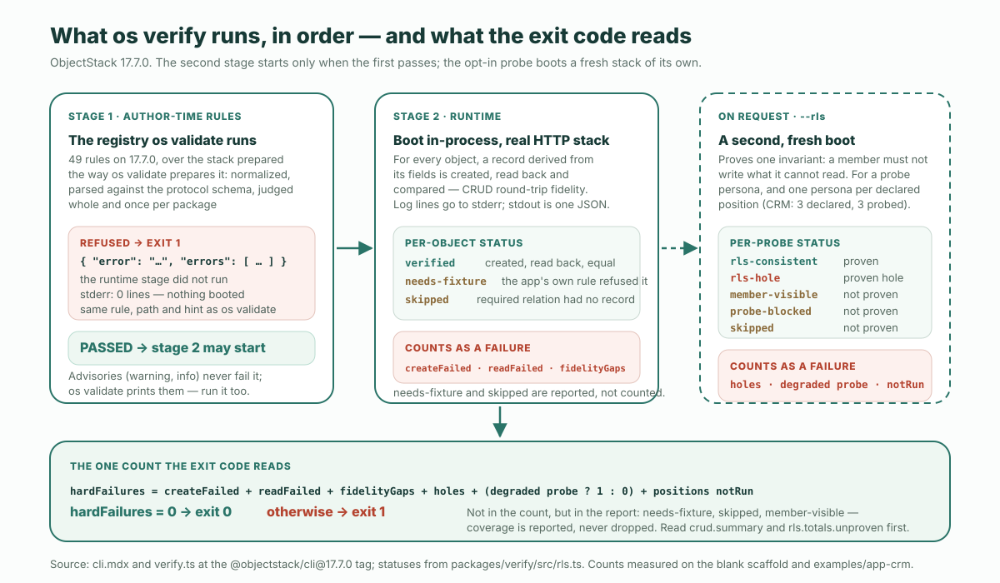

읽기 전에 이것부터 실행해 보라. 깨끗한 머신에서 2분이 안 걸리고, 마지막 줄이 이 글의 한 글자 요약이다.

```bash
npm create objectstack@latest verify-demo && cd verify-demo
npx os verify --json > report.json; echo $?
```

```text
0
```

**짧은 답.** 테스트를 쓰지 않고 AI가 만든 앱의 비즈니스 로직을 검증할 수는 없고, 아래 어디에도 그렇게 주장하는 문장은 없다. 명령 하나로 할 수 있는 일은, 런타임이 증명할 자격이 있는 더 좁은 두 가지를 증명하는 것이다. 정의가 **강제 가능**하다는 것 — `os validate`가 실행하는 바로 그 작성 시점 규칙 — 그리고 앱이 **동작한다**는 것 — 부팅되고, 모든 객체가 실제 HTTP 스택을 통해 레코드 하나를 왕복시킨다는 것. 오늘 `npm create objectstack@latest`가 설치하는 버전인 ObjectStack **17.7.0**에서 그 명령은 `os verify`다. 두 단계를 순서대로 실행하고, **첫 단계가 거부하면 둘째 단계는 결코 시작되지 않으며**, 종료 코드는 `hardFailures`라는 하나의 카운트에서 읽힌다. 이 글의 나머지는 그것의 실제 실행 세 번이다. 빈 스캐폴드, 선언된 포지션 셋을 가진 CRM 예제, 그리고 일부러 실패시킨 실행 하나 — 검증기가 보여줄 수 있는 가장 유용한 것은 무엇을 거부했는가이고, 그다음으로 유용한 것은 무엇을 증명하지 못했다고 인정하는가이기 때문이다.

## 두 단계, 하나의 카운트

CLI 레퍼런스는 계약을 한 문장으로 적는다. "완료선(done-bar): `os verify`가 녹색이면 작성 시점 규칙이 통과하고 **그리고** 앱이 런타임에서 동작한다는 뜻이다. 두 단계를 순서대로 실행하며, 둘째 단계는 첫 단계가 통과할 때만 시작된다." 여기서부터 두 단어를 구분해 둘 가치가 있다. `os validate`는 **게이트**다. 정의가 강제 가능한지를 결정한다. `os verify`는 **완료선**이다. 강제 가능하고 *그리고* 동작한다.

| 단계 | 무엇이 실행되나 | 실패는 어떻게 보이나 |
| :--- | :--- | :--- |
| **1 · 작성 시점 규칙** | `os validate`가 실행하는 규칙 레지스트리 — 17.7.0에서 49개 규칙 — 를 `os validate`가 준비하는 방식으로 준비한 스택에 대해 | 종료 1과 `error` 및 `errors[]`를 담은 JSON 문서; 런타임 단계는 실행되지 않았다 |
| **2 · 런타임** | 앱을 인프로세스로 부팅하고, 객체마다 필드에서 레코드를 도출해 실제 HTTP 스택을 통해 생성하고, 다시 읽고, 비교한다 | `createFailed`, `readFailed`, `fidelityGaps`가 각각 `hardFailures`에 더해진다 |
| **요청 시 · `--rls`** | 두 번째 새 부팅으로 소유자 간 불변식 — "멤버는 읽을 수 없는 것을 쓸 수 없어야 한다" — 을 프로브 페르소나와 선언된 포지션당 페르소나 하나에 대해 증명한다 | `hole`, 저하된 프로브 페르소나, 프로비저닝하지 못한 선언된 포지션이 각각 `hardFailures`에 더해진다 |



종료 코드가 읽는 카운트는 여섯 항이고, 소스가 어떤 풀이보다 분명하게 적는다.

```ts
const hardFailures =
  crud.summary.createFailed +
  crud.summary.readFailed +
  crud.summary.fidelityGaps +
  (rls?.totals.holes ?? 0) +
  (rls?.probe.degraded ? 1 : 0) +
  (rls?.positionCoverage.notRun.length ?? 0);
```

이 목록에 *없는* 것을 기억해 두라 — `needsFixture`, `skipped`, `memberVisible`. CRM 실행에서 다시 등장하고, 종료 코드를 첫 번째가 아니라 두 번째로 읽어야 하는 이유가 바로 그것들이다.

## 첫 단계는 가짜 녹색을 막는다 — 그리고 그것은 17.7.0의 새 동작이다

순서는 사소한 세부가 아니다. 17.7.0 이전의 `os verify`는 앱을 부팅하고 왕복을 돌렸을 뿐, 그 외에는 아무것도 하지 않았다. 17.7.0 체인지로그는 그것이 무엇을 통과시켰는지 자기 말로 기록한다.

> 존재하지 않는 객체로의 lookup, `record.` 없이 필드를 가리키는 액션의 `visible` 표현식, 또는 필드를 지정하지 않은 목록 열을 가진 스택이 부팅되고, 레코드를 왕복시키고, 종료 코드 0으로 `✓ verify passed`를 출력했다 — `os validate`, `os build`, `os lint`가 모두 거부했는데도. 문서화된 완료선("`objectstack verify`가 녹색이다")은 빌드가 출시를 거부하는 스택에서 녹색이었다.

이 모양을 **가짜 녹색**이라 부르자. 빌드가 거부하는 것을 통과시키는 검증기다. 검증기가 가질 수 있는 최악의 결함인데, 검증기를 돌리는 이유 전부가 알아채는 쪽이 되는 것이기 때문이다. 17.7.0은 게이트를 먼저 실행해 이를 막았고, 그 막힘을 가장 빨리 보는 방법은 일부러 구멍을 여는 것이다. 스캐폴드의 유일한 객체에 존재하지 않는 객체로의 lookup을 준다 — 네 줄, 에이전트가 대상을 만들기 전에 이름부터 지을 때 쓰는 바로 그런 것이다.

```diff
   fields: {
     title: Field.text({ label: 'Title', required: true, searchable: true, maxLength: 200, group: 'details' }),
     body: Field.textarea({ label: 'Body', group: 'details' }),
+    project: Field.lookup('verify_demo_project', {
+      label: 'Project',
+      group: 'details',
+    }),
   },
```

그리고 17.7.0에서 완료선을 다시 돌린다.

```text
$ npx os verify; echo $?
  → Running author-time rules (49)...

  ✗ Author-time rules failed (1 issue) — the runtime stage did not run
  • object "verify_demo_note" · field "project": lookup target "verify_demo_project"
    resolves to no object defined in this stack. The reference is inert at runtime —
    nothing reports the miss. Did you mean "verify_demo_note"?
      Point it at one of this stack's objects, or at a platform object by its full
      name (the platform user object is "sys_user", not "user"). The record picker
      has no object to query, `$expand` has nothing to resolve, and the form renders
      a relationship control that can never resolve a value. Defined objects: verify_demo_note.
      rule: object-reference-unknown  at objects[0].fields.project.reference
1
```

같은 거부의 기계 판독 면은 이렇다.

```text
$ npx os verify --json > report.json; echo $?
1
$ cat report.json
{"error":"Author-time rules failed (1 issue) — the runtime stage did not run",
 "errors":[{"severity":"error","rule":"object-reference-unknown",
   "where":"object \"verify_demo_note\" · field \"project\"",
   "path":"objects[0].fields.project.reference",
   "message":"lookup target \"verify_demo_project\" resolves to no object defined in this stack. …",
   "hint":"Point it at one of this stack's objects, or at a platform object by its full name …"}]}
```

이 출력의 세 군데가 메커니즘 그 자체다. *the runtime stage did not run*이라는 문장은 문자 그대로다. 이 실행은 stderr에 **0줄**을 썼다 — 부팅되는 실행은 317줄을 쓴다(다음 절) — 플러그인 하나 로드되지 않았고, 서버는 뜨지 않았고, 데이터베이스는 건드리지 않았다. 이 발견은 같은 스택에 대해 `os validate`가 출력하는 것과 동일해서, 같은 규칙 이름, 같은 경로, 같은 힌트이므로 어느 쪽을 읽는 에이전트든 같은 교정 지시를, *Did you mean*과 함께 받는다. 그리고 종료 코드는 1이고 문서는 stdout에 있어서, CI 단계와 스크립트 모두 산문을 파싱하지 않고 처리할 수 있는 모양이다.

## 둘째 단계: 객체마다 레코드 하나, 실제 HTTP 스택을 통해

필드를 되돌리면 완료선은 둘째 단계에 도달한다. 이것이 스캐폴드의 전체 보고서다 — 객체 하나, 필드 둘.

```json
{
  "app": "com.example.verify-demo",
  "config": "/…/verify-demo/objectstack.config.ts",
  "multiTenant": false,
  "crud": {
    "app": "com.example.verify-demo",
    "results": [
      { "object": "verify_demo_note", "status": "verified", "checked": 2 }
    ],
    "summary": {
      "objects": 1, "verified": 1, "fidelityGaps": 0, "createFailed": 0,
      "needsFixture": 0, "readFailed": 0, "skipped": 0, "mismatchTotal": 0
    }
  },
  "hardFailures": 0
}
```

`checked: 2`는 검증기가 쓰고 다시 읽은 두 필드이고, `mismatchTotal: 0`은 모든 값이 쓴 그대로 돌아왔다는 뜻이다. 파일에 없는 것도 있는 것만큼 의도적이다. 부팅된 스택 자신의 로그 — 플러그인 로드, 보안 부트스트랩, 서버 정지 — 는 stderr로 갔고, 이 객체 하나짜리 앱에서 **317줄**이었으며, stdout은 정확히 JSON 문서 하나만 실었다. 이 계약도 17.7.0의 것이다. 체인지로그는 이전 동작을 측정해 두었는데, 객체 둘짜리 스택에서 318줄의 로그가 보고서 앞에 stdout으로 떨어져 `os verify --json > report.json`이 "종료 코드 0으로 끝나면서 어떤 JSON 파서도 받아들이지 않는 파일을 남겼다". 이제 `JSON.parse`가 파일을 통째로 읽으며, 그것이 `report.json`을 스크린샷이 아니라 풀 리퀘스트에 첨부할 수 있는 산출물로 만드는 것이다.

"필드에서 도출한" 레코드는 검증기의 레코드이지 당신의 것이 아니며, 거기에는 스캐폴드가 너무 작아 보여주지 못하는 귀결이 있다. CRM 예제 — `@objectstack/cli@17.7.0` 태그의 `examples/app-crm`, 객체 여섯, 공개된 17.7.0 패키지로 실행 — 의 텍스트 면이 이렇다.

```text
=== objectstack verify — com.example.crm ===
  ✓ crm_account  (4 fields)
  ✓ crm_activity  (7 fields)
  ✓ crm_contact  (3 fields)
  ✓ crm_lead  (10 fields)
  ~ crm_opportunity  needs-fixture (app validation rejected the auto-record):
    {"error":"Discount cannot exceed 40% without an approved exception.; Close Date must be
    today or a future date.","code":"VALIDATION_FAILED", …}
  – crm_opportunity_line_item  skipped: required relation "opportunity" → no created
    "crm_opportunity" record
  ── 4 verified, 0 gaps, 0 FAILED, 1 needs-fixture, 1 skipped (0 mismatches)
```

여섯 객체 중 넷이 왕복했다. 다섯째 `crm_opportunity`는 자체 검증 규칙을 둘 가지고 있고 — 할인 상한과 마감일 하한 — 검증기가 도출한 레코드는 둘 다 만족하지 못해 앱이 `400`으로 거부했다. 그것은 앱 자신의 거부를 인용하며 **`needs-fixture`** 상태로 보고되고, 실패가 *아니다*. 검증기는 당신의 규칙을 통과하는 레코드를 만들어내지 못했다고 말하는 것이지, 객체가 고장 났다고 말하는 것이 아니다. 여섯째는 **`skipped`** 상태인데, 라인 아이템은 기회를 필요로 하는데 하나도 생성되지 않았기 때문이다. 두 용어 모두 `hardFailures` 합에 들어 있지 않으므로 이 실행은 0으로 종료한다 — 정직하게, 실제로 시험한 것 중 틀린 것이 하나도 없었으므로; 명료하게, 시험하지 않은 두 객체가 이유와 함께 이름이 불렸으므로. 종료 코드보다 요약 줄을 먼저 읽으라.

## 요청 시: 소유자 간 불변식, 선언된 포지션당 페르소나 하나

왕복은 충실도를 증명한다. 누가 무엇을 쓸 수 있는지에 대해서는 아무것도 증명하지 않으며, `os verify`는 기본값에서 그런 척하지 않는다. `--rls`를 붙이면 두 번째 새 스택을 부팅하고 불변식 하나 — 레퍼런스의 표현으로는 "멤버는 읽을 수 없는 것을 쓸 수 없어야 한다" — 를 스스로 프로비저닝한 프로브 페르소나에 대해, 그리고 17.7.0에서는 앱이 선언한 포지션당 페르소나 하나에 대해 증명한다. CRM은 `src/security/sales-positions.ts`에서 셋을 선언한다: `sales_rep`, `sales_manager`, `finance_approver`. 그래서 `npx os verify --rls --json`은 페르소나 넷을 발급했고, 보고서의 `rls` 블록은 각각이 무엇을 확립했는지 말한다.

```json
"rls": {
  "probe": { "label": "verify-rls-probe@objectstack.test", "grantedObjects": 6 },
  "results": [
    { "object": "crm_account", "status": "rls-consistent", "target": "created",
      "detail": "the probe cannot read (GET 404) and could not mutate (PATCH 404, row unchanged)" },
    …
  ],
  "summary":  { "objects": 6,  "consistent": 6, "holes": 0, "memberVisible": 0,  "proven": 6, "unproven": 0  },
  "positionCoverage": {
    "declared": ["sales_rep", "sales_manager", "finance_approver"],
    "ran":      ["sales_rep", "sales_manager", "finance_approver"],
    "notRun":   []
  },
  "totals":   { "objects": 24, "consistent": 6, "holes": 0, "memberVisible": 18, "proven": 6, "unproven": 18 }
},
"hardFailures": 0
```

기본 프로브 페르소나는 여섯 객체 모두에서 불변식을 증명했다. 다른 소유자의 행을 읽을 수 없었고(`GET 404`), 그래도 id로 그 행을 쓰려 했을 때 쓰기는 거부되고 행은 그대로였다(`PATCH 404`). 그것이 id 쓰기 부류의 구멍 — *볼* 수 없는 레코드도 id만 맞히면 *편집*될 수 있다는 구멍 — 이고, 이 앱에서는 막혀 있다.

이제 포지션 페르소나를 읽으면, 텍스트 면이 JSON보다 더 직설적이다.

```text
  ── position personas (each holds one declared position and nothing else) — 3 of 3 declared position(s) probed
  ▸ sales_rep  (verify-rls-pos-sales_rep@objectstack.test)  0 PROVEN (0 consistent, 0 HOLES) · 6 NOT PROVEN (6 member-visible, 0 probe-blocked, 0 skipped)
      ⚠ this persona proved NOTHING — every object was member-visible, probe-blocked or skipped.
  ▸ sales_manager  …  0 PROVEN · 6 NOT PROVEN (6 member-visible, …)
      ⚠ this persona proved NOTHING — every object was member-visible, probe-blocked or skipped.
  ▸ finance_approver  …  0 PROVEN · 6 NOT PROVEN (6 member-visible, …)
      ⚠ this persona proved NOTHING — every object was member-visible, probe-blocked or skipped.
  ══ all personas: 6 PROVEN (6 consistent, 0 HOLES) · 18 NOT PROVEN (18 member-visible, 0 probe-blocked, 0 skipped)   [unit: one object × persona probe]
✓ verify passed — no runtime failures
```

**24개 프로브 중 18개가 아무것도 증명하지 못했고, 실행은 녹색이다.** 이 문장의 두 반쪽 모두 맞고, 보고서는 둘 다 볼 수 있게 만들어져 있다. CRM은 권한 집합 하나 `crm_sales_user`를 세 포지션 모두에 묶고, 그 집합은 모든 CRM 객체에 읽기를 준다. 여섯 객체 중 다섯이 `sharingModel: 'public_read_write'`를 선언하고, 여섯째는 부모를 따른다. 모든 행을 읽을 수 있는 페르소나는 결코 소유자 간 상황에 놓이지 않으므로 찾을 구멍이 없고, 검증기는 정확히 그것을 — `member-visible`, *증명되지 않음* — 보고한다. 돌릴 수 없었던 프로브를 통과로 세는 대신에. 다섯 상태는 닫힌 목록이다.

| 상태 | 판정 | 의미 |
| :--- | :--- | :--- |
| `rls-consistent` | 증명됨 | 페르소나가 그 행을 읽을 수 없었고 변경할 수도 없었다 |
| `rls-hole` | 증명된 구멍 | 페르소나가 그 행을 읽을 수 없는데도 id로 변경했다 — `hardFailures`에 계산된다 |
| `member-visible` | 증명되지 않음 | 페르소나가 그 행을 읽을 수 있어 시험할 소유자 간 시나리오가 없다 |
| `probe-blocked` | 증명되지 않음 | 객체 게이트가 페르소나를 거부해 레코드 범위는 참조되지 않았다 |
| `skipped` | 증명되지 않음 | 프로브 대상을 확립할 수 없었다 |

규칙 하나가 블록 전체를 다스리며, 그것이 이 글에서 가져갈 가치가 있는 두 번째 아이디어다. **커버리지는 보고되지, 결코 버려지지 않는다.** 실행이 프로비저닝하지 못한 선언된 포지션은 실행을 조용히 줄이지 않는다 — `positionCoverage.notRun`에 들어가고, 그 목록의 길이는 `hardFailures`의 한 항이므로, 숫자가 읽히는 것보다 덜 커버한 검증기는 통과하는 대신 *실패한다*. 돌았지만 아무것도 증명하지 못한 페르소나도 객체별 이유와 함께 `unproven`으로 남는다. 종료 코드는 잘못된 것이 발견되지 않았다고 말하고, `totals.unproven`은 질문의 실제 얼마만큼이 물어졌는지 말한다. 이 앱에서 그 답은 4분의 1이고, 이제 당신은 어느 4분의 1인지 안다.

## 녹색 os verify가 말하지 않는 것

여섯 가지 한계를 있는 그대로 적는다. 과장하는 검증기는 다른 옷을 입은 가짜 녹색이기 때문이다.

1. **정확성에 대해서는 아무것도.** 40% 할인 상한은 강제된다. 40이 맞는 숫자인지, 재무가 승인해야 하는지, 그 객체가 존재해야 하는지 — `os verify`에는 의견도 메커니즘도 없다. 그것은 [선언 → 강제 가능 → 정확](/en/blog/how-to-review-ai-generated-app-changes/)의 세 번째 단이며, 여전히 리뷰어의 일이다. 비즈니스 로직에 지킬 가치가 있는 규칙이 있다면 그것을 위한 테스트를 쓰라. 완료선은 그 테스트 아래의 바닥이지 대체물이 아니다.
2. **`os validate`의 전부가 아니다.** 레퍼런스는 명시적이다. 첫 단계는 규칙 레지스트리이고, "`defineStack` 출처 거부…, 패키지 문서 lint, 능력 제공자 검사, 피클리스트 참조와 뷰 컨테이너 이름 검사, 그리고 `--strict`는 `os validate`의 것으로 남으므로 그것도 실행하라". 권고 — `warning`과 `info` 발견 — 도 `os verify`를 실패시키지 않는다. CRM 실행은 9개를 세고 읽으려면 `os validate`를 보라고 가리켰다.
3. **`needs-fixture`와 `skipped`는 실패가 아니다.** CRM의 여섯 객체 중 둘은 한 번도 왕복하지 않았고 실행은 0으로 종료했다. 요약 줄은 그렇게 말한다. 종료 코드는 말할 수 없다.
4. **`--rls`는 불변식 하나, 부류 하나를, 시나리오가 있는 곳에서만 증명한다.** 권한 집합이 *맞는* 것인지에 대해서는 아무 말도 하지 않는다 — 그것은 [리뷰의 두 번째 패스: 키가 아니라 값을 확인하라](/en/blog/how-to-review-ai-generated-app-changes/)다 — 그리고 페르소나가 모든 것을 읽을 수 있는 앱에서는 그들에 대해 아무것도 증명하지 않으며, 그렇게 말한다.
5. **옵트인이고 기본은 단일 테넌트다.** `--rls` 없이는 페르소나가 발급되지 않고, `--multi-tenant` 없이는 부팅이 단일 조직이므로 테넌트 격리 정책은 시험된 것이 아니다.
6. **사람의 verify가 아니다.** 시작 가이드 루프의 4단계는 "당신이 Console UI에서 verify한다" — 사람이 돌아가는 앱을 본다. 같은 단어, 다른 행위. `os verify`는 기계적인 반쪽이며 화면을 보지 않는다.

## 루프에서의 자리

이 사이트가 계속 그리는 루프에는 입력 쪽과 출력 쪽이 있다. 입력 쪽에서 당신은 [에이전트를 ObjectStack으로 향하게 하고](/en/blog/how-to-point-your-agent-at-objectstack/) — 규칙 파일, 스킬 번들, 도구 서버 — 에이전트가 타입이 있는 메타데이터를 쓴다. 출력 쪽에서 메타데이터는 게이트(`os validate`: 강제 가능, 또는 에이전트가 행동할 수 있는 메시지와 함께 거부)를 지나고, 완료선(`os verify`: 부팅되고 동작하며, 무엇이 증명되고 무엇이 증명되지 않았는지의 보고서 포함)을 지나고, 어떤 게이트도 오르지 못하는 한 단을 위한 [리뷰](/en/blog/how-to-review-ai-generated-app-changes/)를 지나, Console 앞의 사람에게 간다. 이 사이트의 [CRM 구축](/en/blog/how-to-build-a-crm-with-an-ai-agent/)은 게이트, 빌드, 개발 서버를 돌렸고 완료선은 한 번도 돌리지 않았다. 이 글은 그 단계와 서명 사이의 단계이며, CI에서는 한 줄이다.

```bash
npx os validate && npx os verify --rls --json > verify-report.json
node -e "const r=require('./verify-report.json'); console.log('hardFailures', r.hardFailures, '· rls unproven', r.rls?.totals.unproven ?? 'n/a')"
```

`verify-report.json`을 풀 리퀘스트에 첨부하라. 리뷰어는 diff 앞서 세 줄을 읽는다 — 종료 코드, `crud.summary`, `rls.totals.unproven` — 그리고 의견을 갖기 전에 무엇이 기계적으로 확립되었고 무엇이 판단의 문제로 남아 있는지 안다. 그 구분이야말로 작성자가 모델일 때 선언되고 [강제되는](/en/glossary/declared-vs-enforced/) 대상 포맷을 택하는 논거의 전부다. 기계는 오를 수 있는 단을 오르고, 오를 수 없는 단을 보고한다.

에이전트를 그 대상으로 향하게 하고 완료선을 스스로 돌리게 하라. README의 이 명령 설명이 약속의 전부이고 그 이상은 아니다. `os verify  # Boot the app in-process and verify it over real HTTP`. 같은 루프를 호스팅으로, 브라우저에서, 아무것도 설치하지 않고 쓰고 싶다면? 그것이 ObjectOS, ObjectStack 위에 구축된 상용 런타임 환경입니다.

---

*ObjectStack 17.7.0에서 검증 — `npm create objectstack@latest`가 설치한 `create-objectstack` 17.7.0과 `@objectstack/cli` 17.7.0, Node 22. CRM은 `@objectstack/cli@17.7.0` 태그의 `examples/app-crm`을 공개된 17.7.0 패키지로 실행한 것이다. 위의 모든 명령과 모든 출력 블록은 실행한 것이지 재구성한 것이 아니다. 출력은 줄임표로 표시한 곳에서 잘라냈고 어디에서도 고쳐 쓰지 않았다.*
