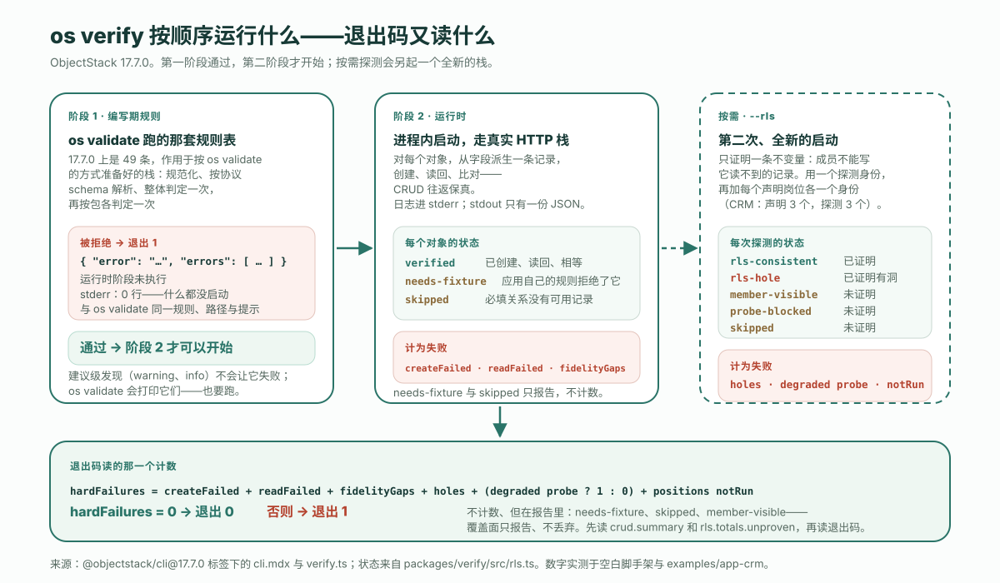

先把这两行跑一遍，再往下读。在一台干净的机器上不到两分钟，而最后一行输出就是整篇文章的一个字符版。

```bash
npm create objectstack@latest verify-demo && cd verify-demo
npx os verify --json > report.json; echo $?
```

```text
0
```

**先给结论**：不写测试，你测不了 AI 写的应用的业务逻辑，下文也没有一句话会这么宣称。你能做的，是用一条命令证明两件更窄、但运行时有资格证明的事：定义是**可强制执行的**——也就是 `os validate` 跑的那套编写期规则——以及应用**行为正常**：它能启动，并且每个对象都能经真实 HTTP 栈把一条记录写进去再读回来。在 ObjectStack **17.7.0**——今天 `npm create objectstack@latest` 装的就是这个版本——这条命令叫 `os verify`。它按顺序跑这两个阶段，**第一阶段拒绝，第二阶段就永远不会开始**，退出码只从一个计数 `hardFailures` 读出。本文其余部分是它的三次真实运行：空白脚手架，带三个声明岗位的 CRM 示例，以及一次故意失败的运行——因为验证器最有用的地方是它拒绝了什么，其次是它承认自己没有证明什么。

## 两个阶段，一个计数

CLI 参考文档用一句话定下契约：「完成线（done-bar）：`os verify` 绿，意味着编写期规则通过，**并且**应用在运行时行为正常。它按顺序运行两个阶段，第一阶段通过后第二阶段才开始。」从这里起有两个词值得分开：`os validate` 是**门禁**，判定一份定义是否可强制执行；`os verify` 是**完成线**，可强制执行*并且*行为正常。

| 阶段 | 跑什么 | 失败长什么样 |
| :--- | :--- | :--- |
| **1 · 编写期规则** | `os validate` 跑的那套规则表——17.7.0 上是 49 条——作用于按 `os validate` 的方式准备好的栈 | 退出 1，stdout 上一份带 `error` 与 `errors[]` 的 JSON 文档；运行时阶段未执行 |
| **2 · 运行时** | 在进程内启动应用，对每个对象从它的字段派生一条记录，经真实 HTTP 栈创建、读回、比对 | `createFailed`、`readFailed`、`fidelityGaps` 各自累加进 `hardFailures` |
| **按需 · `--rls`** | 第二次全新启动，证明跨所有者不变量——「成员不能写它读不到的记录」——用一个探测身份，再加每个声明岗位各一个身份 | 一个 `hole`、一个降级的探测身份、或一个运行无法配置出来的声明岗位，各自累加进 `hardFailures` |



退出码读的那个计数由六项组成，源码写得比任何转述都清楚：

```ts
const hardFailures =
  crud.summary.createFailed +
  crud.summary.readFailed +
  crud.summary.fidelityGaps +
  (rls?.totals.holes ?? 0) +
  (rls?.probe.degraded ? 1 : 0) +
  (rls?.positionCoverage.notRun.length ?? 0);
```

记住哪些*不在*这份清单上：`needsFixture`、`skipped`、`memberVisible`。它们会在 CRM 那次运行中回来，也正是它们让退出码成为你应该读的第二样东西，而不是第一样。

## 第一阶段堵住了一次假绿，而这是 17.7.0 的新行为

顺序不是细节。17.7.0 之前，`os verify` 启动应用、跑往返，别的什么都不做。17.7.0 的变更日志用它自己的话记录了这曾经放过什么：

> 一个带有指向不存在对象的 lookup、一个 `visible` 表达式引用字段时没写 `record.` 的动作、或一个没指定字段的列表列的栈，照样启动、照样往返它的记录、照样以退出码 0 打印 `✓ verify passed`，而 `os validate`、`os build` 和 `os lint` 全都拒绝它。文档里的完成线（「`objectstack verify` 是绿的」）在一个构建拒绝发布的栈上是绿的。

把这种形态叫作**假绿**：一个放行了构建所拒绝之物的验证器。这是验证器能有的最坏缺陷，因为跑验证器的全部意义就是让它成为注意到问题的那一个。17.7.0 用先跑门禁的方式堵住了它，而看清这个封堵最快的办法，是故意把洞打开。拿脚手架唯一的对象，给它加一个指向不存在对象的 lookup——四行，正是 Agent 先起名、后建对象时会写出的东西：

```diff
   fields: {
     title: Field.text({ label: 'Title', required: true, searchable: true, maxLength: 200, group: 'details' }),
     body: Field.textarea({ label: 'Body', group: 'details' }),
+    project: Field.lookup('verify_demo_project', {
+      label: 'Project',
+      group: 'details',
+    }),
   },
```

然后在 17.7.0 上再跑一次完成线：

```text
$ npx os verify; echo $?
  → Running author-time rules (49)...

  ✗ Author-time rules failed (1 issue) — the runtime stage did not run
  • object "verify_demo_note" · field "project": lookup target "verify_demo_project"
    resolves to no object defined in this stack. The reference is inert at runtime —
    nothing reports the miss. Did you mean "verify_demo_note"?
      Point it at one of this stack's objects, or at a platform object by its full
      name (the platform user object is "sys_user", not "user"). The record picker
      has no object to query, `$expand` has nothing to resolve, and the form renders
      a relationship control that can never resolve a value. Defined objects: verify_demo_note.
      rule: object-reference-unknown  at objects[0].fields.project.reference
1
```

同一次拒绝的机器可读面：

```text
$ npx os verify --json > report.json; echo $?
1
$ cat report.json
{"error":"Author-time rules failed (1 issue) — the runtime stage did not run",
 "errors":[{"severity":"error","rule":"object-reference-unknown",
   "where":"object \"verify_demo_note\" · field \"project\"",
   "path":"objects[0].fields.project.reference",
   "message":"lookup target \"verify_demo_project\" resolves to no object defined in this stack. …",
   "hint":"Point it at one of this stack's objects, or at a platform object by its full name …"}]}
```

这段输出中有三处就是机制本身。*the runtime stage did not run* 这句话是字面意思：这次运行往 stderr 写了 **0 行**，而一次真正启动的运行会写 317 行（见下一节）——没有加载任何插件、没有起服务器、没有碰数据库。这条发现与 `os validate` 对同一个栈打印的是同一条：同一规则名、同一路径、同一提示，所以无论 Agent 读的是哪一个，拿到的都是同一句纠正指令，而且带着一句 *Did you mean*。退出码是 1、文档在 stdout 上——这正是 CI 步骤和脚本都能直接处理、不必解析散文的形态。

## 第二阶段：每个对象一条记录，走真实 HTTP 栈

把字段恢复，完成线就能到达第二阶段。这是脚手架的完整报告——一个对象，两个字段：

```json
{
  "app": "com.example.verify-demo",
  "config": "/…/verify-demo/objectstack.config.ts",
  "multiTenant": false,
  "crud": {
    "app": "com.example.verify-demo",
    "results": [
      { "object": "verify_demo_note", "status": "verified", "checked": 2 }
    ],
    "summary": {
      "objects": 1, "verified": 1, "fidelityGaps": 0, "createFailed": 0,
      "needsFixture": 0, "readFailed": 0, "skipped": 0, "mismatchTotal": 0
    }
  },
  "hardFailures": 0
}
```

`checked: 2` 是验证器写入并读回的两个字段；`mismatchTotal: 0` 说每个值都原样回来了。文件中没有的东西和有的东西一样是刻意的：被启动的栈自己的日志——插件加载、安全引导、服务器停止——都去了 stderr，在这个单对象应用上有 **317 行**，而 stdout 恰好只承载一份 JSON 文档。这条契约同样是 17.7.0 的。变更日志测量过之前的行为：在一个双对象栈上，318 行日志落在 stdout 上、排在报告之前，于是 `os verify --json > report.json`「过去以退出码 0 结束，留下一个任何 JSON 解析器都不接受的文件」。现在 `JSON.parse` 能整个读下这个文件，这正是让 `report.json` 成为可以附在 Pull Request 上的工件、而不是一张截图的原因。

「从它的字段派生」出来的记录是验证器的记录，不是你的，这会带来一个脚手架太小而显示不出的后果。下面是 CRM 示例——`@objectstack/cli@17.7.0` 标签下的 `examples/app-crm`，六个对象，用已发布的 17.7.0 包跑——的文本面：

```text
=== objectstack verify — com.example.crm ===
  ✓ crm_account  (4 fields)
  ✓ crm_activity  (7 fields)
  ✓ crm_contact  (3 fields)
  ✓ crm_lead  (10 fields)
  ~ crm_opportunity  needs-fixture (app validation rejected the auto-record):
    {"error":"Discount cannot exceed 40% without an approved exception.; Close Date must be
    today or a future date.","code":"VALIDATION_FAILED", …}
  – crm_opportunity_line_item  skipped: required relation "opportunity" → no created
    "crm_opportunity" record
  ── 4 verified, 0 gaps, 0 FAILED, 1 needs-fixture, 1 skipped (0 mismatches)
```

六个对象中四个完成了往返。第五个 `crm_opportunity` 带着两条它自己的校验规则——折扣上限和成交日期下限——验证器派生出的记录两条都不满足，于是应用用 `400` 拒绝了它。这被报告为 **`needs-fixture`**，并引用了应用自己的拒绝理由，而它*不是*失败：验证器在告诉你，它构造不出一条能通过你的规则的记录，而不是这个对象坏了。第六个是 **`skipped`**，因为明细行要求一个商机，而商机没有被创建。这两个词都不在 `hardFailures` 的求和项中，所以这次运行以 0 退出——诚实，因为它真正演练过的东西没有一样是错的；清晰，因为它没演练的两个对象都被点了名并附上原因。先读汇总行，再读退出码。

## 按需：跨所有者不变量，每个声明岗位各一个身份

往返证明的是保真。它对谁能写什么一无所知，而 `os verify` 默认也不假装知道。加上 `--rls`，它会启动第二个全新的栈，证明一条不变量——参考文档的措辞是「成员不能写它读不到的记录」——用它自己配置的一个探测身份，并且在 17.7.0 上，还用应用声明的每个岗位各一个身份。CRM 在 `src/security/sales-positions.ts` 中声明了三个：`sales_rep`、`sales_manager` 和 `finance_approver`。所以 `npx os verify --rls --json` 铸造了四个身份，报告的 `rls` 块说明了每一个各自确立了什么：

```json
"rls": {
  "probe": { "label": "verify-rls-probe@objectstack.test", "grantedObjects": 6 },
  "results": [
    { "object": "crm_account", "status": "rls-consistent", "target": "created",
      "detail": "the probe cannot read (GET 404) and could not mutate (PATCH 404, row unchanged)" },
    …
  ],
  "summary":  { "objects": 6,  "consistent": 6, "holes": 0, "memberVisible": 0,  "proven": 6, "unproven": 0  },
  "positionCoverage": {
    "declared": ["sales_rep", "sales_manager", "finance_approver"],
    "ran":      ["sales_rep", "sales_manager", "finance_approver"],
    "notRun":   []
  },
  "totals":   { "objects": 24, "consistent": 6, "holes": 0, "memberVisible": 18, "proven": 6, "unproven": 18 }
},
"hardFailures": 0
```

基础探测身份在全部六个对象上证明了这条不变量：它读不到另一个所有者的行（`GET 404`），而当它无论如何都试着按 id 写那一行时，写入被拒绝、行原封不动（`PATCH 404`）。这就是「按 id 写入」这一类的洞——一条你*看不到*的记录，只要猜中 id 就仍能被*编辑*——在这个应用上，它是封住的。

接着读岗位身份，文本面比 JSON 更直白：

```text
  ── position personas (each holds one declared position and nothing else) — 3 of 3 declared position(s) probed
  ▸ sales_rep  (verify-rls-pos-sales_rep@objectstack.test)  0 PROVEN (0 consistent, 0 HOLES) · 6 NOT PROVEN (6 member-visible, 0 probe-blocked, 0 skipped)
      ⚠ this persona proved NOTHING — every object was member-visible, probe-blocked or skipped.
  ▸ sales_manager  …  0 PROVEN · 6 NOT PROVEN (6 member-visible, …)
      ⚠ this persona proved NOTHING — every object was member-visible, probe-blocked or skipped.
  ▸ finance_approver  …  0 PROVEN · 6 NOT PROVEN (6 member-visible, …)
      ⚠ this persona proved NOTHING — every object was member-visible, probe-blocked or skipped.
  ══ all personas: 6 PROVEN (6 consistent, 0 HOLES) · 18 NOT PROVEN (18 member-visible, 0 probe-blocked, 0 skipped)   [unit: one object × persona probe]
✓ verify passed — no runtime failures
```

**24 次探测中有 18 次什么都没证明，而这次运行是绿的**。这句话的两半都对，报告的构造方式就是让你两半都能看见。CRM 把一个权限集 `crm_sales_user` 绑定到全部三个岗位，这个权限集对每个 CRM 对象都授予读权限；六个对象中有五个声明了 `sharingModel: 'public_read_write'`，第六个跟随它的父对象。一个能读到每一行的身份永远不会处于跨所有者的处境，所以没有洞可找，而验证器如实报告这一点——`member-visible`，*未证明*——而不是把一次它跑不了的探测算作通过。五种状态是一份封闭清单：

| 状态 | 判定 | 含义 |
| :--- | :--- | :--- |
| `rls-consistent` | 已证明 | 该身份读不到这一行，也改不了它 |
| `rls-hole` | 已证明有洞 | 该身份读不到这一行，却按 id 改动了它——计入 `hardFailures` |
| `member-visible` | 未证明 | 该身份能读到这一行，所以没有可测试的跨所有者场景 |
| `probe-blocked` | 未证明 | 对象级门禁拒绝了该身份，记录范围根本没被问到 |
| `skipped` | 未证明 | 建立不了任何探测目标 |

一条规则统领整个块，也是本文值得带走的第二个想法：**覆盖面只报告，从不丢弃**。一个运行配置不出来的声明岗位不会悄悄缩小这次运行——它落进 `positionCoverage.notRun`，而这份清单的长度是 `hardFailures` 的一项，所以一个覆盖得比自己数字读上去更少的验证器会*失败*，而不是通过。一个跑了却什么也没证明的身份也被留着，记为 `unproven`，逐对象附上原因。退出码告诉你没发现错的东西；`totals.unproven` 告诉你这个问题真正被问了多少。在这个应用上答案是四分之一，而你现在知道是哪个四分之一。

## 一次绿色的 os verify 没有说什么

六条限制，直说，因为一个夸大自己的验证器就是换了件外衣的假绿。

1. **对正确性一无所知**。40% 的折扣上限被强制执行了；40 是不是对的数字、该不该由财务审批、这个对象该不该存在——`os verify` 没有观点，也没有机制。这是[声明 → 可强制执行 → 正确](/en/blog/how-to-review-ai-generated-app-changes/)的第三级台阶，仍然是评审者的工作。如果你的业务逻辑中有值得保住的规则，为它们写测试；完成线是这些测试脚下的地板，不是替代品。
2. **不是 `os validate` 的全部**。参考文档写得明白：第一阶段是规则表，而「`defineStack` 来源拒绝……、包文档 lint、能力提供者检查、picklist 引用与视图容器名检查，以及 `--strict`，仍归 `os validate` 所有，所以也要跑它」。建议级发现——`warning` 与 `info`——同样永远不会让 `os verify` 失败；CRM 那次运行数到了 9 条，并指向 `os validate` 去读。
3. **`needs-fixture` 与 `skipped` 不是失败**。CRM 六个对象中有两个从未完成往返，而运行以 0 退出。汇总行说了；退出码说不了。
4. **`--rls` 只证明一条不变量、一类洞，而且只在场景存在的地方证明**。它对权限集是不是*对的那个*一言不发——那是[评审的第二遍：检查值，不是检查键](/en/blog/how-to-review-ai-generated-app-changes/)——在一个身份能读到一切的应用上，它对这些身份什么也证明不了，并且会这么说。
5. **它是按需的，默认单租户**。没有 `--rls` 就不会铸造任何身份；没有 `--multi-tenant`，启动就是单组织的，租户隔离策略不在被演练之列。
6. **它不是人的 verify**。入门循环的第 4 步是「你在 Console UI 里 verify」——一个人，看着跑起来的应用。同一个词，不同的动作。`os verify` 是机械的那一半；它不看屏幕。

## 它在循环中的位置

这个站点一直在描述的循环有输入侧和输出侧。输入侧，你[把 Agent 指向 ObjectStack](/en/blog/how-to-point-your-agent-at-objectstack/)——规则文件、技能包、工具服务器——它写出类型化元数据。输出侧，元数据先过门禁（`os validate`：可强制执行，或者带着 Agent 能据以行动的消息被拒绝），再过完成线（`os verify`：启动并行为正常，附一份报告说明证明了什么、没证明什么），再经[评审](/en/blog/how-to-review-ai-generated-app-changes/)处理没有任何门禁能爬的那一级台阶，最后由一个人在 Console 中看。本站的 [CRM 构建](/en/blog/how-to-build-a-crm-with-an-ai-agent/)跑了门禁、构建和开发服务器，却从没跑过完成线；这就是那一步与签字之间的环节，在 CI 中是一行：

```bash
npx os validate && npx os verify --rls --json > verify-report.json
node -e "const r=require('./verify-report.json'); console.log('hardFailures', r.hardFailures, '· rls unproven', r.rls?.totals.unproven ?? 'n/a')"
```

把 `verify-report.json` 附到 Pull Request 上。评审者在看 diff 之前先读三行：退出码、`crud.summary`、`rls.totals.unproven`——于是在形成任何意见之前，就知道哪些已经被机械地确立，哪些仍是判断题。当作者是一个模型时，这种划分就是一个声明即[强制执行](/zh-Hans/glossary/declared-vs-enforced/)的目标格式的全部论据：机器爬它能爬的台阶，并报告它爬不了的。

把你的 Agent 指向这个目标，让它自己去跑完成线。README 对这条命令的描述就是全部承诺，一分不多：`os verify  # Boot the app in-process and verify it over real HTTP`。想把同一个循环托管起来、在浏览器里用、什么都不用安装？那就是 ObjectOS——建立在 ObjectStack 之上的商业运行环境。

---

*在 ObjectStack 17.7.0 上验证——`create-objectstack` 17.7.0 与 `@objectstack/cli` 17.7.0，正是 `npm create objectstack@latest` 安装的版本，Node 22。CRM 是 `@objectstack/cli@17.7.0` 标签下的 `examples/app-crm`，用已发布的 17.7.0 包运行。上文每条命令、每段输出都是真实运行，不是复述；标了省略号的地方做了裁剪，没有任何地方被改写。*
