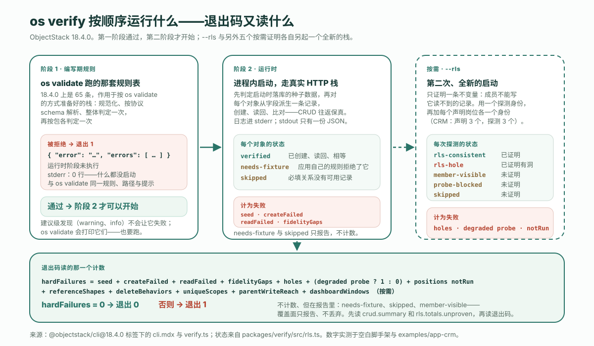

---
# @generated zh-Hant from zh-Hans (s2twp) — edit the zh-Hans file; delete this line to hand-maintain.
title: 不寫測試，怎麼測 AI 寫的應用？os verify 分兩個階段證明了什麼
description: 在已釋出的 18.4.0 上，os verify 分兩個階段執行——先跑編寫期規則，再真的在程序內啟動應用——第一階段拒絕，第二階段就不會開始。三段真實轉錄，其中一段故意失敗，以及一次綠色執行自己承認沒有證明的 18 次探測。
author: ObjectStack Team
date: 2026-10-24
status: published
topic: app-building
audience: developer
solutions: []
industries: []
cover: ./cover.svg
tags:
  - AI Agent
  - 驗證
---

先把這兩行跑一遍，再往下讀。在一臺乾淨的機器上不到兩分鐘，而最後一行輸出就是整篇文章的一個字元版。

```bash
npm create objectstack@latest verify-demo && cd verify-demo
npx os verify --json > report.json; echo $?
```

```text
0
```

**先給結論**：不寫測試，你測不了 AI 寫的應用的業務邏輯，下文也沒有一句話會這麼宣稱。你能做的，是用一條命令證明兩件更窄、但執行環境有資格證明的事：定義是**可強制執行的**——也就是 `os validate` 跑的那套編寫期規則——以及應用**行為正常**：它能啟動，並且每個物件都能經真實 HTTP 棧把一條記錄寫進去再讀回來。在 ObjectStack **18.4.0**——今天 `npm create objectstack@latest` 裝的就是這個版本——這條命令叫 `os verify`。它按順序跑這兩個階段，**第一階段拒絕，第二階段就永遠不會開始**，退出碼只從一個計數 `hardFailures` 讀出。本文其餘部分是它的三次真實執行——空白腳手架，帶三個宣告崗位的 CRM 示例，以及一次故意失敗的執行——外加一次執行，跑它按需提供的另外五種證明。因為驗證器最有用的地方是它拒絕了什麼，其次是它承認自己沒有證明什麼。

## 兩個階段，一個計數

CLI 參考文件用一句話定下契約：「完成線（done-bar）：`os verify` 綠，意味著編寫期規則通過，**並且**應用在執行時行為正常。它按順序執行兩個階段，第一階段通過後第二階段才開始。」從這裡起有兩個詞值得分開：`os validate` 是**門禁**，判定一份定義是否可強制執行；`os verify` 是**完成線**，可強制執行*並且*行為正常。

| 階段 | 跑什麼 | 失敗長什麼樣 |
| :--- | :--- | :--- |
| **1 · 編寫期規則** | `os validate` 跑的那套規則表——18.4.0 上是 65 條——作用於按 `os validate` 的方式準備好的棧 | 退出 1，stdout 上一份帶 `error` 與 `errors[]` 的 JSON 文件；執行環境階段未執行 |
| **2 · 執行環境** | 在程序內啟動應用，先判定啟動時落庫的種子資料，再對每個物件從它的欄位派生一條記錄，經真實 HTTP 棧建立、讀回、比對 | `seed.hardFailures`、`createFailed`、`readFailed`、`fidelityGaps` 各自累加進 `hardFailures` |
| **按需 · `--rls`** | 第二次全新啟動，證明跨所有者不變數——「成員不能寫它讀不到的記錄」——用一個探測身份，再加每個宣告崗位各一個身份 | 一個 `hole`、一個降級的探測身份、或一個執行無法配置出來的宣告崗位，各自累加進 `hardFailures` |
| **按需 · 另外五種證明** | `--reference-shapes`、`--delete-behaviors`、`--unique-scopes`、`--parent-write-reach`、`--dashboard-windows`：各自再起一個全新的棧，經 REST 門與系統門證明一項宣告過的行為 | 每個證明族自己的 `summary.hardFailures` 累加進 `hardFailures`；無法定論與被排除的分支只報告、不計數 |



退出碼讀的那個計數由十二項組成——種子一項、往返三項、`--rls` 三項、每個按需證明族各一項——原始碼寫得比任何轉述都清楚（18.4.0 標籤下 `packages/cli/src/commands/verify.ts` 的第 460-492 行，註釋已刪去）：

```ts
const hardFailures =
  seed.hardFailures +
  crud.summary.createFailed +
  crud.summary.readFailed +
  crud.summary.fidelityGaps +
  (rls?.totals.holes ?? 0) +
  (rls?.probe.degraded ? 1 : 0) +
  (rls?.positionCoverage.notRun.length ?? 0) +
  (referenceShapes?.summary.hardFailures ?? 0) +
  (deleteBehaviors?.summary.hardFailures ?? 0) +
  (uniqueScopes?.summary.hardFailures ?? 0) +
  (parentWriteReach?.summary.hardFailures ?? 0) +
  (dashboardWindows?.summary.hardFailures ?? 0);
```

記住哪些*不在*這份清單上：`needsFixture`、`skipped`、`memberVisible`。它們會在 CRM 那次執行中回來，也正是它們讓退出碼成為你應該讀的第二樣東西，而不是第一樣。

## 第一階段堵住了一次假綠

順序不是細節，它也有一段歷史。17.7.0 之前，`os verify` 啟動應用、跑往返，別的什麼都不做。17.7.0 的變更日誌用它自己的話記錄了這曾經放過什麼：

> 一個帶有指向不存在物件的 lookup、一個 `visible` 表示式引用欄位時沒寫 `record.` 的動作、或一個沒指定欄位的列表列的棧，照樣啟動、照樣往返它的記錄、照樣以退出碼 0 列印 `✓ verify passed`，而 `os validate`、`os build` 和 `os lint` 全都拒絕它。文件裡的完成線（「`objectstack verify` 是綠的」）在一個構建拒絕釋出的棧上是綠的。

把這種形態叫作**假綠**：一個放行了構建所拒絕之物的驗證器。這是驗證器能有的最壞缺陷，因為跑驗證器的全部意義就是讓它成為注意到問題的那一個。從 17.7.0 起門禁先跑，到 18.4.0 依然如此。看清這個封堵最快的辦法，是故意把洞開啟。拿腳手架唯一的物件，給它加一個指向不存在物件的 lookup——四行，正是 Agent 先起名、後建物件時會寫出的東西：

```diff
     body: Field.textarea({
       label: 'Body',
       group: 'details',
     }),
+    project: Field.lookup('verify_demo_project', {
+      label: 'Project',
+      group: 'details',
+    }),
   },
```

然後在 18.4.0 上再跑一次完成線：

```text
$ npx os verify; echo $?
  → Running author-time rules (65)...

  ✗ Author-time rules failed (1 issue) — the runtime stage did not run
  • object "verify_demo_note" · field "project": lookup target "verify_demo_project"
    resolves to no object defined in this stack. The reference is inert at runtime —
    nothing reports the miss. Did you mean "verify_demo_note"?
      fix: Point it at one of this stack's objects, or at a platform object by its full
      name (the platform user object is "sys_user", not "user")
      rule: object-reference-unknown  at objects[0].fields.project.reference — `os explain
      object-reference-unknown` for how an object name resolves, and what a miss costs
1
```

同一次拒絕的機器可讀面：

```text
$ npx os verify --json > report.json; echo $?
1
$ cat report.json
{"error":"Author-time rules failed (1 issue) — the runtime stage did not run",
 "errors":[{"severity":"error","rule":"object-reference-unknown",
   "where":"object \"verify_demo_note\" · field \"project\"",
   "path":"objects[0].fields.project.reference",
   "message":"lookup target \"verify_demo_project\" resolves to no object defined in this stack. …",
   "hint":"Point it at one of this stack's objects, or at a platform object by its full name …"}]}
```

這段輸出中有三處就是機制本身。*the runtime stage did not run* 這句話是字面意思：這次執行往 stderr 寫了 **0 行**，而一次真正啟動的執行會寫 2 行（見下一節）——沒有載入任何外掛、沒有起伺服器、沒有碰資料庫。這條發現與 `os validate` 對同一個棧列印的是同一條：同一規則名、同一路徑、同一提示，所以無論 Agent 讀的是哪一個，拿到的都是同一句糾正指令，帶著一句 *Did you mean*、一行 `fix:`，以及說明這個缺失為何要緊的 `os explain` 命令。退出碼是 1、文件在 stdout 上——這正是 CI 步驟和腳本都能直接處理、不必解析散文的形態。

## 第二階段：每個物件一條記錄，走真實 HTTP 棧

把欄位恢復，完成線就能到達第二階段。這是腳手架的完整報告——一個物件，兩個欄位：

```json
{
  "app": "com.example.verify-demo",
  "config": "/…/verify-demo/objectstack.config.ts",
  "multiTenant": false,
  "seed": {
    "status": "none", "suppressed": [], "inFlight": 0, "sources": [],
    "totals": { "inserted": 0, "updated": 0, "skipped": 0, "rejected": 0, "droppedRefs": 0 },
    "hardFailures": 0
  },
  "crud": {
    "app": "com.example.verify-demo",
    "results": [
      { "object": "verify_demo_note", "status": "verified", "checked": 2 }
    ],
    "summary": {
      "objects": 1, "verified": 1, "fidelityGaps": 0, "createFailed": 0,
      "needsFixture": 0, "readFailed": 0, "skipped": 0, "mismatchTotal": 0
    }
  },
  "hardFailures": 0
}
```

`checked: 2` 是驗證器寫入並讀回的兩個欄位；`mismatchTotal: 0` 說每個值都原樣回來了；`seed.status: "none"` 說腳手架沒有宣告任何需要在啟動時落庫的種子記錄。檔案中沒有的東西和有的東西一樣是刻意的：被啟動的棧自己的日誌——這裡是開發態中繼資料端點的註冊和伺服器停止——都去了 stderr，在這個單物件應用上只有 **2 行**，而 stdout 恰好只承載一份 JSON 文件。這條契約同樣始於 17.7.0；那一版的變更日誌測量過之前的行為：在一個雙物件棧上，318 行日誌落在 stdout 上、排在報告之前，於是 `os verify --json > report.json`「過去以退出碼 0 結束，留下一個任何 JSON 解析器都不接受的檔案」。現在 `JSON.parse` 能整個讀下這個檔案，這正是讓 `report.json` 成為可以附在 Pull Request 上的工件、而不是一張截圖的原因。

「從它的欄位派生」出來的記錄是驗證器的記錄，不是你的，這會帶來一個腳手架太小而顯示不出的後果。下面是 CRM 示例——`@objectstack/cli@18.4.0` 標籤下的 `examples/app-crm`，六個物件，用已釋出的 18.4.0 包跑——的文本面，驗證器引用應用的拒絕時會在 code 處截斷：

```text
=== objectstack verify — com.example.crm ===
  ✓ crm_account  (4 fields)
  ✓ crm_activity  (7 fields)
  ✓ crm_contact  (3 fields)
  ✓ crm_lead  (9 fields)
  ~ crm_opportunity  needs-fixture (app validation rejected the auto-record):
    {"error":"Discount cannot exceed 40% without an approved exception.; Close Date must be
    today or a future date.","code":
  – crm_opportunity_line_item  skipped: required relation "opportunity" → no created
    "crm_opportunity" record
  ── 4 verified, 0 gaps, 0 FAILED, 1 needs-fixture, 1 skipped (0 mismatches)
  ✓ seed: 28 records landed (28 inserted, 0 updated, 0 already present)
```

六個物件中四個完成了往返。第五個 `crm_opportunity` 帶著兩條它自己的校驗規則——折扣上限和成交日期下限——驗證器派生出的記錄兩條都不滿足，於是應用用 `400` 拒絕了它。這被報告為 **`needs-fixture`**，並引用了應用自己的拒絕理由，而它*不是*失敗：驗證器在告訴你，它構造不出一條能通過你的規則的記錄，而不是這個物件壞了。第六個是 **`skipped`**，因為明細行要求一個商機，而商機沒有被建立。這兩個詞都不在 `hardFailures` 的求和項中，所以這次執行以 0 退出——誠實，因為它真正演練過的東西沒有一樣是錯的；清晰，因為它沒演練的兩個物件都被點了名並附上原因。彙總行下面那行是種子：啟動時 CRM 宣告的 28 條記錄全部落庫；若丟掉一條，它就會成為 `hardFailures` 中的一項。先讀彙總行，再讀退出碼。

## 按需：跨所有者不變數，每個宣告崗位各一個身份

往返證明的是保真。它對誰能寫什麼一無所知，而 `os verify` 預設也不假裝知道。加上 `--rls`，它會啟動第二個全新的棧，證明一條不變數——參考文件的措辭是「成員不能寫它讀不到的記錄」——用它自己配置的一個探測身份，並且在 18.4.0 上，還用應用宣告的每個崗位各一個身份。從 18.0 起，探測身份的權限集是在本次執行中註冊進應用的安全目錄，而不是寫成一行資料；啟動若提供不了它，就報告一個降級的探測身份——這是 `hardFailures` 中的一項——而不是換一個更弱的身份去探測。CRM 在 `src/security/sales-positions.ts` 中聲明瞭三個：`crm_sales_rep`、`crm_sales_manager` 和 `crm_finance_approver`。所以 `npx os verify --rls --json` 鑄造了四個身份，報告的 `rls` 塊說明了每一個各自確立了什麼：

```json
"rls": {
  "app": "com.example.crm",
  "probe": { "label": "verify-rls-probe@objectstack.test", "grantedObjects": 6 },
  "results": [
    { "object": "crm_account", "status": "rls-consistent", "target": "created",
      "detail": "the probe cannot read (GET 404) and could not mutate (PATCH 404, row unchanged)" },
    …
  ],
  "unproven": [ … ],
  "summary": { "objects": 6, "consistent": 6, "holes": 0, "memberVisible": 0,
               "probeBlocked": 0, "skipped": 0, "proven": 6, "unproven": 0 },
  "positionRuns": [ … ],
  "positionCoverage": {
    "declared": ["crm_sales_rep", "crm_sales_manager", "crm_finance_approver"],
    "ran":      ["crm_sales_rep", "crm_sales_manager", "crm_finance_approver"],
    "notRun":   []
  },
  "totals":  { "objects": 24, "consistent": 6, "holes": 0, "memberVisible": 18,
               "probeBlocked": 0, "skipped": 0, "proven": 6, "unproven": 18 }
},
"hardFailures": 0
```

基礎探測身份在全部六個物件上證明了這條不變數：它讀不到另一個所有者的行（`GET 404`），而當它無論如何都試著按 id 寫那一行時，寫入被拒絕、行原封不動（`PATCH 404`）。這就是「按 id 寫入」這一類的洞——一條你*看不到*的記錄，只要猜中 id 就仍能被*編輯*——在這個應用上，它是封住的。

接著讀崗位身份，文本面比 JSON 更直白：

```text
  ── position personas (each holds one declared position and nothing else) — 3 of 3 declared position(s) probed
  ▸ crm_sales_rep  (verify-rls-pos-crm_sales_rep@objectstack.test)  0 PROVEN (0 consistent, 0 HOLES) · 6 NOT PROVEN (6 member-visible, 0 probe-blocked, 0 skipped)
      ⚠ this persona proved NOTHING — every object was member-visible, probe-blocked or skipped.
  ▸ crm_sales_manager  …  0 PROVEN · 6 NOT PROVEN (6 member-visible, …)
      ⚠ this persona proved NOTHING — every object was member-visible, probe-blocked or skipped.
  ▸ crm_finance_approver  …  0 PROVEN · 6 NOT PROVEN (6 member-visible, …)
      ⚠ this persona proved NOTHING — every object was member-visible, probe-blocked or skipped.
  ══ all personas: 6 PROVEN (6 consistent, 0 HOLES) · 18 NOT PROVEN (18 member-visible, 0 probe-blocked, 0 skipped)   [unit: one object × persona probe]
✓ verify passed — no runtime failures
```

**24 次探測中有 18 次什麼都沒證明，而這次執行是綠的**。這句話的兩半都對，報告的構造方式就是讓你兩半都能看見。CRM 的三個崗位都在各自的 `permissionSets` 裡分發同一個權限集 `crm_sales_user`，這個權限集對每個 CRM 物件都授予讀權限；六個物件中有五個聲明瞭 `sharingModel: 'public_read_write'`，第六個跟隨它的父物件。一個能讀到每一行的身份永遠不會處於跨所有者的處境，所以沒有洞可找，而驗證器如實報告這一點——`member-visible`，*未證明*——而不是把一次它跑不了的探測算作通過。五種狀態是一份封閉清單：

| 狀態 | 判定 | 含義 |
| :--- | :--- | :--- |
| `rls-consistent` | 已證明 | 該身份讀不到這一行，也改不了它 |
| `rls-hole` | 已證明有洞 | 該身份讀不到這一行，卻按 id 改動了它——計入 `hardFailures` |
| `member-visible` | 未證明 | 該身份能讀到這一行，所以沒有可測試的跨所有者場景 |
| `probe-blocked` | 未證明 | 物件級門禁拒絕了該身份，記錄範圍根本沒被問到 |
| `skipped` | 未證明 | 建立不了任何探測目標 |

一條規則統領整個塊，也是本文值得帶走的第二個想法：**覆蓋面只報告，從不丟棄**。一個執行配置不出來的宣告崗位不會悄悄縮小這次執行——它落進 `positionCoverage.notRun`，而這份清單的長度是 `hardFailures` 的一項，所以一個覆蓋得比自己數字讀上去更少的驗證器會*失敗*，而不是通過。一個跑了卻什麼也沒證明的身份也被留著，記為 `unproven`，逐物件附上原因。退出碼告訴你沒發現錯的東西；`totals.unproven` 告訴你這個問題真正被問了多少。在這個應用上答案是四分之一，而你現在知道是哪個四分之一。

## 另外五種按需證明，同一條規則

從 18.0 起，`os verify` 另外提供五個證明族，都是按需的，每個都在自己的全新啟動上執行：`--reference-shapes`（引用欄位拒絕不是記錄 id 的值）、`--delete-behaviors`（每個宣告的 `deleteBehavior` 就是刪除被引用記錄時真正發生的事）、`--unique-scopes`（每個 `unique` 欄位在它的範圍所說之處衝突）、`--parent-write-reach`（`controlled_by_parent` 明細的寫入，恰在呼叫者能編輯其主記錄時才被放行）和 `--dashboard-windows`（儀表盤的日期選擇器數到的，正是它的時間視窗選中的行）。每個證明族把自己的 `summary.hardFailures` 加進計數；它定論不了的部分只報告、不計數。在 CRM 上一次跑全部五個：

```text
$ npx os verify --reference-shapes --delete-behaviors --unique-scopes \
    --parent-write-reach --dashboard-windows --json > families.json; echo $?
0
```

```json
"referenceShapes":  { …, "summary": { "fields": 10, "proven": 7, "holes": 0, "failed": 0,
                                      "inconclusive": 3, …, "hardFailures": 0 } },
"deleteBehaviors":  { …, "summary": { "fields": 10, …, "proven": 8, "contradicted": 0, "failed": 0,
                                      "inconclusive": 0, "excluded": 2, …, "hardFailures": 0 } },
"uniqueScopes":     { …, "summary": { "fields": 0, …, "proven": 0, …, "hardFailures": 0 } },
"parentWriteReach": { …, "summary": { "objects": 1, "probed": 1, "proven": 1, "contradicted": 0,
                                      …, "held": 60, …, "hardFailures": 0 } },
"dashboardWindows": { …, "summary": { "dashboards": { "declared": 1, "windowed": 0, "notWindowed": 1, … },
                                      …, "hardFailures": 0 } },
"hardFailures": 0
```

身份那一節的規則在這裡同樣成立。有兩個證明族在這個應用上什麼都沒證明——它沒有宣告任何 `unique` 欄位，唯一的儀表盤也沒有宣告日期範圍——而 `--unique-scopes` 的跨組織分支被報告為未執行，因為這次啟動是單組織的。三個無法定論的引用欄位，追根溯源是同一組折扣與成交日期規則，正是它們讓 `crm_opportunity` 成了 `needs-fixture`。退出碼 0，而這些缺口每一個都在檔案裡點了名。

## 一次綠色的 os verify 沒有說什麼

六條限制，直說，因為一個誇大自己的驗證器就是換了件外衣的假綠。

1. **對正確性一無所知**。40% 的折扣上限被強制執行了；40 是不是對的數字、該不該由財務審批、這個物件該不該存在——`os verify` 沒有觀點，也沒有機制。這是[宣告 → 可強制執行 → 正確](/en/blog/how-to-review-ai-generated-app-changes/)的第三級臺階，仍然是評審者的工作。如果你的業務邏輯中有值得保住的規則，為它們寫測試；完成線是這些測試腳下的地板，不是替代品。
2. **不是 `os validate` 的全部**。參考文件寫得明白：第一階段是規則表，而「`defineStack` 來源拒絕……、包文件 lint、能力提供者檢查、picklist 引用與檢視容器名檢查，以及 `--strict`，仍歸 `os validate` 所有，所以也要跑它」。建議級發現——`warning` 與 `info`——同樣永遠不會讓 `os verify` 失敗；CRM 那次執行數到了 4 條，並指向 `os validate` 去讀。
3. **`needs-fixture` 與 `skipped` 不是失敗**。CRM 六個物件中有兩個從未完成往返，而執行以 0 退出。彙總行說了；退出碼說不了。
4. **`--rls` 只證明一條不變數、一類洞，而且只在場景存在的地方證明**。它對權限集是不是*對的那個*一言不發——那是[評審的第二遍：檢查值，不是檢查鍵](/en/blog/how-to-review-ai-generated-app-changes/)——在一個身份能讀到一切的應用上，它對這些身份什麼也證明不了，並且會這麼說。
5. **它是按需的，預設單租戶**。沒有 `--rls` 就不會鑄造任何身份，另外五個證明族沒有各自的標誌也都不會執行。沒有 `--multi-tenant`，啟動就是單組織的，租戶隔離策略不在被演練之列——除非環境設了帶隔離牆的租戶姿態（`OS_TENANCY_POSTURE` 為 `isolated` 或 `group`），它要求的是同樣的按組織啟動。
6. **它不是人的 verify**。入門迴圈的第 4 步是「你在 Console UI 裡 verify」——一個人，看著跑起來的應用。同一個詞，不同的動作。`os verify` 是機械的那一半；它不看螢幕。

## 它在迴圈中的位置

這個站點一直在描述的迴圈有輸入側和輸出側。輸入側，你[把 Agent 指向 ObjectStack](/en/blog/how-to-point-your-agent-at-objectstack/)——規則檔案、技能包、工具伺服器——它寫出型別化中繼資料。輸出側，中繼資料先過門禁（`os validate`：可強制執行，或者帶著 Agent 能據以行動的訊息被拒絕），再過完成線（`os verify`：啟動並行為正常，附一份報告說明證明了什麼、沒證明什麼），再經[評審](/en/blog/how-to-review-ai-generated-app-changes/)處理沒有任何門禁能爬的那一級臺階，最後由一個人在 Console 中看。本站的 [CRM 構建](/en/blog/how-to-build-a-crm-with-an-ai-agent/)跑了門禁、構建和開發伺服器，卻從沒跑過完成線；這就是那一步與簽字之間的環節，在 CI 中是一行：

```bash
npx os validate && npx os verify --rls --json > verify-report.json
node -e "const r=require('./verify-report.json'); console.log('hardFailures', r.hardFailures, '· rls unproven', r.rls?.totals.unproven ?? 'n/a')"
```

把 `verify-report.json` 附到 Pull Request 上。評審者在看 diff 之前先讀三行：退出碼、`crud.summary`、`rls.totals.unproven`——於是在形成任何意見之前，就知道哪些已經被機械地確立，哪些仍是判斷題。當作者是一個模型時，這種劃分就是一個宣告即[強制執行](/zh-Hant/glossary/declared-vs-enforced/)的目標格式的全部論據：機器爬它能爬的臺階，並報告它爬不了的。

把你的 Agent 指向這個目標，讓它自己去跑完成線。README 對這條命令的描述就是全部承諾，一分不多：`os verify  # Boot the app in-process and verify it over real HTTP`。為了執行它，ObjectStack 倉庫提供 ObjectOS Community —— ghcr.io/objectstack-ai/objectstack 映像、os start 和 Console，免費且自託管 —— 而 ObjectOS Cloud 是託管版本，ObjectOS Enterprise 是自管理、需許可的版本。

---

*在 ObjectStack 18.4.0 上驗證——`create-objectstack` 18.4.0 與 `@objectstack/cli` 18.4.0，正是 2026-11-14 `npm create objectstack@latest` 安裝的版本，Node 22。CRM 是 `@objectstack/cli@18.4.0` 標籤下的 `examples/app-crm`，用已釋出的 18.4.0 包執行；原始碼引用也出自同一標籤。上文每條命令、每段輸出都是真實執行，不是複述；標了省略號的地方做了裁剪，沒有任何地方被改寫。*
