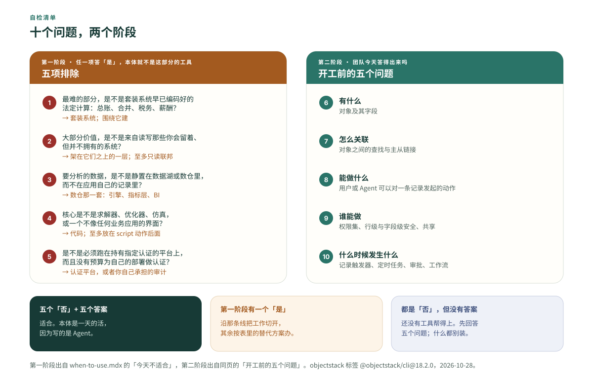

**先说结论：有五种工作负载不该用，而且是 ObjectStack 自己的文档点的名。** 取代大企业的核心 ERP 或财务系统；价值主要在于集成大量现有系统的工作；数据湖上的分析；定价、排程这类算法密集的领域——除非把算法包成一个动作；以及任何必须跑在认证平台上的工作。每一种都有一个更合适的工具。这篇文章逐个说清该用哪一个、为什么那是对的选择、选错了要付什么代价。文末有一张每行都带出处的决策表，还有一份十个问题的自检清单，装任何东西之前，先拿你自己的场景跑一遍。

一份诚实的「什么情况下别用我」清单，是厂商能发布的最有用的东西，因为这是买方从销售材料里唯一拿不到的信息。ObjectStack 的一句话定位是「一份可执行的业务本体。AI 编写它，运行时运行它，Agent 操作它，你拥有它。」下面写的全是这句话的边界在哪里，材料取自项目自己的[什么时候用它](https://objectstack.ai/docs/concepts/when-to-use)页和[它与其他方案的对比](https://objectstack.ai/docs/concepts/compare)页（`origin/main`，2026 年 10 月 16 日读取），以及边界恰好就是一行代码的那些源码文件。本站的[对比页](/zh-Hans/compare/)已经把这五种工作负载和开工前的五个问题各用一行列过了；这篇是长版：每一种给一个具体场景、替代方案和它的道理、代价，以及一条起决定作用的事实。

## 六类测试

有一条测试能一次覆盖五种情形，所以先讲它。概念页把可执行业务本体的核心定义为六类东西：对象与字段、关系、动作、权限、流程、Agent 与工具定义。运行时从这六类推导出数据库、API、界面和 Agent 工具，并在每一次调用上强制执行它们。代码不会消失，但它搬进了运行时——钩子、动作体、CEL 和受限 JSX——在六类东西划出的围栏之内运行。

于是对任何一个工作负载都可以问：**它最难的那部分，是不是这六类之一？** 如果这项工作里困难、值钱、有风险的部分，是在决定「有什么、怎么关联、能做什么、谁能做、什么时候发生什么」，那本体就是合适的工具，而且 Agent 写得出来。如果最难的部分是别的东西——一项法定计算、与四十个系统的连接、对 PB 级数据的扫描、一个求解器、一张审计师签发的证书——那这部分就不是一份定义能表达的，本体最多把它包起来，最糟是去模仿它。姑且把这叫作**六类测试**。下面五种工作负载各因为不同的原因过不了它，所以它们需要的是五个不同的替代方案，而不是一个。

## 一、大企业的核心 ERP 或财务系统

**场景。** 一家四千人的制造企业，总账、合并报表和薪酬在一套套装 ERP 上跑了十二年。编码 Agent 看过会计科目表之后，提议把它重新声明成对象：过账规则写成流程，税写成公式。演示很有说服力：凭证、试算平衡表、每一笔分录都带审批。

**该用什么，为什么那是对的。** 用套装系统，并且围绕它来建。「什么时候用它」页这样写：「总账、合并、税务和薪酬承载着套装系统早已编码进去的法规与边角情况。围绕这个核心建，而不是取而代之。」在那个市场里，法规本身就是产品。一个薪酬引擎，是一座由税收辖区、申报日历和追溯调整组成的图书馆，由一群唯一工作就是保持它最新的人维护着；一个合并引擎，是多年积累的内部交易抵消和外币折算的边角情况。这些都不是「有什么、谁能做什么」，而是计算；它随政府的变化而变，不随你的业务而变。

**选错的代价。** 第二本账。你重新编码的每一条规则，现在都是你要维护的 diff、你要通过的审计、换了税务年度之后出的缺陷；而你为法定申报留下的那套套装系统，每个季度都和你这份副本多差一点。一天就把规则写完的 Agent，没法替你读税法。

**起决定作用的事实。** README 的能力表列出运行时提供的十二项能力：对象与字段、权限、自动化、审批、视图、仪表盘与报表、动作、API 与 SDK、AI 工具、翻译、种子数据、数据源。总账、税务引擎、薪酬计算都不在其中，项目也没有说它们在路上。

同一页说适合的，是围绕这个核心的长尾：「供应商准入、巡检、内部申请」——那些追踪 ERP 不管的事的表格和表单。每一个都变成一份类型化定义，而不是靠邮件传来传去的文件；而且每一个都可以读 ERP 的数据而不必拥有它。这就是下一种情形。

## 二、价值主要在于集成大量现有系统的工作

**场景。** 一家银行希望它的 Agent 能同时从核心银行系统、CRM、卡平台和工单系统里回答一个客户的问题，并把一个状态写回其中两个。这些系统一个都不会搬。任务是让它们对 Agent 可读，并且能跨系统行动。

**该用什么，为什么。** 架在这些系统之上的一层：读的部分用语义层或上下文层，有回写要治理时用 Palantir 那一类运营本体。对比页直接承认这一点：「当数据已经住在一个数据仓库、一个湖仓和十几个业务系统里时，它们从你所在的地方起步。」那些产品的前提假设就是记录系统留在原地：它们的对象模型是一个视图，它们的写入是回写，而它们的价值随底下系统的数量增长。ObjectStack 建立在相反的假设上——本体*就是*系统，数据库是从它推导出来的。

**选错的代价。** 这是最常选错的一种，因为第一周会很顺。ObjectStack 可以用 `schemaMode: 'external'` 把一个外部数据库联邦接入为数据源，在一张遗留表上搭一个只读模型，一个下午就够。然后到了写入。联邦写入默认关闭，而且关了两道：数据源必须声明 `external.allowWrites: true`，对象必须声明 `external.writable: true`，「任一道闸门关着，对联邦对象的 insert/update/delete 都会被拒绝」。这道闸不是建议性的：`assertWriteAllowed` 在引擎的 `insert` 和 `update` 一开头就跑，在默认值、钩子和校验之前。你逐个对象把两道闸都打开，于是你开始对一个你不掌控的 schema 负责写入语义；而 `schemaMode: 'external'` 在 schema 不匹配时会让启动失败，上游改一个列名，你的应用就停了。或者你转而去写同步任务——到那时你已经把本来不想买的那层集成层自己造了一遍，而且是造在一个连自己的文档都把联邦称为「早期」的工具里。

**起决定作用的事实。** 两道默认关闭的主动开启：数据源上的 `allowWrites` 和对象上的 `writable`（`content/docs/data-modeling/external-datasources.mdx` 讲写入的那一节），由 `packages/objectql/src/engine.ts` 里的 `assertWriteAllowed` 强制执行。

诚实的路径是存在的，但很窄：只读接入，先测量，一个对象一个对象地开启写入，按对象切换。[如何把内部系统迁到元数据](/en/blog/how-to-move-an-internal-system-to-metadata/)走的就是这条路，包括那些正确答案是「根本不要迁」的情形。那条路是给你打算*取代*的系统走的。如果你打算留着四十个系统、跨着它们读，那就走错了路。

## 三、数据湖上的分析

**场景。** 一家零售商把三年的点击流和 POS 事件放在对象存储里，是 Parquet 和 Iceberg 表，品类团队想要仪表盘。有人注意到这个平台有仪表盘、报表，还有一个文档里称为语义层的数据集层，于是提议把它指向数据湖。

**该用什么，为什么。** 数仓那一套：为列式扫描而生的查询引擎，上面一层指标层或语义层，顶上一个 BI 工具。ObjectStack 的分析层，是面向应用自己那些行的指标层。它的文档把数据集定义为「一个基础对象、要纳入的关系，以及声明出来的维度与度量」，连接从对象图推导；schema 把这件事写得很直白，数据集的 `object` 的描述就是「Base object name」（基础对象名）。「什么时候用它」页一句话说完：分析层「在应用自己的对象上定义指标，供它的报表和仪表盘使用。它不是为查询数据湖而建的。」数仓的语义层在数据湖之上做的是同一件事，本站的对比页也说，认真做 BI 的公司仍然需要一个。

**选错的代价。** 两份副本选一份。要么把数据湖装进应用对象——于是你有了三年事件的第二份副本，带着它自己的新鲜度和它自己的账单，放在一个从业务定义推导出来、而不是为扫描设计的行存储里；要么联邦接入一张数仓表，然后发现你在把分析型问题送进一个为应用回答行级查询而建的引擎——有过滤下推，没有任何东西认识列式文件。仪表盘会渲染出来，但不会是品类团队要的那些仪表盘。

**起决定作用的事实。** README 列出的驱动是 PostgreSQL、MySQL、SQLite、MongoDB、Turso、WebAssembly 里的 SQLite 和内存。没有数据湖格式，没有列式引擎，没有对象存储驱动；而数据集层绑定的是一个对象，不是数据湖里的一张表。

## 四、定价、排程这类算法密集的领域

**场景。** 一家物流公司的产品是路径优化器：一个求解器，输入一天的订单和一支车队，输出一份计划；再加一块调度看板，调度员把站点在车辆之间拖来拖去，看着计划重新求解。订单、车辆、司机和计划显然都是对象；公司问，整个东西能不能做成一份可执行本体。

**该用什么，为什么。** 求解器和看板都用代码——而这里替代方案最有力的论证，恰恰来自本体自己的文档。「什么时候用它」页说：本体「声明能做什么；它不表达优化器。」一个动作的 `type` 只能是 `script`、`url`、`modal`、`flow`、`api`、`form` 之一，而一个 `script` 动作的处理函数是代码，以应用的全部数据权限运行。定义拥有的是那扇门、门上的权限、以及谁走过这扇门的审计。门后面的算法是你的，用什么语言能解就用什么。界面是同一个故事的另一个方向：对比页说，Console「是由元数据驱动的服务端渲染，一个不像任何业务应用的界面，直接做反而更容易。」

**选错的代价。** 把最要紧的部分，建在自由度最小的地方。求解器可以住在一个动作后面——对于一次由记录触发的排程运行，这正合适。调度看板不行：页面里的受限 JSX「被解析成一棵服务端驱动的 UI 树，从不作为代码执行」，这是有意为之，于是调度员需要的每一个交互，都变成了和一个为列表、表单和看板而建的渲染器讨价还价。半年之后，本体成了你真正卖的那个东西外面薄薄的一层壳。

**起决定作用的事实。** `packages/spec/src/ui/action.zod.ts` 里的 `ActionType` 是一个封闭集合：`script | url | modal | flow | api | form`。算法永远不是其中一项，它只是通往算法的那条路。

行得通的切分是：业务那一半——订单、车辆、司机、谁可以批准一份计划、计划发布时发生什么——做成本体，让 Agent 能写、能操作；求解器做成 `script` 动作后面的代码，于是权限、审计和 Agent 访问像对待任何其他动作一样适用于它；调度员的看板做成它自己的应用。如果看板*就是*产品，从看板开始。

## 五、必须跑在认证平台上的工作

**场景。** 一家医院集团想要一个入院登记流程，它的采购要求所承载的平台持有某项指定的鉴证。一份政务招标对 ISO 证书问同一个问题。这项工作本身——表单、流转、审批、审计轨迹——是教科书式的适合。

**该用什么，为什么。** 要么用一个持有证书的平台，要么由你自己为部署做认证；这个决定取决于买方的日历，不取决于厂商的路线图。「什么时候用它」页写道：「ObjectStack 是由你部署和运营的开源软件，它自身不带任何合规认证。当一项工作必须跑在认证平台上时，为你的部署做认证是你要承担的工作。」这不是回避，认证本来就是这样运作的：一份鉴证覆盖的是一个运行中的环境、它的控制措施和它的运营者，而一个 Apache-2.0 的代码仓库哪一样都不是。本站的[安全页](/zh-Hans/security/)对商业版说的是同一句话：认证取决于你运行中的部署，而不是一个二进制文件本身。

**选错的代价。** 在采购阶段而不是设计阶段才发现这一点，而时间表早已默认平台会自带证书。于是审计落到你的计划里，没有预算，就在上线之前。

**起决定作用的事实。** 项目的术语表把它自己的协议一致性测试套件都列为「计划中」，并写明「代码库里今天不存在 TCK 项目或认证机制」。除了你的部署，没有别的东西可以指给审计师看。

这项工作仍然适合；问题在于它跑在哪里。诚实的顺序是先把认证工作的成本算出来，再做决定。

## 另外两处别的类别起步更早

对比页还承认了两点，它们不在「今天不适合」的清单上，因为它们说的是一类问题而不是一类工作负载。两者过六类测试的方式是一样的。

**对异构数据做推理。** 如果问题是「从我们知道的一切能推出什么」——类层级、推导出的事实、跨词汇表的一致性检查——那是知识本体的工作，而 ObjectStack「没有对象继承、没有公理、没有推理器」。`abstract` 这个键是从 spec 里删掉的，而不是留作一个承诺。定义先校验、再运行；运行时不做任何推断。[那篇定义文章](/zh-Hans/blog/what-does-the-ontology-is-the-software-mean/)把这个「不是」讲全了。

**生态成熟度。** Salesforce、Odoo 和 ERPNext「带来多年的生产使用、打包好的应用、应用市场和实施伙伴。ObjectStack 更年轻；要有更多东西自己建的准备。」如果你这个季度就需要一个打包好的应用、需要你所在城市里有一家实施伙伴，那么不管定义怎么写，一个更年轻的平台都是错的赌注。

## 决策表

每一行：工作负载、今天是否适合与该用什么，以及起决定作用的那一条事实和它的出处。「今天」是一个日期：出处是 objectstack `origin/main` 的 `43567a8f`，2026 年 10 月 16 日读取。出处按文件名写：when-to-use、compare、ontology 是 `content/docs/concepts/*.mdx`；external-datasources 和 analytics 在 `content/docs/data-modeling/` 下；glossary 在 `content/docs/getting-started/` 下；`engine.ts` 是 `packages/objectql/src/engine.ts`；`dataset.zod.ts` 和 `action.zod.ts` 在 `packages/spec/src/ui/` 下。

| 工作负载 | 今天适合吗？该用什么 | 起决定作用的事实（出处） |
| :--- | :--- | :--- |
| 大企业的核心 ERP 或财务 | **否**：套装系统；围绕它建 | 法规和边角情况就是产品；运行时的十二项能力里没有总账、税务或薪酬引擎（when-to-use；README 能力表） |
| 集成大量现有系统 | **否**：语义层或上下文层；有回写时用运营本体 | 联邦默认只读，而且关了两道：数据源上的 `allowWrites` 和对象上的 `writable`（external-datasources；`engine.ts` 的 `assertWriteAllowed`） |
| 数据湖上的分析 | **否**：数仓查询引擎、指标层、BI | 数据集绑定到一个基础对象；驱动都是行存储，没有数据湖格式（analytics；`dataset.zod.ts`；README 驱动列表） |
| 算法密集的领域 | **算法本身不适合**：代码；其余是业务应用时，放在 `script` 动作后面 | `ActionType` 是 script、url、modal、flow、api、form；求解器永远不是其中一种（`action.zod.ts`；when-to-use） |
| 必须跑在认证平台上 | **不自己承担认证工作就不适合**：一个认证平台，或者为你的部署做认证 | 自身不带合规认证；连一致性测试套件都还是「计划中」（when-to-use；glossary） |
| 对异构数据做推理 | **否**：带推理器的知识本体 | 没有继承、没有公理、没有推理器；`abstract` 按 ADR-0049 删除（ontology；compare） |
| 现在就需要成熟生态 | **还不行**：有打包应用和实施伙伴的元数据平台 | 「ObjectStack 更年轻；要有更多东西自己建的准备」（compare） |
| 新建业务应用：CRM、工单、审批、运营、内部工具 | **是** | 对象、关系、动作、权限和流程就是这些应用的大部分（when-to-use） |
| 围绕核心 ERP 的长尾 | **是** | 小、具体、经常变；每个应用一份类型化定义，读 ERP 的数据而不拥有它（when-to-use） |
| 从第一天起就由 Agent 操作的后台 | **是** | 每一个部署都是一个 MCP 服务器，默认开启，在用户自己的权限之下（when-to-use；README） |

## 跑一遍自检

十个问题，两个阶段，十分钟。第一阶段是排除清单；第二阶段是「什么时候用它」页上「开工前的五个问题」。

**第一阶段。任一项答「是」，本体就不是这部分工作的工具。**

1. 这项工作最难的部分，是不是一项套装系统早已编码好的法定计算：总账、合并、税务、薪酬？
2. 大部分价值是不是来自读写那些你会留着、但并不拥有的系统？
3. 你想分析的数据，是不是静置在数据湖或数仓里，而不在应用自己的记录里？
4. 产品的核心是不是一个求解器、优化器或仿真，或者一个不像任何业务应用的界面？
5. 这项工作是不是必须跑在持有指定认证的平台上，而且没有预算为自己的部署做认证？

**第二阶段。你的团队今天能替业务回答这些吗？**

6. 有什么——对象及其字段。
7. 怎么关联——对象之间的查找（lookup）与主从（master-detail）链接。
8. 能做什么——用户或 Agent 可以对一条记录发起的动作。
9. 谁能做——权限集、行级与字段级安全、共享。
10. 什么时候发生什么——记录触发器、定时任务、审批、工作流。

五个「否」加五个答案：用那一页的话说，本体「是一天的活，因为写的是 Agent」。五个「否」但一个答案都没有：「还没有工具帮得上，这一个也不例外。第一笔投入是回答这五个问题，而不是安装任何东西。」第一阶段有一个「是」：沿着那条线把工作切开，留下通过的那部分，其余按表里的替代方案办。

## 这份清单没有说的

它没有说这些限制是永久的。那一页的标题是「*今天*不适合」，联邦被称为「早期」，上面的表带着日期；决定之前，拿它对照一下当前的页面。

它没有说这些替代方案在一般意义上更好。语义层是跨四十个系统读数据的正确工具，也是运营一个工单台的错误工具——理由正是第二节反过来讲的那些。每一行的替代方案，只对那一行是对的。

它也没有说过不了一行就等于整个工作过不了。真实的情形多半是切开的：入院登记流程适合，承载平台是采购问题；调度这个领域适合，求解器是代码；围绕 ERP 的部门应用适合，总账留在原地。六类测试针对的是最难的那部分，不是项目的名字。

## ObjectOS 在这份清单里的位置

上面说的一切不随版本而变。「想把同一个循环托管起来、在浏览器里用、什么都不用安装？那就是 ObjectOS——建立在 ObjectStack 之上的商业运行环境。」ObjectOS 既可托管在浏览器中、无需安装（ObjectOS Cloud），也可自管部署在你自己的基础设施上（ObjectOS Enterprise）；无论哪个版本，你都可以导出本体，拿到开源的 ObjectStack 运行时上运行。这五种工作负载说的是一份可执行本体能表达什么，不是它跑在哪里，所以这份清单在任何承载环境上读起来都一样。唯一一个和承载环境有关的问题是认证，安全页对 ObjectOS 的回答和开源页的措辞一致：取决于运行中的部署。

## 如果你的场景通过了

那么最快、也最诚实的下一步不是看演示，而是写一份定义。把你的编码 Agent 指向 ObjectStack——规则文件、技能包和工具服务器见[如何把你的 Agent 指向 ObjectStack](/en/blog/how-to-point-your-agent-at-objectstack/)——然后向它要第一个对象：几个字段、一个关系、一个动作、一个权限集、一个触发器。跑 `npm run validate`，先读 diff，再看 Console。如果你能把整份 diff 读完，而且它说的就是你的业务在做的事，那六类测试在实践中就通过了，下一页该交给 Agent 的是[定义本身是什么](/zh-Hans/ontology/)。如果读不完，这篇文章本来也帮不了你，而你刚刚省下了一个项目。
