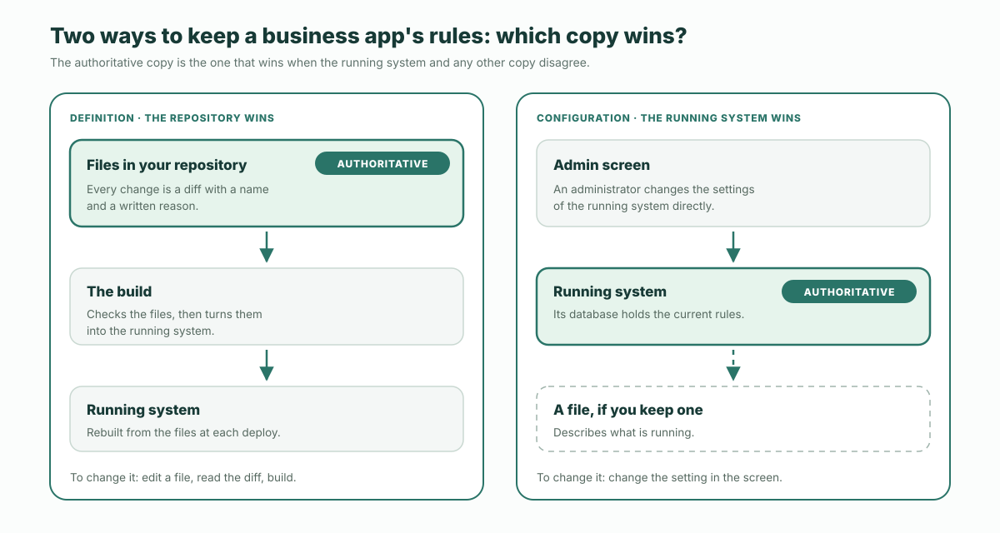

AI エージェントが業務ソフトウェアを変更するのなら、そのソフトウェアのルールのマスターコピーを、自社が管理するリポジトリにファイルとして置き、稼働中のシステムはそのファイルからビルドしましょう。そうすれば、すべての変更が日付と署名と書面の理由つきの変更前後の差分として届き、「営業にそれを許したのは誰で、なぜか？」には記憶ではなく記録から答えられます。代償は二つあります。既存のプラットフォーム（Salesforce、Odoo とその仲間）には長年の本番運用、パッケージ化されたアプリ、パートナーがあり、リポジトリ起点のプラットフォームでは自分で作る部分が増えます。そして、すべての変更が、管理画面なら求められないレビューの段階を通ります。

*ObjectStack 18.5.0（今日新規インストールで入るバージョン）で計測：リリースタグ時点のオープンソース CRM サンプルの git 履歴と、そのサンプルに対して実行した公開版 18.5.0 のコマンドラインツール。コマンドはすべて[証拠](#証拠)にあります。*

## 設定か定義か：どちらのコピーが優先されるのか

どちらの種類のプラットフォームも、目に見える仕事は同じです。あなたが業務（顧客、商談、誰が何を編集できるか）を記述すると、プラットフォームがその記述をデータベースのテーブル、画面、プログラミングインターフェース（API）に変えます。このように動くプラットフォームはメタデータプラットフォームと呼ばれます。それが動く元になる記述がメタデータ、つまりデータについてのデータです。ObjectStack 自身の[比較ページ](/en/compare/)は、こうしたプラットフォームを[「最も近い親戚」](https://github.com/objectstack-ai/objectstack/blob/b914e7247f692a79804f9b7eba278add46d57625/content/docs/concepts/compare.mdx#L58-L73)と呼んでいます。「Salesforce のメタデータが祖先であり、オープンソースのいとこには Frappe Framework と ERPNext、Odoo、NocoBase、Payload、Twenty がある」。違いは一文で示されています。

> 定義がどこにあり、誰のために書かれているか。これらのプラットフォームの多くでは、メタデータはプラットフォームのデータベースに保存され、その UI で編集される設定である。コードである場合、たとえば Payload Config や Odoo のモジュールのように、それはフレームワークのコードである。

ここでいうフレームワークのコードとは、その一つのプラットフォームのためだけに書かれたコードのことです。買い手にとって役に立つ問いは「メタデータかコードか」よりも狭く、こうです。**どちらのコピーが正本なのか？** 正本とは、稼働中のシステムと他のコピーが食い違ったときに優先されるコピーのことです。

- **設定。** 稼働中のシステムのデータベースが正本を持ちます。システムを変えるにはそれを変えます。たいていは管理画面からで、ファイルを残しているなら、そのファイルは稼働中のものを記述しているにすぎません。
- **定義。** リポジトリ内の一連のファイルが正本を持ち、稼働中のシステムはそこからビルドされます。システムを変えるにはファイルを変え、変更はビルド（ファイルを稼働中のシステムに変える工程）の後に有効になります。

これは二つの働き方であって、二つのベンダーリストではありません。上に挙げたプラットフォームのいくつかはファイルから運用することもできます。各ベンダーに、顧客が実際にどちらで働いているのかを尋ねてください。この記事を公開している ObjectStack は、リポジトリ起点の側です。



リポジトリとは、バージョン管理されたフォルダーのことで、ふつうは GitHub や GitLab でホストされ、すべての変更を作成者・日付・メッセージつきの変更前後として保存します。この変更前後を diff と呼びます。プルリクエストとは、その形で示された変更の提案で、誰かがそれをメインのコピーに取り込みます。どちらの種類のプラットフォームも履歴を持てます。本記事はどのベンダーの変更追跡についても主張しないので、検討中のプラットフォームについてはご自身で確かめてください。この選択が決めるのは、「今、何が正しいのか、いつからか？」にどこで答えるのか、そして変更が有効になる前にどこで読まれるのか、です。ファイルの履歴の中か、プラットフォーム自身の記録とツールの中か。

AI エージェントが変更の多くを書くようになった今、この点はいっそう重要です。下の例では、営業ロールの権限ファイルに対する 7 回の変更のすべてに、AI コーディングエージェントが共同作成者として記録されています。

## 権限変更を 1 件、追跡する

ObjectStack のリポジトリには、オープンソースの CRM サンプルが含まれています。顧客のシステムではなく、デモ用のアプリです。2026 年 8 月、その営業ロールは商談を開けても、商談に製品明細を追加できませんでした。プラットフォームは管理者でないすべてのユーザーを拒否していたのです。修正では権限の行を 1 行と、アプリのアクセス表の行を 1 行追加しました。アクセス表とは、リポジトリに保存された、各ロールが何を作成・読み取り・編集・削除できるかの一覧です。私たちは、監査担当者や財務責任者が尋ねるであろう質問を権限ファイルの履歴に投げかけ、それから今日のリリースでこの修正を取り消して、何がそれを止めるかを確かめました。

| 尋ねたこと | 記録の答え | あなたにとっての意味 |
|:--|:--|:--|
| 営業ロールの権限ファイルは何回変わったか？ | 2026 年 7 月 9 日に現在の名前になってから 7 回、最新は 11 月 6 日。どの変更にも日付、作成者、番号つきのプルリクエスト、書面の理由がある。 | 監査の質問に、誰かの記憶ではなくファイル自身の履歴から答えられる。 |
| それらの変更を書いたのは誰か？ | 7 回すべてで AI コーディングエージェントが共同作成者として記録されている。CRM サンプルのソースファイル全体では、2026 年 7 月 1 日以降の 50 回の変更のうち 49 回に同じ共同作成者の行がある（2026 年 2 月に始まるサンプルの全履歴では 218 回中 71 回）。 | AI はすでに定義を書いており、記録がそれを示している。 |
| 誰が承認したか？ | GitHub のレビュー記録では、7 件のプルリクエストのうち 1 件に承認がある。残り 6 件にはレビュー記録がない。3 件は同じ個人のアカウントが作成してマージし、2 件はプロジェクトの自動化アカウントが作成してマージし、1 件は AI エージェントのアカウントが作成して個人のアカウントがマージした。 | リポジトリはレビューを生み出さない。変更ごとにレビューが記録されたかどうかを示し、ここでは私たちの変更の大半で記録がなかったことを示している。 |
| なぜ営業は商談に製品明細を追加できるのか？ | 権限の 1 行とアクセス表の新しい 1 行。2026 年 8 月 12 日、[プルリクエスト 8228](https://github.com/objectstack-ai/objectstack/pull/8228)。理由も書かれている：営業ユーザーが、本来は完全に自分のものである商談で拒否されていた。 | 答えは 1 行と表の 1 行で、理由が添えられている。レビュー担当者が承認するのはコードのかたまりではなく、表の 1 行。 |
| 今日、誰かがその行を黙って消したら？ | プラットフォームの最初のチェック（ファイルを読んで誤りを探す）はそのまま通り、管理者でないすべてのユーザーが拒否されるという警告が出る。ビルドは止まり、失われるものを名指しする（下記）。 | この表を持つアプリでは、あるロールからある種類のレコードへのアクセスを外すと、誰かが表を再生成するまでビルドが止まる。そのチェックは、変更が正しいかどうかを判断しない。 |
| 削除を意図的に受け入れたら？ | 表を再生成すると、8 月の修正前の表とまったく同じもの（一文字の違いもない）ができる。 | 誰が何をできたかは、履歴のどの時点でも定義から再現できる。 |

ここでいう正式なレビューとは、GitHub 上のプルリクエストに残るレビュー記録のことです。承認、変更の要求、またはレビューコメントを指します。

ビルドの拒否はこう表示されます。

```text
✗ Access matrix drift (1 change) — capability changes must be reviewed
• 'crm_sales_user' loses ALL access to 'crm_opportunity_line_item' (entry removed)
If intended, re-run with --update-access-matrix and commit the snapshot — its diff IS the review artifact.
```

平たく言えば、営業ロールは商談の製品明細へのアクセスをすべて失い、誰かがそれを意図的に受け入れるまでビルドは完了しない、ということです。「アクセスマトリクス」とは、リポジトリに保存されたそのアクセス表で、ロールとレコードの種類ごとに 1 行あります。仕組みを 1 行ずつ追った解説は[AI が黙って変えた権限を出荷前に捕まえるには？](/ja/blog/catch-ai-silent-permission-change-access-matrix-gate/)にあります。

## メタデータプラットフォームのほうが優れている点

既存のプラットフォームを選ぶ理由は強く、ObjectStack のドキュメントは自らの言葉でそれを述べています。得意なこと：[「実績のあるランタイムの上で、出発点となるパッケージ化されたアプリ、モジュール、連携を使って、業務アプリケーションをすばやく構築すること」](https://github.com/objectstack-ai/objectstack/blob/b914e7247f692a79804f9b7eba278add46d57625/content/docs/concepts/compare.mdx#L65-L66)。先行している点：

> Salesforce、Odoo、ERPNext には、長年の本番運用、パッケージ化されたアプリケーション、アプリマーケットプレイス、導入パートナーがある。ObjectStack はより若い。自分で作る部分が多いと考えておくこと。
> — [ObjectStack ドキュメント「他のほうが強いところ」](https://github.com/objectstack-ai/objectstack/blob/b914e7247f692a79804f9b7eba278add46d57625/content/docs/concepts/compare.mdx#L115-L117)

さらに三つの点が、それらに有利に働きます。

- **エージェントもそれらに届く。** 同じページには[「そのうちいくつかは今では MCP サーバーを提供しており、エージェントもそれらに届く」](https://github.com/objectstack-ai/objectstack/blob/b914e7247f692a79804f9b7eba278add46d57625/content/docs/concepts/compare.mdx#L62-L63)とあります。MCP は、AI エージェントがシステムのツールを呼び出すためのオープンな標準です。
- **ロジックをデータとして保存するのは普通の形で、欠陥ではない。** [「これは ServiceNow（Business Rules）、Salesforce（メタデータとして保存される Formulas と Apex Triggers）、Retool（transformer の JS 文字列）、Airtable（Scripting blocks）が行ったのと同じトレードオフである。標準的なローコードの形だ」](https://github.com/objectstack-ai/objectstack/blob/b914e7247f692a79804f9b7eba278add46d57625/content/docs/automation/hook-bodies.mdx#L61)。これは ObjectStack 自身のドキュメントで、小さな業務ロジックをデータとして保つという自らの選択について述べたものです。つまり、違いはプラットフォームがメタデータを使うかどうかではありません。ObjectStack もメタデータプラットフォームです。違いは、正本がどこでバージョン管理されるかです。
- **管理画面にはリポジトリが要らない。** 設定型のプラットフォームでは、業務側の管理者がプルリクエストもビルドもデプロイもなしに、数分でフィールドを追加できます。多くのチームにとって、それこそが重要な点です。

すでにこうしたプラットフォームのどれかを使っているなら、そこで築いてきたものが、とどまる本当の理由になります。[Power Platform と Dataverse](/ja/blog/power-platform-lock-in-dataverse-self-host/) や [Retool](/ja/blog/retool-vs-ai-native-app-platform/) についての記事では、個別の製品を比較しています。

## 選び方

**設定型のプラットフォームから始める**のは、パッケージ化されたアプリ、マーケットプレイス、導入パートナーが今四半期のうちに必要なとき。システムを変えるのが、その画面で作業する管理者であるとき。そして監査担当者がプラットフォーム自身の変更記録を認めているときです。

**定義をリポジトリに置く**のは、変更の大半を AI エージェントが書き、そのひとつひとつに人が責任を負わなければならないとき。権限の変更に理由と読める変更前後が必要なとき。そして業務の定義を、稼働中のシステムのデータベースの行ではなく、自社が保有するファイルにしたいときです。ObjectStack の README は最後の点をこう述べています：[「定義はふつうの TypeScript としてあなたのリポジトリにあり、あなたの VCS でバージョン管理され、diff としてレビューできる。ベンダーのシステム内に保持されるグラフではない」](https://github.com/objectstack-ai/objectstack/blob/b914e7247f692a79804f9b7eba278add46d57625/README.md#L197-L199)。VCS はバージョン管理のこと、TypeScript はファイルを書くのに使われている言語です。

どちらを選ぶにしても、ベンダーに三つの質問をしてください。

1. どちらのコピーが正本か：稼働中のシステムか、ファイルか？
2. 権限の変更はすべて、有効になる前に、作成者と理由つきの読める変更前後として受け取れるか？
3. 稼働中のシステムとファイルが食い違ったとき、どちらが優先され、誰が気づくのか？

## リポジトリでは解決しないこと

- **変更が正しいかどうかは判断しない。** 8 月の修正を取り除いたとき、プラットフォームの最初のチェックは警告つきで通りました。ビルドを止めたのはアクセス表だけで、それもこのアプリが表を持っていたからです。表は各アプリが自分で有効にする必要があり、表のないアプリならビルドは通っていました。営業が製品明細に触れるべきかどうかは、やはり人が決めなければなりません。
- **レビューを生み出しはしない。** 上の 7 件のプルリクエストのうち 6 件には GitHub 上のレビュー記録がありません。私たち自身も数に入っています。これは ObjectStack 自身のリポジトリです。記録がないことは、誰も変更を読まなかったことの証明にはなりません。誰かが読んだことを誰も示せない、という意味です。リポジトリは、その抜けを数えられるようにします。それを埋めるには、マージ前に承認を必須にする設定が必要です。
- **ObjectStack にも設定はある。** ビュー、ダッシュボード、レポート、翻訳、メールテンプレートは、稼働中の環境の管理画面で編集できます。その編集はその環境のデータベースに保存され、[リポジトリ側のバージョンより優先されます](https://github.com/objectstack-ai/objectstack/blob/b914e7247f692a79804f9b7eba278add46d57625/content/docs/concepts/metadata-lifecycle.mdx#L43)。独自の変更ログもあります。権限のまとまりを含め、ほとんどの種類の定義は[プログラミングインターフェースを通じて実行時に作成する](https://github.com/objectstack-ai/objectstack/blob/b914e7247f692a79804f9b7eba278add46d57625/packages/spec/src/kernel/metadata-plugin.zod.ts#L348)こともできます。これらは本記事の意味でまさに設定なので、どの変更をリポジトリ経由にしなければならないかは、あなたが決めるルールです。

## エージェントを定義に向ける

エージェントが生成でき、形が決まっていて検査でき、人が小さな diff としてレビューでき、稼働中のシステムが強制する定義。ObjectStack はそうした対象の一つです。[エージェントを ObjectStack に向けて](/en/blog/how-to-point-your-agent-at-objectstack/)、自社のプロセスで試してみてください。用語については[定義レイヤー](/en/glossary/definition-layer/)、[アプリケーション定義とランタイム](/en/glossary/application-definition-vs-runtime/)、そして[「オントロジーこそがソフトウェア」とはどういう意味か](/ja/blog/what-does-the-ontology-is-the-software-mean/)を参照してください。

{/* the-proof */}
## 証拠

ここまでの内容はすべて、2026-11-17 に ObjectStack **18.5.0** に対して計測しました。

```text
$ npm view @objectstack/cli dist-tags
{ next: '18.5.0', latest: '18.5.0' }
```

git の件数は、タグ `@objectstack/cli@18.5.0`（コミット [`b914e72`](https://github.com/objectstack-ai/objectstack/commit/b914e7247f692a79804f9b7eba278add46d57625)）時点の objectstack リポジトリを、シャロークローンではなく完全なクローンで読んだものです。

### 1. 権限ファイルの履歴：7 回の変更

```text
$ T='@objectstack/cli@18.5.0'
$ git log $T --format='%h %ad  %s' --date=short -- examples/app-crm/src/security/sales-positions.ts
9d313f3ac70 2026-11-06  refactor(examples): every example-authored metadata name carries its package namespace (#30927)
9975c26ae38 2026-10-18  docs(rest,app-crm): the public form submit is authorized by its declaration, not by a guest_portal set (#24237)
bfc15d275ba 2026-10-11  feat(spec,core)!: positions declare their permissionSets; the authorization resolver reads the security catalog and the activation ledger (#22723)
90718b6804e 2026-09-03  docs(app-crm): point two stale comments at the real consumers (#14840)
c4624f084f7 2026-08-12  fix(example-crm): grant crm_opportunity_line_item in crm_sales_user, matching its master crm_opportunity (#8164) (#8228)
0a8e68580eb 2026-07-10  feat(showcase,docs): ADR-0090 permission-model zoo + full docs alignment (#2739)
6d83431cfaf 2026-07-09  feat(security)!: ADR-0090 P1 breaking wave — position rename, profile removal, secure OWD default, principal/external spec shapes (#2697)

$ git log $T --oneline -- examples/app-crm/src/security/sales-positions.ts | wc -l
7
$ git log $T --follow --oneline -- examples/app-crm/src/security/sales-positions.ts | wc -l
15
$ git show -M --format= --name-status 6d83431cfaf | grep sales-
R088	examples/app-crm/src/security/sales-roles.ts	examples/app-crm/src/security/sales-positions.ts
$ git log $T --oneline -- examples/app-crm/access-matrix.json | wc -l
2
```

この件数は現在の名前でのファイルについてのものです。7 回のうち最初の変更で `sales-roles.ts` から名前が変わりました。`git log --follow` ではさらに 8 件古いコミットまで、2026 年 5 月 27 日までさかのぼれます。11 月 6 日の変更 #30927 はファイル内の名前を変えたもので、ファイル名を変えたものではありません。アクセス表のコミットは 2 件です。`a5a1e41ba89`（2026-07-09）が作成し、`c4624f084f7`（2026-08-12）が下の修正です。

### 2. AI の共同作成とプルリクエスト

```text
$ for c in $(git log $T --format=%h -- examples/app-crm/src/security/sales-positions.ts); do
>   git log -1 --format=%B $c | grep -qi 'co-authored-by: claude' && echo ai || echo other; done | sort | uniq -c
      7 ai

$ git log $T --since=2026-07-01 --format=%H -- examples/app-crm/src | while read c; do
>   git log -1 --format=%B $c | grep -qi 'co-authored-by: claude' && echo ai || echo other; done | sort | uniq -c
     49 ai
      1 other

$ git log $T --format=%H -- examples/app-crm/src | while read c; do
>   git log -1 --format=%B $c | grep -qi 'co-authored-by: claude' && echo ai || echo other; done | sort | uniq -c
     71 ai
    147 other
$ git log $T --reverse --format=%ad --date=short -- examples/app-crm/src | head -1
2026-02-03

$ git log --first-parent $T --since=2026-07-01 --oneline -- examples/app-crm/src | wc -l
50
$ git log --first-parent $T --since=2026-07-01 --oneline -- examples/app-crm/src | grep -v '(#[0-9]*)'
df1137309d0 Merge pull request #2624 from objectstack-ai/claude/metadata-showcase-redesign-ougiov
```

共同作成者の行が記録するのは、そのツールが変更に関わったことであり、そのうちどれだけをツールが書いたかではありません。`--since` はコミット日で絞り込みます。期間内で最も古いコミットは 2026 年 7 月 5 日のものです。その期間に CRM サンプルのソースファイルに加えられた 50 回の変更は、すべてプルリクエストを通じてメインブランチに入りました。49 回は件名に番号を持つスカッシュされたプルリクエストとして、1 回はプルリクエスト 2624 のマージの中で。共同作成者の行がない唯一の変更は `23430995bcf`（#3806）です。

### 3. 7 件のプルリクエストのレビュー記録

```text
$ for n in 2697 2739 8228 14840 22723 24237 30927; do
>   r=$(gh api repos/objectstack-ai/objectstack/pulls/$n/reviews --jq length)
>   gh api repos/objectstack-ai/objectstack/pulls/$n --jq "\"$n reviews=$r opened-by=\(.user.type) merged-by=\(.merged_by.type) same-account=\(if .user.login == .merged_by.login then \"yes\" else \"no\" end)\""
> done
2697 reviews=0 opened-by=User merged-by=User same-account=yes
2739 reviews=0 opened-by=User merged-by=User same-account=yes
8228 reviews=0 opened-by=User merged-by=User same-account=yes
14840 reviews=0 opened-by=Bot merged-by=User same-account=no
22723 reviews=1 opened-by=Bot merged-by=Bot same-account=yes
24237 reviews=0 opened-by=Bot merged-by=Bot same-account=yes
30927 reviews=0 opened-by=Bot merged-by=Bot same-account=yes
```

22723 にある唯一のレビュー記録は承認です。記録のない 6 件を種類別に数えると、同じ個人のアカウントが作成してマージしたものが 3 件（2697、2739、8228）、プロジェクトの自動化アカウントが作成してマージしたものが 2 件（24237、30927）、AI エージェントのアカウントが作成して個人のアカウントがマージしたものが 1 件（14840）です。自動化アカウントと AI エージェントのアカウントは別々のボットアカウントです。このコマンドは名前ではなくアカウントの種類を出力しますが、`type` の参照を外せばアカウントそのものが表示されます。

### 4. 8 月の変更：1 行と表の 1 項目

```text
$ git show c4624f084f7 --stat --format='%h %ad%n%n%b' --date=short | sed -n '1,14p'
c4624f084f7 2026-08-12

* fix(example-crm): grant crm_opportunity_line_item in crm_sales_user, matching its master crm_opportunity (#8164)

crm_opportunity_line_item is a master-detail CHILD of crm_opportunity
(sharingModel: 'controlled_by_parent', inlineEdit: 'grid' on the
Opportunity form), but crm_sales_user granted object-level CRUD on 5
CRM objects and never the line item. Record-level access always
follows the master (ADR-0055), but object-level CRUD is a SEPARATE
gate the platform never derives -- every role-bound (non-admin) user
got a silent 403 the moment they tried to add/edit a product line on
an Opportunity they otherwise fully own. The platform's own
build-time lint (security-master-detail-ungranted) already flagged
this independently.
```

定義への変更です。空白を整えただけの変更のない 5 行は省いています。

```diff
     crm_opportunity: { allowRead: true, allowCreate: true, allowEdit: true, allowDelete: false },
+    // [#8164] crm_opportunity_line_item is a master-detail CHILD of
+    // crm_opportunity (sharingModel: 'controlled_by_parent') — ...
+    crm_opportunity_line_item: { allowRead: true, allowCreate: true, allowEdit: true, allowDelete: false },
     crm_lead: { allowRead: true, allowCreate: true, allowEdit: true, allowDelete: false },
```

そして `examples/app-crm/access-matrix.json` に追加された項目で、18.5.0 のタグ時点でも残っています。

```diff
+    {
+      "permissionSet": "crm_sales_user",
+      "object": "crm_opportunity_line_item",
+      "create": true,
+      "read": true,
+      "edit": true,
+      "delete": false,
+      "viewAllRecords": false,
+      "modifyAllRecords": false,
+      "sharingModel": "controlled_by_parent"
+    },
```

### 5. 18.5.0 で取り消す

タグ時点の CRM サンプルを、モノレポではなく公開版の 18.5.0 パッケージに対してインストールし（`workspace:*` の依存を `18.5.0` に設定し、テストフォルダーは除外）、編集が diff として見えるよう一時的なリポジトリにコミットしました。

```text
$ git -C ~/objectstack archive '@objectstack/cli@18.5.0' examples/app-crm | tar -x --strip-components=2
$ npm install
$ npx os --version
@objectstack/cli/18.5.0 linux-x64 node-v22.22.0
$ npx os compile; echo $?
  ...
  → Checking access-matrix snapshot (ADR-0090 D6)...
  ...
  ✓ Build complete (353ms)
0
```

権限の 1 行を削除し、チェックとビルドを実行します。

```text
$ sed -i '/^    crm_opportunity_line_item: { allowRead: true/d' src/security/sales-positions.ts
$ git diff --stat
 src/security/sales-positions.ts | 1 -
 1 file changed, 1 deletion(-)

$ npx os validate; echo $?
  → Running author-time rules (68)...
  ...
  ✓ Validation passed (414ms)
  ...
  ⚠ object "crm_opportunity_line_item": detail object "crm_opportunity_line_item" (master_detail "opportunity" → "crm_opportunity") has no object-level CRUD grant in any permission set, so non-admin users are denied it (403)
    fix: Grant it where its master "crm_opportunity" is granted: permissions[i].objects.crm_opportunity_line_item = { allowRead: true, allowCreate: true, allowEdit: true }
    rule: security-master-detail-ungranted  at objects[5].fields.opportunity
  ...
0

$ npx os compile; echo $?
  → Running author-time rules (68)...
  ...
  → Checking access-matrix snapshot (ADR-0090 D6)...

  ✗ Access matrix drift (1 change) — capability changes must be reviewed
  • 'crm_sales_user' loses ALL access to 'crm_opportunity_line_item' (entry removed)
  If intended, re-run with --update-access-matrix and commit the snapshot — its diff IS the review artifact.
1
```

この表はアプリごとのオプトインです。18.5.0 のビルドのソースは、チェックを実行する箇所でそう述べています：[「Opt-in per app: when `access-matrix.json` sits next to the config」](https://github.com/objectstack-ai/objectstack/blob/b914e7247f692a79804f9b7eba278add46d57625/packages/cli/src/commands/compile.ts#L1108-L1114)。

### 6. 削除を意図的に受け入れる

```text
$ npx os compile --update-access-matrix; echo $?
  → Access matrix snapshot written to access-matrix.json (ADR-0090 D6) — review the diff.
  ✓ Build complete (387ms)
0
$ git diff --stat
 access-matrix.json              | 11 -----------
 src/security/sales-positions.ts |  1 -
 2 files changed, 12 deletions(-)

$ git hash-object access-matrix.json
ecfe192469fc5500deecb0924d20699a382d6b45
$ git -C ~/objectstack rev-parse c4624f084f7^:examples/app-crm/access-matrix.json
ecfe192469fc5500deecb0924d20699a382d6b45
```

再生成された表は、8 月の修正前の表とバイト単位で同じファイルです。その後、一時ツリーを `git checkout HEAD -- .` で元に戻し、`git diff HEAD` は空でした。

### 7. 引用した箇所（18.5.0 タグ時点）

- `content/docs/concepts/compare.mdx` の[58–73 行目](https://github.com/objectstack-ai/objectstack/blob/b914e7247f692a79804f9b7eba278add46d57625/content/docs/concepts/compare.mdx#L58-L73)（最も近い親戚、得意なこと、違い）と[115–117 行目](https://github.com/objectstack-ai/objectstack/blob/b914e7247f692a79804f9b7eba278add46d57625/content/docs/concepts/compare.mdx#L115-L117)（他のほうが強いところ）。
- `content/docs/automation/hook-bodies.mdx` の[61 行目](https://github.com/objectstack-ai/objectstack/blob/b914e7247f692a79804f9b7eba278add46d57625/content/docs/automation/hook-bodies.mdx#L61)（標準的なローコードの形）。
- `README.md` の[197–199 行目](https://github.com/objectstack-ai/objectstack/blob/b914e7247f692a79804f9b7eba278add46d57625/README.md#L197-L199)（定義はあなたのリポジトリにある）。
- `content/docs/concepts/metadata-lifecycle.mdx` の[43 行目](https://github.com/objectstack-ai/objectstack/blob/b914e7247f692a79804f9b7eba278add46d57625/content/docs/concepts/metadata-lifecycle.mdx#L43)（「Reads walk top-to-bottom: the first non-null layer wins」）と[327 行目](https://github.com/objectstack-ai/objectstack/blob/b914e7247f692a79804f9b7eba278add46d57625/content/docs/concepts/metadata-lifecycle.mdx#L327)（管理画面での編集はオーバーレイ行として書き込まれ、同じトランザクションで履歴行も書かれる）。
- `packages/spec/src/kernel/metadata-plugin.zod.ts` の[348 行目](https://github.com/objectstack-ai/objectstack/blob/b914e7247f692a79804f9b7eba278add46d57625/packages/spec/src/kernel/metadata-plugin.zod.ts#L348)（「Allow runtime creation via API」）と、その下の型レジストリ：管理画面のオーバーレイは `view`、`dashboard`、`report`、`translation`、`email_template` で有効、`permission`、`position`、`object`、`flow` で無効。
