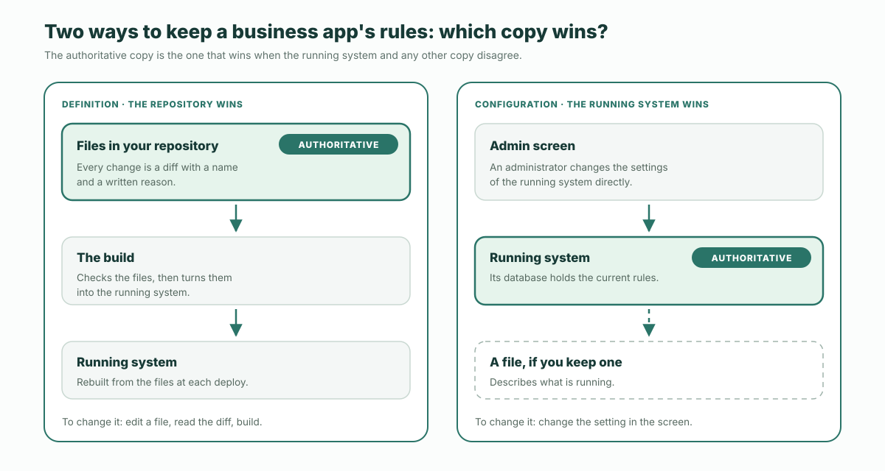

AI 에이전트가 업무 소프트웨어를 바꾸게 된다면, 그 소프트웨어 규칙의 마스터 사본을 회사가 통제하는 저장소에 파일로 두고, 실행 중인 시스템은 그 파일에서 빌드하십시오. 그러면 모든 변경이 날짜와 서명, 서면 사유가 붙은 변경 전후 비교로 도착하고, "누가 영업에게 그걸 허락했고, 왜인가?"에는 기억이 아니라 기록으로 답할 수 있습니다. 대가는 두 가지입니다. 기존 플랫폼(Salesforce, Odoo와 그 친척들)은 수년간의 운영 실적, 패키지 앱, 파트너를 갖추고 있고, 저장소 우선 플랫폼에서는 직접 만들어야 할 것이 더 많습니다. 그리고 모든 변경은 저장소에서 제안되고 받아들여져야 합니다. 관리 화면이라면 요구하지 않는 단계입니다.

*ObjectStack 18.5.0(오늘 새로 설치하면 받게 되는 버전)에서 측정: 릴리스 태그 시점의 오픈소스 CRM 예제 git 이력과, 그 예제에 대해 실행한 공개된 18.5.0 명령줄 도구. 모든 명령은 [증거](#증거)에 있습니다.*

## 설정인가 정의인가: 어느 사본이 우선하는가?

두 종류의 플랫폼은 눈에 보이는 일은 같습니다. 당신이 업무(고객, 영업 기회, 누가 무엇을 편집할 수 있는지)를 기술하면, 플랫폼이 그 기술을 데이터베이스 테이블, 화면, 프로그래밍 인터페이스(API)로 바꿉니다. 이렇게 동작하는 플랫폼을 메타데이터 플랫폼이라고 합니다. 플랫폼이 실행의 근거로 삼는 기술이 메타데이터, 즉 데이터에 관한 데이터입니다. ObjectStack 자신의 [비교 페이지](/en/compare/)는 이런 플랫폼을 ["가장 가까운 친척"](https://github.com/objectstack-ai/objectstack/blob/b914e7247f692a79804f9b7eba278add46d57625/content/docs/concepts/compare.mdx#L58-L73)이라고 부릅니다. "Salesforce의 메타데이터가 조상이며, 오픈소스 사촌으로는 Frappe Framework와 ERPNext, Odoo, NocoBase, Payload, Twenty가 있다." 차이는 한 문장으로 짚습니다.

> 정의가 어디에 있고, 누구를 위해 쓰였는가. 이 플랫폼들 대부분에서 메타데이터는 플랫폼의 데이터베이스에 저장되고 그 UI로 편집되는 설정이다. 코드인 경우, 예컨대 Payload Config나 Odoo의 모듈처럼, 그것은 프레임워크 코드다.

여기서 프레임워크 코드란 그 한 플랫폼만을 위해 작성된 코드를 뜻합니다. 구매자에게 쓸모 있는 질문은 "메타데이터냐 코드냐"보다 좁습니다. 바로 이것입니다. **어느 사본이 권위 있는 사본인가?** 권위 있는 사본이란 실행 중인 시스템과 다른 사본이 어긋날 때 우선하는 사본입니다.

- **설정.** 실행 중인 시스템의 데이터베이스가 권위 있는 사본을 가집니다. 시스템을 바꾸려면 그것을 바꾸는데, 보통 관리 화면에서 하며, 파일을 따로 둔다면 그 파일은 실행 중인 것을 기술할 뿐입니다.
- **정의.** 저장소에 있는 일련의 파일이 권위 있는 사본을 가지고, 실행 중인 시스템은 그 파일에서 빌드됩니다. 시스템을 바꾸려면 파일을 바꾸고, 변경은 빌드, 즉 파일을 실행 중인 시스템으로 바꾸는 단계를 거친 뒤에 적용됩니다.

이것은 두 가지 일하는 방식이지, 두 개의 벤더 목록이 아닙니다. 위에서 언급한 플랫폼 가운데 몇몇은 파일로 운영할 수도 있습니다. 각 벤더에게 고객들이 실제로 어떤 방식으로 일하는지 물어보십시오. 이 글을 게시하는 ObjectStack은 저장소 우선 쪽입니다.



저장소란 버전 관리되는 폴더로, 보통 GitHub나 GitLab에 호스팅되며 모든 변경을 작성자, 날짜, 메시지가 붙은 변경 전후로 보관합니다. 이 변경 전후를 diff라고 부릅니다. 풀 리퀘스트란 그런 형태로 보여 주는 변경 제안으로, 누군가 그것을 메인 사본에 받아들입니다. 두 종류의 플랫폼 모두 이력을 남길 수 있습니다. 이 글은 어느 벤더의 변경 추적에 대해서도 주장하지 않으니, 검토 중인 플랫폼은 직접 확인하십시오. 이 선택이 정하는 것은 "지금 무엇이 사실이고, 언제부터인가?"에 어디서 답하는지, 그리고 변경이 적용되기 전에 어디서 읽히는지입니다. 파일의 이력에서인지, 플랫폼 자체의 기록과 도구에서인지.

AI 에이전트가 변경의 상당수를 작성하는 지금, 이 점은 더 중요합니다. 아래 예에서는 영업 역할 권한 파일에 대한 7번의 변경 모두에 AI 코딩 에이전트가 공동 작성자로 기록되어 있습니다.

## 권한 변경 한 건을 추적하다

ObjectStack 저장소에는 오픈소스 CRM 예제가 들어 있습니다. 고객 시스템이 아니라 데모 앱입니다. 2026년 8월, 이 앱의 영업 역할은 영업 기회를 열 수는 있었지만 거기에 제품 항목을 추가할 수는 없었습니다. 플랫폼이 관리자가 아닌 모든 사용자를 거부했기 때문입니다. 수정은 권한 한 줄과, 앱 접근 표의 한 행을 추가했습니다. 접근 표란 저장소에 저장된 목록으로, 각 역할이 무엇을 생성, 조회, 편집, 삭제할 수 있는지를 적어 둔 것입니다. 우리는 감사 담당자나 재무 책임자가 물을 법한 질문을 권한 파일의 이력에 던졌고, 그다음 오늘의 릴리스에서 이 수정을 되돌려 무엇이 그것을 막는지 보았습니다.

| 우리가 물은 것 | 기록의 답 | 당신에게 의미하는 것 |
|:--|:--|:--|
| 영업 역할의 권한 파일은 몇 번 바뀌었나? | 2026년 7월 9일 지금의 이름을 갖게 된 뒤 7번, 가장 최근은 11월 6일. 모든 변경에 날짜, 작성자, 번호가 붙은 풀 리퀘스트, 서면 사유가 있다. | 감사 질문에 누군가의 기억이 아니라 파일 자체의 이력으로 답한다. |
| 그 변경은 누가 작성했나? | 7번 모두 AI 코딩 에이전트가 공동 작성자로 기록되어 있다. CRM 예제의 소스 파일 전체로 보면, 2026년 7월 1일 이후 50번의 변경 중 49번에 같은 공동 작성자 줄이 있다(2026년 2월에 시작하는 예제의 전체 이력에서는 218번 중 71번). | AI는 이미 정의를 쓰고 있고, 기록이 그렇다고 말한다. |
| 누가 승인했나? | GitHub의 리뷰 기록에는 7개 풀 리퀘스트 중 1개에 승인이 있다. 나머지 6개에는 리뷰 기록이 없다. 3개는 같은 사람의 계정이 열고 병합했고, 2개는 프로젝트의 자동화 계정이 열고 병합했으며, 1개는 AI 에이전트의 계정이 열고 사람의 계정이 병합했다. | 저장소가 리뷰를 만들어 내지는 않는다. 변경마다 리뷰가 기록되었는지를 보여 주며, 여기서는 우리 변경 대부분에 기록이 없었음을 보여 준다. |
| 영업은 왜 영업 기회에 제품 항목을 추가할 수 있나? | 권한 한 줄과 접근 표의 새 행 하나, 2026년 8월 12일, [풀 리퀘스트 8228](https://github.com/objectstack-ai/objectstack/pull/8228), 사유도 적혀 있다: 영업 사용자가 본래 온전히 자기 것인 영업 기회에서 거부되고 있었다. | 답은 한 줄과 표의 한 행이며, 사유가 함께 붙어 있다. 리뷰어가 서명하는 것은 코드 덩어리가 아니라 표의 한 행이다. |
| 오늘 누군가 그 줄을 몰래 지운다면? | 플랫폼의 첫 번째 검사(파일을 읽어 실수를 찾는)는 그대로 통과하고, 관리자가 아닌 모든 사용자가 거부될 것이라는 경고가 나온다. 빌드는 멈추고 무엇을 잃는지 명시한다(아래). | 이 표를 유지하는 앱에서는, 어떤 역할의 어떤 레코드 유형 접근을 없애면 누군가 표를 다시 생성할 때까지 빌드가 멈춘다. 그 검사가 변경이 옳은지를 판단하지는 않는다. |
| 삭제를 의도적으로 받아들인다면? | 표를 다시 생성하면 8월 수정 이전의 표가 그대로, 한 글자도 다르지 않게 나온다. | 누가 무엇을 할 수 있었는지를 이력의 어느 시점에서든 정의로부터 재현할 수 있다. |

여기서 정식 리뷰란 GitHub의 풀 리퀘스트에 남은 리뷰 기록, 즉 승인, 변경 요청, 또는 리뷰 댓글을 뜻합니다.

빌드의 거부는 이렇게 표시됩니다.

```text
✗ Access matrix drift (1 change) — capability changes must be reviewed
• 'crm_sales_user' loses ALL access to 'crm_opportunity_line_item' (entry removed)
If intended, re-run with --update-access-matrix and commit the snapshot — its diff IS the review artifact.
```

쉽게 말해, 영업 역할은 영업 기회의 제품 항목에 대한 모든 접근을 잃게 되고, 누군가 이를 의도적으로 받아들일 때까지 빌드는 끝나지 않습니다. "접근 매트릭스"(access matrix)는 저장소에 저장된 그 접근 표이며, 역할과 레코드 유형마다 한 행이 있습니다. 동작 원리를 한 줄씩 짚은 글은 [AI가 조용히 바꾼 권한을 배포 전에 어떻게 잡아내는가?](/ko/blog/catch-ai-silent-permission-change-access-matrix-gate/)에 있습니다.

## 메타데이터 플랫폼이 더 잘하는 것

기존 플랫폼을 고를 이유는 강하며, ObjectStack의 문서는 자기 말로 그것을 밝힙니다. 잘하는 것: ["검증된 런타임 위에서, 출발점이 되는 패키지 앱, 모듈, 연동을 활용해 업무 애플리케이션을 빠르게 구축하는 것."](https://github.com/objectstack-ai/objectstack/blob/b914e7247f692a79804f9b7eba278add46d57625/content/docs/concepts/compare.mdx#L65-L66) 앞서 있는 지점:

> Salesforce, Odoo, ERPNext는 수년간의 운영 실적, 패키지 애플리케이션, 앱 마켓플레이스, 구축 파트너를 갖추고 있다. ObjectStack은 더 젊다. 직접 만들 것이 더 많다고 예상하라.
> — [ObjectStack 문서, "다른 쪽이 더 강한 지점"](https://github.com/objectstack-ai/objectstack/blob/b914e7247f692a79804f9b7eba278add46d57625/content/docs/concepts/compare.mdx#L115-L117)

세 가지가 더 그들에게 유리합니다.

- **에이전트도 그들에게 닿는다.** 같은 페이지에는 ["그중 몇몇은 이제 MCP 서버를 제공하므로, 에이전트도 그들에게 닿을 수 있다."](https://github.com/objectstack-ai/objectstack/blob/b914e7247f692a79804f9b7eba278add46d57625/content/docs/concepts/compare.mdx#L62-L63)라고 적혀 있습니다. MCP는 AI 에이전트가 시스템의 도구를 호출하는 개방형 표준입니다.
- **로직을 데이터로 저장하는 것은 흔한 형태이지 결함이 아니다.** ["이는 ServiceNow(Business Rules), Salesforce(메타데이터로 저장되는 Formulas와 Apex Triggers), Retool(transformer JS 문자열), Airtable(Scripting blocks)이 한 것과 같은 트레이드오프다. 표준적인 로우코드 형태다."](https://github.com/objectstack-ai/objectstack/blob/b914e7247f692a79804f9b7eba278add46d57625/content/docs/automation/hook-bodies.mdx#L61) 이는 ObjectStack 자신의 문서로, 작은 업무 로직을 데이터로 두기로 한 선택에 대한 설명입니다. 그러니 차이는 플랫폼이 메타데이터를 쓰느냐가 아닙니다. ObjectStack도 메타데이터 플랫폼입니다. 차이는 권위 있는 사본이 어디서 버전 관리되느냐입니다.
- **관리 화면에는 저장소가 필요 없다.** 설정형 플랫폼에서는 업무 관리자가 풀 리퀘스트도, 빌드도, 배포도 없이 몇 분 만에 필드를 추가할 수 있습니다. 많은 팀에게는 바로 그것이 핵심입니다.

이미 이런 플랫폼 중 하나를 쓰고 있다면, 거기서 이미 만들어 둔 것이 남을 실제 이유가 됩니다. [Power Platform과 Dataverse](/ko/blog/power-platform-lock-in-dataverse-self-host/), [Retool](/ko/blog/retool-vs-ai-native-app-platform/)에 관한 글에서는 구체적인 제품을 따져 봅니다.

## 고르는 법

**설정형 플랫폼으로 시작하십시오.** 패키지 앱, 마켓플레이스, 구축 파트너가 이번 분기 안에 필요할 때, 시스템을 바꾸는 사람이 그 화면에서 일하는 관리자일 때, 그리고 감사 담당자가 플랫폼 자체의 변경 기록을 인정할 때입니다.

**정의를 저장소에 두십시오.** 변경 대부분을 AI 에이전트가 작성하고 그 하나하나를 사람이 책임져야 할 때, 권한 변경에 사유와 읽을 수 있는 변경 전후가 반드시 따라와야 할 때, 그리고 업무의 정의가 실행 중인 시스템 데이터베이스의 행이 아니라 회사가 보유한 파일이기를 원할 때입니다. ObjectStack의 README는 마지막 요점을 이렇게 말합니다: ["정의는 평범한 TypeScript로 당신의 저장소에 있으며, 당신의 VCS로 버전 관리되고 diff로 리뷰할 수 있다. 벤더 시스템 안에 보관된 그래프가 아니다."](https://github.com/objectstack-ai/objectstack/blob/b914e7247f692a79804f9b7eba278add46d57625/README.md#L197-L199) VCS는 버전 관리를, TypeScript는 파일을 작성하는 언어를 말합니다.

어느 쪽을 고르든 벤더에게 세 가지를 물으십시오.

1. 어느 사본이 권위 있는 사본인가: 실행 중인 시스템인가, 파일인가?
2. 모든 권한 변경을, 적용되기 전에, 작성자와 사유가 붙은 읽을 수 있는 변경 전후로 받을 수 있는가?
3. 실행 중인 시스템과 파일이 어긋나면 어느 쪽이 우선하며, 누가 알아차리는가?

## 저장소가 해결하지 못하는 것

- **변경이 옳은지는 판단하지 않는다.** 8월의 수정을 제거했을 때, 플랫폼의 첫 번째 검사는 경고와 함께 통과했습니다. 빌드를 멈춘 것은 접근 표뿐이었고, 그것도 이 앱에 표가 있었기 때문입니다. 표는 앱마다 직접 켜야 하며, 표가 없는 앱이라면 빌드가 통과했을 것입니다. 영업이 제품 항목을 건드려야 하는지는 여전히 사람이 정해야 합니다.
- **리뷰를 만들어 내지는 않는다.** 위의 7개 풀 리퀘스트 중 6개에는 GitHub에 리뷰 기록이 없으며, 우리 자신도 그 숫자에 들어 있습니다. 이것은 ObjectStack 자신의 저장소입니다. 기록이 없다고 해서 아무도 변경을 읽지 않았다는 증거는 아닙니다. 누군가 읽었다는 것을 아무도 보여 줄 수 없다는 뜻입니다. 저장소는 그 빈틈을 셀 수 있게 만듭니다. 그것을 메우려면 병합 전에 승인을 요구하는 설정이 필요합니다.
- **ObjectStack도 일부 설정을 둔다.** 뷰, 대시보드, 보고서, 번역, 이메일 템플릿은 실행 중인 환경의 관리 화면에서 편집할 수 있습니다. 그 편집은 해당 환경의 데이터베이스에 저장되고 [저장소의 버전보다 우선하며](https://github.com/objectstack-ai/objectstack/blob/b914e7247f692a79804f9b7eba278add46d57625/content/docs/concepts/metadata-lifecycle.mdx#L43), 자체 변경 로그를 가집니다. 권한 묶음을 포함한 대부분의 정의 종류는 [실행 중에 프로그래밍 인터페이스를 통해 만들](https://github.com/objectstack-ai/objectstack/blob/b914e7247f692a79804f9b7eba278add46d57625/packages/spec/src/kernel/metadata-plugin.zod.ts#L348) 수도 있습니다. 이 글의 의미로 보면 이것들은 정확히 설정이므로, 어떤 변경이 반드시 저장소를 거쳐야 하는지는 당신이 정하는 규칙입니다.

## 에이전트를 정의로 향하게 하라

에이전트가 생성할 수 있고, 형태가 고정되어 검사할 수 있으며, 사람이 작은 diff로 리뷰할 수 있고, 실행 중인 시스템이 강제하는 정의. ObjectStack은 그런 대상 가운데 하나입니다. [에이전트를 ObjectStack으로 향하게 해서](/en/blog/how-to-point-your-agent-at-objectstack/) 자신의 프로세스로 시험해 보십시오. 용어는 [정의 계층](/en/glossary/definition-layer/), [애플리케이션 정의와 런타임](/en/glossary/application-definition-vs-runtime/), 그리고 ["온톨로지가 곧 소프트웨어"는 무슨 뜻인가](/ko/blog/what-does-the-ontology-is-the-software-mean/)를 참고하십시오.

{/* the-proof */}
## 증거

위의 모든 내용은 2026-11-17에 ObjectStack **18.5.0**을 대상으로 측정했습니다.

```text
$ npm view @objectstack/cli dist-tags
{ next: '18.5.0', latest: '18.5.0' }
```

git 집계는 태그 `@objectstack/cli@18.5.0`(커밋 [`b914e72`](https://github.com/objectstack-ai/objectstack/commit/b914e7247f692a79804f9b7eba278add46d57625)) 시점의 objectstack 저장소를, 얕은 클론이 아닌 전체 클론으로 읽은 것입니다.

### 1. 권한 파일의 이력: 7번의 변경

```text
$ T='@objectstack/cli@18.5.0'
$ git log $T --format='%h %ad  %s' --date=short -- examples/app-crm/src/security/sales-positions.ts
9d313f3ac70 2026-11-06  refactor(examples): every example-authored metadata name carries its package namespace (#30927)
9975c26ae38 2026-10-18  docs(rest,app-crm): the public form submit is authorized by its declaration, not by a guest_portal set (#24237)
bfc15d275ba 2026-10-11  feat(spec,core)!: positions declare their permissionSets; the authorization resolver reads the security catalog and the activation ledger (#22723)
90718b6804e 2026-09-03  docs(app-crm): point two stale comments at the real consumers (#14840)
c4624f084f7 2026-08-12  fix(example-crm): grant crm_opportunity_line_item in crm_sales_user, matching its master crm_opportunity (#8164) (#8228)
0a8e68580eb 2026-07-10  feat(showcase,docs): ADR-0090 permission-model zoo + full docs alignment (#2739)
6d83431cfaf 2026-07-09  feat(security)!: ADR-0090 P1 breaking wave — position rename, profile removal, secure OWD default, principal/external spec shapes (#2697)

$ git log $T --oneline -- examples/app-crm/src/security/sales-positions.ts | wc -l
7
$ git log $T --follow --oneline -- examples/app-crm/src/security/sales-positions.ts | wc -l
15
$ git show -M --format= --name-status 6d83431cfaf | grep sales-
R088	examples/app-crm/src/security/sales-roles.ts	examples/app-crm/src/security/sales-positions.ts
$ git log $T --oneline -- examples/app-crm/access-matrix.json | wc -l
2
```

이 집계는 현재 이름의 파일에 대한 것입니다. 일곱 번 중 첫 번째 변경에서 `sales-roles.ts`에서 이름이 바뀌었습니다. `git log --follow`로는 8개의 더 이른 커밋까지, 2026년 5월 27일까지 거슬러 올라갑니다. 11월 6일의 변경 #30927은 파일 안의 이름을 바꾼 것이지 파일 이름을 바꾼 것이 아닙니다. 접근 표의 커밋은 두 개입니다. `a5a1e41ba89`(2026-07-09)가 표를 만들었고, `c4624f084f7`(2026-08-12)이 아래의 수정입니다.

### 2. AI 공동 작성과 풀 리퀘스트

```text
$ for c in $(git log $T --format=%h -- examples/app-crm/src/security/sales-positions.ts); do
>   git log -1 --format=%B $c | grep -qi 'co-authored-by: claude' && echo ai || echo other; done | sort | uniq -c
      7 ai

$ git log $T --since=2026-07-01 --format=%H -- examples/app-crm/src | while read c; do
>   git log -1 --format=%B $c | grep -qi 'co-authored-by: claude' && echo ai || echo other; done | sort | uniq -c
     49 ai
      1 other

$ git log $T --format=%H -- examples/app-crm/src | while read c; do
>   git log -1 --format=%B $c | grep -qi 'co-authored-by: claude' && echo ai || echo other; done | sort | uniq -c
     71 ai
    147 other
$ git log $T --reverse --format=%ad --date=short -- examples/app-crm/src | head -1
2026-02-03

$ git log --first-parent $T --since=2026-07-01 --oneline -- examples/app-crm/src | wc -l
50
$ git log --first-parent $T --since=2026-07-01 --oneline -- examples/app-crm/src | grep -v '(#[0-9]*)'
df1137309d0 Merge pull request #2624 from objectstack-ai/claude/metadata-showcase-redesign-ougiov
```

공동 작성자 줄이 기록하는 것은 그 도구가 변경에 참여했다는 사실이지, 그중 얼마를 도구가 썼는지가 아닙니다. `--since`는 커밋 날짜로 거릅니다. 기간 안에서 가장 이른 커밋은 2026년 7월 5일 것입니다. 그 기간에 CRM 예제 소스 파일에 가해진 50번의 변경은 모두 풀 리퀘스트를 통해 메인 브랜치에 들어갔습니다. 49번은 제목에 번호가 있는 스쿼시된 풀 리퀘스트로, 1번은 풀 리퀘스트 2624의 병합 안에서. 공동 작성자 줄이 없는 유일한 변경은 `23430995bcf`(#3806)입니다.

### 3. 7개 풀 리퀘스트의 리뷰 기록

```text
$ for n in 2697 2739 8228 14840 22723 24237 30927; do
>   r=$(gh api repos/objectstack-ai/objectstack/pulls/$n/reviews --jq length)
>   gh api repos/objectstack-ai/objectstack/pulls/$n --jq "\"$n reviews=$r opened-by=\(.user.type) merged-by=\(.merged_by.type) same-account=\(if .user.login == .merged_by.login then \"yes\" else \"no\" end)\""
> done
2697 reviews=0 opened-by=User merged-by=User same-account=yes
2739 reviews=0 opened-by=User merged-by=User same-account=yes
8228 reviews=0 opened-by=User merged-by=User same-account=yes
14840 reviews=0 opened-by=Bot merged-by=User same-account=no
22723 reviews=1 opened-by=Bot merged-by=Bot same-account=yes
24237 reviews=0 opened-by=Bot merged-by=Bot same-account=yes
30927 reviews=0 opened-by=Bot merged-by=Bot same-account=yes
```

22723에 있는 유일한 리뷰 기록은 승인입니다. 기록이 없는 6개를 유형별로 세면, 같은 사람의 계정이 열고 병합한 것이 3개(2697, 2739, 8228), 프로젝트의 자동화 계정이 열고 병합한 것이 2개(24237, 30927), AI 에이전트의 계정이 열고 사람의 계정이 병합한 것이 1개(14840)입니다. 자동화 계정과 AI 에이전트의 계정은 서로 다른 봇 계정입니다. 이 명령은 이름 대신 계정 유형을 출력하며, `type` 조회를 빼면 계정 자체가 보입니다.

### 4. 8월의 변경: 한 줄, 표 항목 하나

```text
$ git show c4624f084f7 --stat --format='%h %ad%n%n%b' --date=short | sed -n '1,14p'
c4624f084f7 2026-08-12

* fix(example-crm): grant crm_opportunity_line_item in crm_sales_user, matching its master crm_opportunity (#8164)

crm_opportunity_line_item is a master-detail CHILD of crm_opportunity
(sharingModel: 'controlled_by_parent', inlineEdit: 'grid' on the
Opportunity form), but crm_sales_user granted object-level CRUD on 5
CRM objects and never the line item. Record-level access always
follows the master (ADR-0055), but object-level CRUD is a SEPARATE
gate the platform never derives -- every role-bound (non-admin) user
got a silent 403 the moment they tried to add/edit a product line on
an Opportunity they otherwise fully own. The platform's own
build-time lint (security-master-detail-ungranted) already flagged
this independently.
```

정의에 대한 변경입니다. 공백만 다시 맞춘, 바뀌지 않은 다섯 줄은 생략했습니다.

```diff
     crm_opportunity: { allowRead: true, allowCreate: true, allowEdit: true, allowDelete: false },
+    // [#8164] crm_opportunity_line_item is a master-detail CHILD of
+    // crm_opportunity (sharingModel: 'controlled_by_parent') — ...
+    crm_opportunity_line_item: { allowRead: true, allowCreate: true, allowEdit: true, allowDelete: false },
     crm_lead: { allowRead: true, allowCreate: true, allowEdit: true, allowDelete: false },
```

그리고 `examples/app-crm/access-matrix.json`에 추가된 항목으로, 18.5.0 태그에도 그대로 있습니다.

```diff
+    {
+      "permissionSet": "crm_sales_user",
+      "object": "crm_opportunity_line_item",
+      "create": true,
+      "read": true,
+      "edit": true,
+      "delete": false,
+      "viewAllRecords": false,
+      "modifyAllRecords": false,
+      "sharingModel": "controlled_by_parent"
+    },
```

### 5. 18.5.0에서 되돌리기

태그 시점의 CRM 예제를 모노레포가 아닌 공개된 18.5.0 패키지로 설치하고(`workspace:*` 의존성을 `18.5.0`으로 지정, 테스트 폴더는 제외), 편집이 diff로 보이도록 임시 저장소에 커밋했습니다.

```text
$ git -C ~/objectstack archive '@objectstack/cli@18.5.0' examples/app-crm | tar -x --strip-components=2
$ npm install
$ npx os --version
@objectstack/cli/18.5.0 linux-x64 node-v22.22.0
$ npx os compile; echo $?
  ...
  → Checking access-matrix snapshot (ADR-0090 D6)...
  ...
  ✓ Build complete (353ms)
0
```

권한 한 줄을 지우고, 검사와 빌드를 실행합니다.

```text
$ sed -i '/^    crm_opportunity_line_item: { allowRead: true/d' src/security/sales-positions.ts
$ git diff --stat
 src/security/sales-positions.ts | 1 -
 1 file changed, 1 deletion(-)

$ npx os validate; echo $?
  → Running author-time rules (68)...
  ...
  ✓ Validation passed (414ms)
  ...
  ⚠ object "crm_opportunity_line_item": detail object "crm_opportunity_line_item" (master_detail "opportunity" → "crm_opportunity") has no object-level CRUD grant in any permission set, so non-admin users are denied it (403)
    fix: Grant it where its master "crm_opportunity" is granted: permissions[i].objects.crm_opportunity_line_item = { allowRead: true, allowCreate: true, allowEdit: true }
    rule: security-master-detail-ungranted  at objects[5].fields.opportunity
  ...
0

$ npx os compile; echo $?
  → Running author-time rules (68)...
  ...
  → Checking access-matrix snapshot (ADR-0090 D6)...

  ✗ Access matrix drift (1 change) — capability changes must be reviewed
  • 'crm_sales_user' loses ALL access to 'crm_opportunity_line_item' (entry removed)
  If intended, re-run with --update-access-matrix and commit the snapshot — its diff IS the review artifact.
1
```

이 표는 앱마다 선택해서 켭니다. 18.5.0 빌드 소스는 검사를 실행하는 곳에서 그렇게 말합니다: ["Opt-in per app: when `access-matrix.json` sits next to the config"](https://github.com/objectstack-ai/objectstack/blob/b914e7247f692a79804f9b7eba278add46d57625/packages/cli/src/commands/compile.ts#L1108-L1114).

### 6. 삭제를 의도적으로 받아들이기

```text
$ npx os compile --update-access-matrix; echo $?
  → Access matrix snapshot written to access-matrix.json (ADR-0090 D6) — review the diff.
  ✓ Build complete (387ms)
0
$ git diff --stat
 access-matrix.json              | 11 -----------
 src/security/sales-positions.ts |  1 -
 2 files changed, 12 deletions(-)

$ git hash-object access-matrix.json
ecfe192469fc5500deecb0924d20699a382d6b45
$ git -C ~/objectstack rev-parse c4624f084f7^:examples/app-crm/access-matrix.json
ecfe192469fc5500deecb0924d20699a382d6b45
```

다시 생성된 표는 8월 수정 이전의 표와 바이트 단위까지 같은 파일입니다. 그 뒤 임시 트리를 `git checkout HEAD -- .`로 복원했고, `git diff HEAD`는 비어 있었습니다.

### 7. 인용한 줄(18.5.0 태그 기준)

- `content/docs/concepts/compare.mdx` [58–73행](https://github.com/objectstack-ai/objectstack/blob/b914e7247f692a79804f9b7eba278add46d57625/content/docs/concepts/compare.mdx#L58-L73)(가장 가까운 친척, 잘하는 것, 차이)과 [115–117행](https://github.com/objectstack-ai/objectstack/blob/b914e7247f692a79804f9b7eba278add46d57625/content/docs/concepts/compare.mdx#L115-L117)(그들이 더 강한 지점).
- `content/docs/automation/hook-bodies.mdx` [61행](https://github.com/objectstack-ai/objectstack/blob/b914e7247f692a79804f9b7eba278add46d57625/content/docs/automation/hook-bodies.mdx#L61)(표준적인 로우코드 형태).
- `README.md` [197–199행](https://github.com/objectstack-ai/objectstack/blob/b914e7247f692a79804f9b7eba278add46d57625/README.md#L197-L199)(정의는 당신의 저장소에 있다).
- `content/docs/concepts/metadata-lifecycle.mdx` [43행](https://github.com/objectstack-ai/objectstack/blob/b914e7247f692a79804f9b7eba278add46d57625/content/docs/concepts/metadata-lifecycle.mdx#L43)("Reads walk top-to-bottom: the first non-null layer wins")과 [327행](https://github.com/objectstack-ai/objectstack/blob/b914e7247f692a79804f9b7eba278add46d57625/content/docs/concepts/metadata-lifecycle.mdx#L327)(관리 화면에서의 편집은 오버레이 행으로 기록되고, 같은 트랜잭션에서 이력 행도 기록된다).
- `packages/spec/src/kernel/metadata-plugin.zod.ts` [348행](https://github.com/objectstack-ai/objectstack/blob/b914e7247f692a79804f9b7eba278add46d57625/packages/spec/src/kernel/metadata-plugin.zod.ts#L348)("Allow runtime creation via API")과 그 아래의 유형 레지스트리: 관리 화면 오버레이는 `view`, `dashboard`, `report`, `translation`, `email_template`에서 켜져 있고 `permission`, `position`, `object`, `flow`에서는 꺼져 있다.
