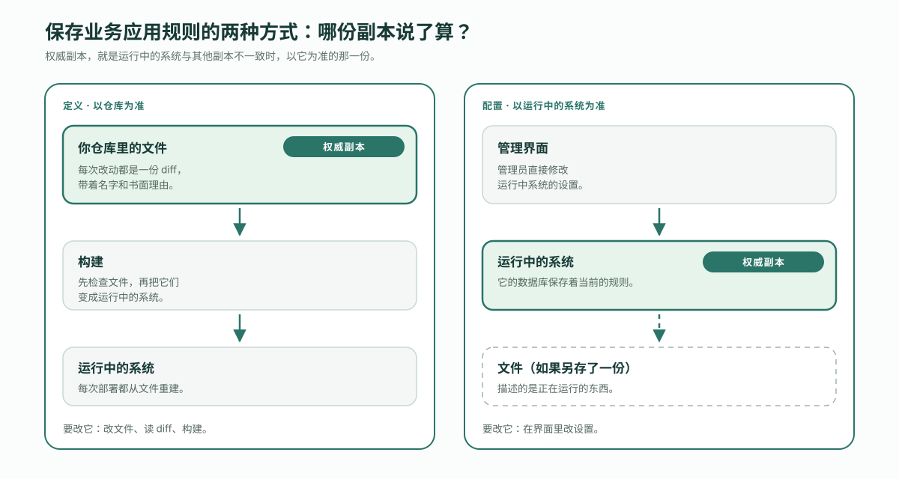

如果 AI Agent 会改动你的业务软件，就把这套软件规则的主副本，以文件的形式放在公司自己掌控的代码仓库里，再由这些文件构建出运行中的系统。这样，每次改动都会以一份注明日期、署了名、附带书面理由的前后对比出现，「谁让销售能这么做，为什么？」可以从记录里找到答案，而不是靠回忆。代价有两层。成熟平台（Salesforce、Odoo 及同类）拥有多年的生产使用经验、现成的应用包和实施伙伴，而以仓库为先的平台需要你自己多建一些。另外，每次改动都要经过一道评审，而管理界面并不要求这一步。

*测量基于 ObjectStack 18.5.0，即今天新安装得到的版本：发布标签下其开源 CRM 示例的 git 历史，以及用已发布的 18.5.0 命令行工具对该示例的实际运行。所有命令见[证据](#证据)。*

## 配置还是定义：哪份副本说了算？

两类平台做的是同一件看得见的事。你描述自己的业务（客户、商机、谁可以编辑什么），平台把这份描述变成数据库表、界面和一套编程接口（API）。这样工作的平台叫元数据平台：它赖以运行的那份描述就是元数据，即关于数据的数据。ObjectStack 自己的[对比页](/zh-Hans/compare/)把这类平台称为[「最近的亲戚」](https://github.com/objectstack-ai/objectstack/blob/b914e7247f692a79804f9b7eba278add46d57625/content/docs/concepts/compare.mdx#L58-L73)：「Salesforce 的元数据是祖先；开源的表亲包括 Frappe Framework 与 ERPNext、Odoo、NocoBase、Payload 和 Twenty。」它用一句话点出差别：

> 定义放在哪里，写给谁看。在其中大多数平台上，元数据是存放在平台数据库中、通过其界面编辑的配置；当它是代码时，比如 Payload Config 或 Odoo 的模块，那是框架代码。

这里的框架代码，指只为那一个平台编写的代码。对买方有用的问题，比「元数据还是代码」更窄，那就是：**哪份副本是权威副本？** 权威副本，就是运行中的系统与其他副本不一致时，以它为准的那一份。

- **配置。** 运行中系统的数据库保存着权威副本。你通过修改它来修改系统，通常是在管理界面里；如果你另存了一份文件，它描述的是正在运行的东西。
- **定义。** 仓库里的一组文件保存着权威副本，运行中的系统由它们构建而来。你通过修改文件来修改系统，改动在构建之后生效；构建，就是把文件变成运行中系统的那一步。

这是两种工作方式，不是两张厂商名单。上面提到的平台里，有几家也可以从文件来运行；去问每家厂商，它的客户实际是怎么工作的。发布这篇文章的 ObjectStack，属于以仓库为先的那一类。



代码仓库是一个有版本控制的文件夹，通常托管在 GitHub 或 GitLab 上，它把每次改动都保存为一份前后对比，带作者、日期和说明。这份前后对比叫作 diff。拉取请求（pull request）就是以这种形式呈现的一次拟议改动，由某个人把它接受进主副本。两类平台都可以保留历史；本文不对任何厂商自己的变更追踪做判断，请针对你在评估的平台自行核实。这个选择决定的是：「现在什么是真的，从什么时候起？」在哪里得到回答，以及一次改动在生效前在哪里被阅读：是在文件的历史里，还是在平台自己的记录和工具里。

现在很多改动是 AI Agent 写的，这一点因此更要紧。在下面的例子里，销售角色权限文件的七次改动，每一次都记录了一个 AI 编程 Agent 作为合著者。

## 追溯一次权限改动

ObjectStack 的仓库附带一个开源 CRM 示例，它是演示应用，不是客户系统。2026 年 8 月，它的销售角色可以打开商机，却不能往商机里添加产品明细：平台拒绝了所有不是管理员的用户。修复加了一行权限，并在应用的访问表里加了一行；访问表是保存在仓库里的一份清单，列出每个角色可以新建、读取、编辑和删除什么。我们拿审计人员或财务负责人会问的问题去问这个权限文件的历史，然后在今天的发布版上撤销这次修复，看看什么会拦住它。

| 我们问了什么 | 记录怎么回答 | 这对你意味着什么 |
|:--|:--|:--|
| 销售角色的权限文件改过几次？ | 自 2026 年 7 月 9 日用上现在的文件名以来改过 7 次，最近一次在 11 月 6 日。每次改动都有日期、作者、带编号的拉取请求和书面理由。 | 审计问题从文件自己的历史里得到回答，不靠任何人的记忆。 |
| 这些改动是谁写的？ | 7 次全部记录了一个 AI 编程 Agent 作为合著者。在 CRM 示例的源文件里，2026 年 7 月 1 日以来的 50 次改动中有 49 次带着同样的合著者行（在示例从 2026 年 2 月开始的整个历史里是 218 次中的 71 次）。 | AI 已经在写这份定义，记录也如实写着。 |
| 谁批准的？ | GitHub 的评审记录显示，7 个拉取请求中有 1 个获得了批准。另外 6 个没有评审记录。其中三个由同一个人的账号发起并合并，两个由项目的自动化账号发起并合并，一个由某个 AI Agent 的账号发起、由一个人的账号合并。 | 仓库不会凭空产生评审。它逐次显示是否留下了评审记录，而在这里它显示，我们的大多没有。 |
| 为什么销售能往商机里加产品明细？ | 一行权限，加上访问表里新增的一行，2026 年 8 月 12 日，[拉取请求 8228](https://github.com/objectstack-ai/objectstack/pull/8228)，理由写得清清楚楚：销售用户在原本完全归自己的商机上被拒绝了。 | 答案是一行代码和一行表格，理由就附在旁边。评审人签认的是表格里的一行，不是一段代码。 |
| 如果今天有人悄悄删掉那一行呢？ | 平台的第一道检查（读取文件查错）仍然通过，并给出警告：所有不是管理员的用户都会被拒绝。构建会停下，并点名损失（见下）。 | 在保留这张表的应用里，去掉某个角色对某类记录的访问权，会让构建停下，直到有人重新生成这张表。这道检查并不判断改动对不对。 |
| 如果我们有意接受这次删除呢？ | 重新生成的表，与 8 月修复之前的那张表完全相同，一个字符都不差。 | 谁能做什么，在定义历史上的任何时点都能从定义复现出来。 |

这里的正式评审，指 GitHub 上该拉取请求的评审记录：一次批准、一次要求修改，或一条评审意见。

构建的拒绝信息是这样的：

```text
✗ Access matrix drift (1 change) — capability changes must be reviewed
• 'crm_sales_user' loses ALL access to 'crm_opportunity_line_item' (entry removed)
If intended, re-run with --update-access-matrix and commit the snapshot — its diff IS the review artifact.
```

说白了：销售角色将失去对商机产品明细的全部访问权，在有人有意接受这一点之前，构建不会完成。「访问矩阵」（access matrix）就是保存在仓库里的那张访问表，每个角色和每类记录各占一行。具体机制逐行讲解见[怎样在上线前抓住 AI 悄悄改掉的权限？](/zh-Hans/blog/catch-ai-silent-permission-change-access-matrix-gate/)

## 元数据平台做得更好的地方

支持成熟平台的理由很充分，ObjectStack 的文档用自己的话把它讲了出来。它们擅长的是：[「在久经考验的运行时上快速构建业务应用，有现成的应用包、模块和集成可以起步。」](https://github.com/objectstack-ai/objectstack/blob/b914e7247f692a79804f9b7eba278add46d57625/content/docs/concepts/compare.mdx#L65-L66)它们领先的地方：

> Salesforce、Odoo 和 ERPNext 拥有多年的生产使用经验、成套的应用、应用市场和实施伙伴。ObjectStack 更年轻；要准备好自己多建一些。
> — [ObjectStack 文档，「其他方案更强的地方」](https://github.com/objectstack-ai/objectstack/blob/b914e7247f692a79804f9b7eba278add46d57625/content/docs/concepts/compare.mdx#L115-L117)

还有三点对它们有利：

- **Agent 也能接入它们。** 同一页写道：[「其中几家现在提供 MCP 服务器，所以 Agent 也能接入它们。」](https://github.com/objectstack-ai/objectstack/blob/b914e7247f692a79804f9b7eba278add46d57625/content/docs/concepts/compare.mdx#L62-L63)MCP 是 AI Agent 调用一个系统的工具所用的开放标准。
- **把逻辑存成数据是常规形态，不是缺陷。** [「这与 ServiceNow（Business Rules）、Salesforce（以元数据存储的 Formulas 与 Apex Triggers）、Retool（transformer JS 字符串）和 Airtable（Scripting blocks）做出的取舍相同。这是标准的低代码形态。」](https://github.com/objectstack-ai/objectstack/blob/b914e7247f692a79804f9b7eba278add46d57625/content/docs/automation/hook-bodies.mdx#L61)这是 ObjectStack 自己的文档，说的是它把小段业务逻辑存成数据的选择。所以差别不在于平台用不用元数据。ObjectStack 就是元数据平台。差别在于权威副本在哪里做版本管理。
- **管理界面不需要仓库。** 在配置型平台上，业务管理员几分钟就能加一个字段，不需要拉取请求、构建或部署。对很多团队来说，这正是重点。

如果你已经在用其中某个平台，你在上面已经建好的东西，就是留下来的真实理由；我们关于 [Power Platform 与 Dataverse](/zh-Hans/blog/power-platform-lock-in-dataverse-self-host/) 和关于 [Retool](/zh-Hans/blog/retool-vs-ai-native-app-platform/) 的文章逐个权衡了具体产品。

## 怎么选

**从配置型平台起步**，如果你这个季度就需要现成的应用包、应用市场和实施伙伴；如果改系统的人是在界面里工作的管理员；如果你的审计人员认可平台自己的变更记录。

**把定义放在仓库里**，如果大多数改动将由 AI Agent 来写，而每一次都要有人负责；如果一次权限改动必须附带理由和可读的前后对比；如果你希望业务的定义是公司持有的文件，而不是运行中系统数据库里的一行行记录。ObjectStack 的 README 是这样说最后这一点的：[「定义以普通 TypeScript 的形式放在你的仓库里，在你的 VCS 中做版本管理，可以作为 diff 来评审——而不是困在某个厂商系统内部的一张图。」](https://github.com/objectstack-ai/objectstack/blob/b914e7247f692a79804f9b7eba278add46d57625/README.md#L197-L199)VCS 就是版本控制；TypeScript 是这些文件所用的语言。

无论选哪种，都去问厂商三个问题：

1. 哪份副本是权威副本：运行中的系统，还是一个文件？
2. 每一次权限改动，我能否在它生效前拿到一份可读的前后对比，附带作者和理由？
3. 运行中的系统和文件不一致时，以哪个为准，谁会发现？

## 仓库解决不了的事

- **它不判断一次改动对不对。** 我们删掉 8 月的修复时，平台的第一道检查带着一条警告通过了。只有访问表拦住了构建，而且只是因为这个应用有这张表：每个应用都要自己开启它，没有这张表的应用照样能构建成功。销售该不该碰产品明细，仍然要由人来决定。
- **它不会凭空产生评审。** 上面七个拉取请求中有六个在 GitHub 上没有评审记录，我们自己也算在内：这是 ObjectStack 自己的仓库。没有记录并不证明没人读过这次改动；它的意思是，没人能证明有人读过。仓库让这个缺口变得可以清点。要补上它，需要一项在合并前要求批准的设置。
- **ObjectStack 也保留了一些配置。** 视图、仪表盘、报表、翻译和邮件模板可以在运行环境的管理界面里编辑。这些编辑存放在该环境的数据库里，并且[优先于仓库里的版本](https://github.com/objectstack-ai/objectstack/blob/b914e7247f692a79804f9b7eba278add46d57625/content/docs/concepts/metadata-lifecycle.mdx#L43)，有它们自己的变更日志。大多数类别的定义，包括权限包，也可以[在运行时通过编程接口创建](https://github.com/objectstack-ai/objectstack/blob/b914e7247f692a79804f9b7eba278add46d57625/packages/spec/src/kernel/metadata-plugin.zod.ts#L348)。按本文的说法，这些都是配置，所以哪些改动必须走仓库，是由你来定的规矩。

## 把你的 Agent 指向定义

一份 Agent 能生成、形状固定且可检查、人能作为小 diff 评审、运行中的系统会强制执行的定义：ObjectStack 就是这样一个目标；[把你的 Agent 指向 ObjectStack](/en/blog/how-to-point-your-agent-at-objectstack/)，用你自己的流程试一试。相关概念见[定义层](/zh-Hans/glossary/definition-layer/)、[应用定义与运行时](/zh-Hans/glossary/application-definition-vs-runtime/)，以及[「本体即软件」是什么意思](/zh-Hans/blog/what-does-the-ontology-is-the-software-mean/)。

{/* the-proof */}
## 证据

上文的一切都在 2026-11-17 针对 ObjectStack **18.5.0** 测得。

```text
$ npm view @objectstack/cli dist-tags
{ next: '18.5.0', latest: '18.5.0' }
```

git 计数读取的是 objectstack 仓库在标签 `@objectstack/cli@18.5.0` 处的状态（提交 [`b914e72`](https://github.com/objectstack-ai/objectstack/commit/b914e7247f692a79804f9b7eba278add46d57625)），用的是完整克隆，不是浅克隆。

### 1. 权限文件的历史：7 次改动

```text
$ T='@objectstack/cli@18.5.0'
$ git log $T --format='%h %ad  %s' --date=short -- examples/app-crm/src/security/sales-positions.ts
9d313f3ac70 2026-11-06  refactor(examples): every example-authored metadata name carries its package namespace (#30927)
9975c26ae38 2026-10-18  docs(rest,app-crm): the public form submit is authorized by its declaration, not by a guest_portal set (#24237)
bfc15d275ba 2026-10-11  feat(spec,core)!: positions declare their permissionSets; the authorization resolver reads the security catalog and the activation ledger (#22723)
90718b6804e 2026-09-03  docs(app-crm): point two stale comments at the real consumers (#14840)
c4624f084f7 2026-08-12  fix(example-crm): grant crm_opportunity_line_item in crm_sales_user, matching its master crm_opportunity (#8164) (#8228)
0a8e68580eb 2026-07-10  feat(showcase,docs): ADR-0090 permission-model zoo + full docs alignment (#2739)
6d83431cfaf 2026-07-09  feat(security)!: ADR-0090 P1 breaking wave — position rename, profile removal, secure OWD default, principal/external spec shapes (#2697)

$ git log $T --oneline -- examples/app-crm/src/security/sales-positions.ts | wc -l
7
$ git log $T --follow --oneline -- examples/app-crm/src/security/sales-positions.ts | wc -l
15
$ git show -M --format= --name-status 6d83431cfaf | grep sales-
R088	examples/app-crm/src/security/sales-roles.ts	examples/app-crm/src/security/sales-positions.ts
$ git log $T --oneline -- examples/app-crm/access-matrix.json | wc -l
2
```

这个计数针对的是现用文件名下的文件。它在七次改动中的第一次里由 `sales-roles.ts` 改名而来；`git log --follow` 还能再追溯 8 个更早的提交，一直到 2026 年 5 月 27 日。11 月 6 日那次改动（#30927）改的是文件里的名称，不是文件名。访问表有两个提交：`a5a1e41ba89`（2026-07-09）创建了它，`c4624f084f7`（2026-08-12）就是下面的修复。

### 2. AI 合著与拉取请求

```text
$ for c in $(git log $T --format=%h -- examples/app-crm/src/security/sales-positions.ts); do
>   git log -1 --format=%B $c | grep -qi 'co-authored-by: claude' && echo ai || echo other; done | sort | uniq -c
      7 ai

$ git log $T --since=2026-07-01 --format=%H -- examples/app-crm/src | while read c; do
>   git log -1 --format=%B $c | grep -qi 'co-authored-by: claude' && echo ai || echo other; done | sort | uniq -c
     49 ai
      1 other

$ git log $T --format=%H -- examples/app-crm/src | while read c; do
>   git log -1 --format=%B $c | grep -qi 'co-authored-by: claude' && echo ai || echo other; done | sort | uniq -c
     71 ai
    147 other
$ git log $T --reverse --format=%ad --date=short -- examples/app-crm/src | head -1
2026-02-03

$ git log --first-parent $T --since=2026-07-01 --oneline -- examples/app-crm/src | wc -l
50
$ git log --first-parent $T --since=2026-07-01 --oneline -- examples/app-crm/src | grep -v '(#[0-9]*)'
df1137309d0 Merge pull request #2624 from objectstack-ai/claude/metadata-showcase-redesign-ougiov
```

合著者行记录的是这个工具参与了改动，而不是改动里有多少是它写的。`--since` 按提交日期筛选；时间窗里最早的提交是 2026 年 7 月 5 日的。这个时间窗里对 CRM 示例源文件的 50 次改动，全部经由拉取请求进入主分支：49 次是标题带编号的压缩合并拉取请求，1 次包含在拉取请求 2624 的合并里。唯一没有合著者行的改动是 `23430995bcf`（#3806）。

### 3. 7 个拉取请求的评审记录

```text
$ for n in 2697 2739 8228 14840 22723 24237 30927; do
>   r=$(gh api repos/objectstack-ai/objectstack/pulls/$n/reviews --jq length)
>   gh api repos/objectstack-ai/objectstack/pulls/$n --jq "\"$n reviews=$r opened-by=\(.user.type) merged-by=\(.merged_by.type) same-account=\(if .user.login == .merged_by.login then \"yes\" else \"no\" end)\""
> done
2697 reviews=0 opened-by=User merged-by=User same-account=yes
2739 reviews=0 opened-by=User merged-by=User same-account=yes
8228 reviews=0 opened-by=User merged-by=User same-account=yes
14840 reviews=0 opened-by=Bot merged-by=User same-account=no
22723 reviews=1 opened-by=Bot merged-by=Bot same-account=yes
24237 reviews=0 opened-by=Bot merged-by=Bot same-account=yes
30927 reviews=0 opened-by=Bot merged-by=Bot same-account=yes
```

22723 上唯一的那条评审记录是一次批准。按类别统计没有评审记录的六个：三个由同一个人的账号发起并合并（2697、2739、8228）；两个由项目的自动化账号发起并合并（24237、30927）；一个由某个 AI Agent 的账号发起、由一个人的账号合并（14840）。自动化账号与 AI Agent 的账号是两个不同的机器人账号；这条命令打印的是账号类型而不是名字，去掉 `type` 查询就能看到账号本身。

### 4. 8 月的改动：一行代码，一条表项

```text
$ git show c4624f084f7 --stat --format='%h %ad%n%n%b' --date=short | sed -n '1,14p'
c4624f084f7 2026-08-12

* fix(example-crm): grant crm_opportunity_line_item in crm_sales_user, matching its master crm_opportunity (#8164)

crm_opportunity_line_item is a master-detail CHILD of crm_opportunity
(sharingModel: 'controlled_by_parent', inlineEdit: 'grid' on the
Opportunity form), but crm_sales_user granted object-level CRUD on 5
CRM objects and never the line item. Record-level access always
follows the master (ADR-0055), but object-level CRUD is a SEPARATE
gate the platform never derives -- every role-bound (non-admin) user
got a silent 403 the moment they tried to add/edit a product line on
an Opportunity they otherwise fully own. The platform's own
build-time lint (security-master-detail-ungranted) already flagged
this independently.
```

对定义的改动如下，省略了只是调整了空格的五行未变内容：

```diff
     crm_opportunity: { allowRead: true, allowCreate: true, allowEdit: true, allowDelete: false },
+    // [#8164] crm_opportunity_line_item is a master-detail CHILD of
+    // crm_opportunity (sharingModel: 'controlled_by_parent') — ...
+    crm_opportunity_line_item: { allowRead: true, allowCreate: true, allowEdit: true, allowDelete: false },
     crm_lead: { allowRead: true, allowCreate: true, allowEdit: true, allowDelete: false },
```

以及它在 `examples/app-crm/access-matrix.json` 里新增的表项，在 18.5.0 标签下仍然存在：

```diff
+    {
+      "permissionSet": "crm_sales_user",
+      "object": "crm_opportunity_line_item",
+      "create": true,
+      "read": true,
+      "edit": true,
+      "delete": false,
+      "viewAllRecords": false,
+      "modifyAllRecords": false,
+      "sharingModel": "controlled_by_parent"
+    },
```

### 5. 在 18.5.0 上撤销它

从标签取出的 CRM 示例，按已发布的 18.5.0 包安装，而不是用 monorepo（把它的 `workspace:*` 依赖改为 `18.5.0`，去掉测试目录），并提交到一个临时仓库，好让编辑以 diff 的形式显示：

```text
$ git -C ~/objectstack archive '@objectstack/cli@18.5.0' examples/app-crm | tar -x --strip-components=2
$ npm install
$ npx os --version
@objectstack/cli/18.5.0 linux-x64 node-v22.22.0
$ npx os compile; echo $?
  ...
  → Checking access-matrix snapshot (ADR-0090 D6)...
  ...
  ✓ Build complete (353ms)
0
```

删掉那一行授权，然后运行检查和构建：

```text
$ sed -i '/^    crm_opportunity_line_item: { allowRead: true/d' src/security/sales-positions.ts
$ git diff --stat
 src/security/sales-positions.ts | 1 -
 1 file changed, 1 deletion(-)

$ npx os validate; echo $?
  → Running author-time rules (68)...
  ...
  ✓ Validation passed (414ms)
  ...
  ⚠ object "crm_opportunity_line_item": detail object "crm_opportunity_line_item" (master_detail "opportunity" → "crm_opportunity") has no object-level CRUD grant in any permission set, so non-admin users are denied it (403)
    fix: Grant it where its master "crm_opportunity" is granted: permissions[i].objects.crm_opportunity_line_item = { allowRead: true, allowCreate: true, allowEdit: true }
    rule: security-master-detail-ungranted  at objects[5].fields.opportunity
  ...
0

$ npx os compile; echo $?
  → Running author-time rules (68)...
  ...
  → Checking access-matrix snapshot (ADR-0090 D6)...

  ✗ Access matrix drift (1 change) — capability changes must be reviewed
  • 'crm_sales_user' loses ALL access to 'crm_opportunity_line_item' (entry removed)
  If intended, re-run with --update-access-matrix and commit the snapshot — its diff IS the review artifact.
1
```

这张表是按应用选择开启的。18.5.0 的构建源码在执行这项检查的地方写明了这一点：[「Opt-in per app: when `access-matrix.json` sits next to the config」](https://github.com/objectstack-ai/objectstack/blob/b914e7247f692a79804f9b7eba278add46d57625/packages/cli/src/commands/compile.ts#L1108-L1114)。

### 6. 有意接受这次删除

```text
$ npx os compile --update-access-matrix; echo $?
  → Access matrix snapshot written to access-matrix.json (ADR-0090 D6) — review the diff.
  ✓ Build complete (387ms)
0
$ git diff --stat
 access-matrix.json              | 11 -----------
 src/security/sales-positions.ts |  1 -
 2 files changed, 12 deletions(-)

$ git hash-object access-matrix.json
ecfe192469fc5500deecb0924d20699a382d6b45
$ git -C ~/objectstack rev-parse c4624f084f7^:examples/app-crm/access-matrix.json
ecfe192469fc5500deecb0924d20699a382d6b45
```

重新生成的表与 8 月修复之前的表是同一个文件，逐字节相同。随后用 `git checkout HEAD -- .` 还原了临时目录，`git diff HEAD` 为空。

### 7. 引用的原文，在 18.5.0 标签下

- `content/docs/concepts/compare.mdx` [第 58–73 行](https://github.com/objectstack-ai/objectstack/blob/b914e7247f692a79804f9b7eba278add46d57625/content/docs/concepts/compare.mdx#L58-L73)（最近的亲戚、它们擅长什么、差别）和[第 115–117 行](https://github.com/objectstack-ai/objectstack/blob/b914e7247f692a79804f9b7eba278add46d57625/content/docs/concepts/compare.mdx#L115-L117)（它们更强的地方）。
- `content/docs/automation/hook-bodies.mdx` [第 61 行](https://github.com/objectstack-ai/objectstack/blob/b914e7247f692a79804f9b7eba278add46d57625/content/docs/automation/hook-bodies.mdx#L61)（标准的低代码形态）。
- `README.md` [第 197–199 行](https://github.com/objectstack-ai/objectstack/blob/b914e7247f692a79804f9b7eba278add46d57625/README.md#L197-L199)（定义放在你的仓库里）。
- `content/docs/concepts/metadata-lifecycle.mdx` [第 43 行](https://github.com/objectstack-ai/objectstack/blob/b914e7247f692a79804f9b7eba278add46d57625/content/docs/concepts/metadata-lifecycle.mdx#L43)（「Reads walk top-to-bottom: the first non-null layer wins」）和[第 327 行](https://github.com/objectstack-ai/objectstack/blob/b914e7247f692a79804f9b7eba278add46d57625/content/docs/concepts/metadata-lifecycle.mdx#L327)（在管理界面里的编辑作为覆盖行写入，并在同一事务里写入一条历史记录）。
- `packages/spec/src/kernel/metadata-plugin.zod.ts` [第 348 行](https://github.com/objectstack-ai/objectstack/blob/b914e7247f692a79804f9b7eba278add46d57625/packages/spec/src/kernel/metadata-plugin.zod.ts#L348)（「Allow runtime creation via API」）及其下方的类型注册表：管理界面覆盖对 `view`、`dashboard`、`report`、`translation` 和 `email_template` 开启，对 `permission`、`position`、`object` 和 `flow` 关闭。
