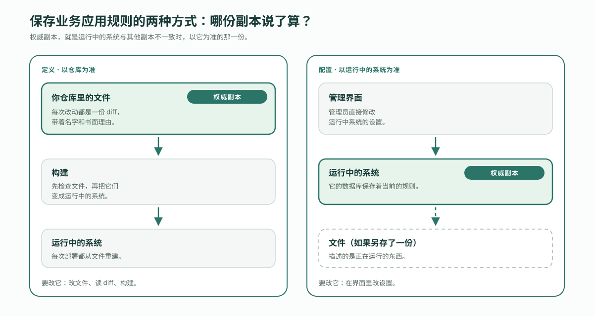

---
# @generated zh-Hant from zh-Hans (s2twp) — edit the zh-Hans file; delete this line to hand-maintain.
title: 業務應用該放在資料庫裡，還是放在程式碼倉庫裡？
description: 是平台數據庫裡的配置，還是你倉庫裡的定義？在 ObjectStack 18.5.0 上追溯並撤銷一個開源 CRM 裡的一次權限改動，看看兩種選擇各自能回答哪些問題。
author: ObjectStack Team
date: 2026-11-23
status: published
topic: governance
audience: business
solutions: []
industries: []
cover: ./cover.svg
tags:
  - 中繼資料
  - 可評審的 diff
  - AI Agent
---

如果 AI Agent 會改動你的業務軟體，就把這套軟體規則的主副本，以檔案的形式放在公司自己掌控的程式碼倉庫裡，再由這些檔案構建出執行中的系統。這樣，每次改動都會以一份註明日期、署了名、附帶書面理由的前後對比出現，「誰讓銷售能這麼做，為什麼？」可以從記錄裡找到答案，而不是靠回憶。代價有兩層。成熟平台（Salesforce、Odoo 及同類）擁有多年的生產使用經驗、現成的應用包和實施夥伴，而以倉庫為先的平台需要你自己多建一些。另外，每次改動都要經過一道評審，而管理介面並不要求這一步。

*測量基於 ObjectStack 18.5.0，即今天新安裝得到的版本：釋出標籤下其開源 CRM 示例的 git 歷史，以及用已釋出的 18.5.0 命令列工具對該示例的實際執行。所有命令見[證據](#證據)。*

## 配置還是定義：哪份副本說了算？

兩類平台做的是同一件看得見的事。你描述自己的業務（客戶、商機、誰可以編輯什麼），平台把這份描述變成資料庫表、介面和一套程式設計介面（API）。這樣工作的平台叫中繼資料平台：它賴以執行的那份描述就是中繼資料，即關於資料的資料。ObjectStack 自己的[對比頁](/zh-Hant/compare/)把這類平台稱為[「最近的親戚」](https://github.com/objectstack-ai/objectstack/blob/b914e7247f692a79804f9b7eba278add46d57625/content/docs/concepts/compare.mdx#L58-L73)：「Salesforce 的中繼資料是祖先；開源的表親包括 Frappe Framework 與 ERPNext、Odoo、NocoBase、Payload 和 Twenty。」它用一句話點出差別：

> 定義放在哪裡，寫給誰看。在其中大多數平台上，中繼資料是存放在平台數據庫中、通過其介面編輯的配置；當它是程式碼時，比如 Payload Config 或 Odoo 的模組，那是框架程式碼。

這裡的框架程式碼，指只為那一個平台編寫的程式碼。對買方有用的問題，比「中繼資料還是程式碼」更窄，那就是：**哪份副本是權威副本？** 權威副本，就是執行中的系統與其他副本不一致時，以它為準的那一份。

- **配置。** 執行中系統的資料庫儲存著權威副本。你通過修改它來修改系統，通常是在管理介面裡；如果你另存了一份檔案，它描述的是正在執行的東西。
- **定義。** 倉庫裡的一組檔案儲存著權威副本，執行中的系統由它們構建而來。你通過修改檔案來修改系統，改動在構建之後生效；構建，就是把檔案變成執行中系統的那一步。

這是兩種工作方式，不是兩張廠商名單。上面提到的平台裡，有幾家也可以從檔案來執行；去問每家廠商，它的客戶實際是怎麼工作的。釋出這篇文章的 ObjectStack，屬於以倉庫為先的那一類。



程式碼倉庫是一個有版本控制的資料夾，通常託管在 GitHub 或 GitLab 上，它把每次改動都儲存為一份前後對比，帶作者、日期和說明。這份前後對比叫作 diff。拉取請求（pull request）就是以這種形式呈現的一次擬議改動，由某個人把它接受進主副本。兩類平台都可以保留歷史；本文不對任何廠商自己的變更追蹤做判斷，請針對你在評估的平台自行核實。這個選擇決定的是：「現在什麼是真的，從什麼時候起？」在哪裡得到回答，以及一次改動在生效前在哪裡被閱讀：是在檔案的歷史裡，還是在平台自己的記錄和工具裡。

現在很多改動是 AI Agent 寫的，這一點因此更要緊。在下面的例子裡，銷售角色權限檔案的七次改動，每一次都記錄了一個 AI 程式設計 Agent 作為合著者。

## 追溯一次權限改動

ObjectStack 的倉庫附帶一個開源 CRM 示例，它是演示應用，不是客戶系統。2026 年 8 月，它的銷售角色可以開啟商機，卻不能往商機裡新增產品明細：平台拒絕了所有不是管理員的使用者。修復加了一行權限，並在應用的訪問表裡加了一行；訪問表是儲存在倉庫裡的一份清單，列出每個角色可以新建、讀取、編輯和刪除什麼。我們拿審計人員或財務負責人會問的問題去問這個權限檔案的歷史，然後在今天的釋出版上撤銷這次修復，看看什麼會攔住它。

| 我們問了什麼 | 記錄怎麼回答 | 這對你意味著什麼 |
|:--|:--|:--|
| 銷售角色的權限檔案改過幾次？ | 自 2026 年 7 月 9 日用上現在的檔名以來改過 7 次，最近一次在 11 月 6 日。每次改動都有日期、作者、帶編號的拉取請求和書面理由。 | 審計問題從檔案自己的歷史裡得到回答，不靠任何人的記憶。 |
| 這些改動是誰寫的？ | 7 次全部記錄了一個 AI 程式設計 Agent 作為合著者。在 CRM 示例的原始檔裡，2026 年 7 月 1 日以來的 50 次改動中有 49 次帶著同樣的合著者行（在示例從 2026 年 2 月開始的整個歷史裡是 218 次中的 71 次）。 | AI 已經在寫這份定義，記錄也如實寫著。 |
| 誰批准的？ | GitHub 的評審記錄顯示，7 個拉取請求中有 1 個獲得了批准。另外 6 個沒有評審記錄。其中三個由同一個人的賬號發起併合並，兩個由專案的自動化賬號發起併合並，一個由某個 AI Agent 的賬號發起、由一個人的賬號合併。 | 倉庫不會憑空產生評審。它逐次顯示是否留下了評審記錄，而在這裡它顯示，我們的大多沒有。 |
| 為什麼銷售能往商機里加產品明細？ | 一行權限，加上訪問表裡新增的一行，2026 年 8 月 12 日，[拉取請求 8228](https://github.com/objectstack-ai/objectstack/pull/8228)，理由寫得清清楚楚：銷售使用者在原本完全歸自己的商機上被拒絕了。 | 答案是一行程式碼和一行表格，理由就附在旁邊。評審人籤認的是表格裡的一行，不是一段程式碼。 |
| 如果今天有人悄悄刪掉那一行呢？ | 平台的第一道檢查（讀取檔案查錯）仍然通過，並給出警告：所有不是管理員的使用者都會被拒絕。構建會停下，並點名損失（見下）。 | 在保留這張表的應用裡，去掉某個角色對某類記錄的訪問權，會讓構建停下，直到有人重新生成這張表。這道檢查並不判斷改動對不對。 |
| 如果我們有意接受這次刪除呢？ | 重新生成的表，與 8 月修復之前的那張表完全相同，一個字元都不差。 | 誰能做什麼，在定義歷史上的任何時點都能從定義復現出來。 |

這裡的正式評審，指 GitHub 上該拉取請求的評審記錄：一次批准、一次要求修改，或一條評審意見。

構建的拒絕資訊是這樣的：

```text
✗ Access matrix drift (1 change) — capability changes must be reviewed
• 'crm_sales_user' loses ALL access to 'crm_opportunity_line_item' (entry removed)
If intended, re-run with --update-access-matrix and commit the snapshot — its diff IS the review artifact.
```

說白了：銷售角色將失去對商機產品明細的全部訪問權，在有人有意接受這一點之前，構建不會完成。「訪問矩陣」（access matrix）就是儲存在倉庫裡的那張訪問表，每個角色和每類記錄各佔一行。具體機制逐行講解見[怎樣在上線前抓住 AI 悄悄改掉的權限？](/zh-Hant/blog/catch-ai-silent-permission-change-access-matrix-gate/)

## 中繼資料平台做得更好的地方

支援成熟平台的理由很充分，ObjectStack 的文件用自己的話把它講了出來。它們擅長的是：[「在久經考驗的執行環境上快速構建業務應用，有現成的應用包、模組和整合可以起步。」](https://github.com/objectstack-ai/objectstack/blob/b914e7247f692a79804f9b7eba278add46d57625/content/docs/concepts/compare.mdx#L65-L66)它們領先的地方：

> Salesforce、Odoo 和 ERPNext 擁有多年的生產使用經驗、成套的應用、應用市場和實施夥伴。ObjectStack 更年輕；要準備好自己多建一些。
> — [ObjectStack 文件，「其他方案更強的地方」](https://github.com/objectstack-ai/objectstack/blob/b914e7247f692a79804f9b7eba278add46d57625/content/docs/concepts/compare.mdx#L115-L117)

還有三點對它們有利：

- **Agent 也能接入它們。** 同一頁寫道：[「其中幾家現在提供 MCP 伺服器，所以 Agent 也能接入它們。」](https://github.com/objectstack-ai/objectstack/blob/b914e7247f692a79804f9b7eba278add46d57625/content/docs/concepts/compare.mdx#L62-L63)MCP 是 AI Agent 呼叫一個系統的工具所用的開放標準。
- **把邏輯存成資料是常規形態，不是缺陷。** [「這與 ServiceNow（Business Rules）、Salesforce（以中繼資料儲存的 Formulas 與 Apex Triggers）、Retool（transformer JS 字串）和 Airtable（Scripting blocks）做出的取捨相同。這是標準的低程式碼形態。」](https://github.com/objectstack-ai/objectstack/blob/b914e7247f692a79804f9b7eba278add46d57625/content/docs/automation/hook-bodies.mdx#L61)這是 ObjectStack 自己的文件，說的是它把小段業務邏輯存成資料的選擇。所以差別不在於平台用不用中繼資料。ObjectStack 就是中繼資料平台。差別在於權威副本在哪裡做版本管理。
- **管理介面不需要倉庫。** 在配置型平台上，業務管理員幾分鐘就能加一個欄位，不需要拉取請求、構建或部署。對很多團隊來說，這正是重點。

如果你已經在用其中某個平台，你在上面已經建好的東西，就是留下來的真實理由；我們關於 [Power Platform 與 Dataverse](/zh-Hant/blog/power-platform-lock-in-dataverse-self-host/) 和關於 [Retool](/zh-Hant/blog/retool-vs-ai-native-app-platform/) 的文章逐個權衡了具體產品。

## 怎麼選

**從配置型平台起步**，如果你這個季度就需要現成的應用包、應用市場和實施夥伴；如果改系統的人是在介面裡工作的管理員；如果你的審計人員認可平台自己的變更記錄。

**把定義放在倉庫裡**，如果大多數改動將由 AI Agent 來寫，而每一次都要有人負責；如果一次權限改動必須附帶理由和可讀的前後對比；如果你希望業務的定義是公司持有的檔案，而不是執行中系統資料庫裡的一行行記錄。ObjectStack 的 README 是這樣說最後這一點的：[「定義以普通 TypeScript 的形式放在你的倉庫裡，在你的 VCS 中做版本管理，可以作為 diff 來評審——而不是困在某個廠商系統內部的一張圖。」](https://github.com/objectstack-ai/objectstack/blob/b914e7247f692a79804f9b7eba278add46d57625/README.md#L197-L199)VCS 就是版本控制；TypeScript 是這些檔案所用的語言。

無論選哪種，都去問廠商三個問題：

1. 哪份副本是權威副本：執行中的系統，還是一個檔案？
2. 每一次權限改動，我能否在它生效前拿到一份可讀的前後對比，附帶作者和理由？
3. 執行中的系統和檔案不一致時，以哪個為準，誰會發現？

## 倉庫解決不了的事

- **它不判斷一次改動對不對。** 我們刪掉 8 月的修復時，平台的第一道檢查帶著一條警告通過了。只有訪問表攔住了構建，而且只是因為這個應用有這張表：每個應用都要自己開啟它，沒有這張表的應用照樣能構建成功。銷售該不該碰產品明細，仍然要由人來決定。
- **它不會憑空產生評審。** 上面七個拉取請求中有六個在 GitHub 上沒有評審記錄，我們自己也算在內：這是 ObjectStack 自己的倉庫。沒有記錄並不證明沒人讀過這次改動；它的意思是，沒人能證明有人讀過。倉庫讓這個缺口變得可以清點。要補上它，需要一項在合併前要求批准的設定。
- **ObjectStack 也保留了一些配置。** 檢視、儀表盤、報表、翻譯和郵件模板可以在執行環境的管理介面裡編輯。這些編輯存放在該環境的資料庫裡，並且[優先於倉庫裡的版本](https://github.com/objectstack-ai/objectstack/blob/b914e7247f692a79804f9b7eba278add46d57625/content/docs/concepts/metadata-lifecycle.mdx#L43)，有它們自己的變更日誌。大多數類別的定義，包括權限包，也可以[在執行時通過程式設計介面建立](https://github.com/objectstack-ai/objectstack/blob/b914e7247f692a79804f9b7eba278add46d57625/packages/spec/src/kernel/metadata-plugin.zod.ts#L348)。按本文的說法，這些都是配置，所以哪些改動必須走倉庫，是由你來定的規矩。

## 把你的 Agent 指向定義

一份 Agent 能生成、形狀固定且可檢查、人能作為小 diff 評審、執行中的系統會強制執行的定義：ObjectStack 就是這樣一個目標；[把你的 Agent 指向 ObjectStack](/en/blog/how-to-point-your-agent-at-objectstack/)，用你自己的流程試一試。相關概念見[定義層](/zh-Hant/glossary/definition-layer/)、[應用定義與執行環境](/zh-Hant/glossary/application-definition-vs-runtime/)，以及[「本體即軟體」是什麼意思](/zh-Hant/blog/what-does-the-ontology-is-the-software-mean/)。

{/* the-proof */}
## 證據

上文的一切都在 2026-11-17 針對 ObjectStack **18.5.0** 測得。

```text
$ npm view @objectstack/cli dist-tags
{ next: '18.5.0', latest: '18.5.0' }
```

git 計數讀取的是 objectstack 倉庫在標籤 `@objectstack/cli@18.5.0` 處的狀態（提交 [`b914e72`](https://github.com/objectstack-ai/objectstack/commit/b914e7247f692a79804f9b7eba278add46d57625)），用的是完整克隆，不是淺克隆。

### 1. 權限檔案的歷史：7 次改動

```text
$ T='@objectstack/cli@18.5.0'
$ git log $T --format='%h %ad  %s' --date=short -- examples/app-crm/src/security/sales-positions.ts
9d313f3ac70 2026-11-06  refactor(examples): every example-authored metadata name carries its package namespace (#30927)
9975c26ae38 2026-10-18  docs(rest,app-crm): the public form submit is authorized by its declaration, not by a guest_portal set (#24237)
bfc15d275ba 2026-10-11  feat(spec,core)!: positions declare their permissionSets; the authorization resolver reads the security catalog and the activation ledger (#22723)
90718b6804e 2026-09-03  docs(app-crm): point two stale comments at the real consumers (#14840)
c4624f084f7 2026-08-12  fix(example-crm): grant crm_opportunity_line_item in crm_sales_user, matching its master crm_opportunity (#8164) (#8228)
0a8e68580eb 2026-07-10  feat(showcase,docs): ADR-0090 permission-model zoo + full docs alignment (#2739)
6d83431cfaf 2026-07-09  feat(security)!: ADR-0090 P1 breaking wave — position rename, profile removal, secure OWD default, principal/external spec shapes (#2697)

$ git log $T --oneline -- examples/app-crm/src/security/sales-positions.ts | wc -l
7
$ git log $T --follow --oneline -- examples/app-crm/src/security/sales-positions.ts | wc -l
15
$ git show -M --format= --name-status 6d83431cfaf | grep sales-
R088	examples/app-crm/src/security/sales-roles.ts	examples/app-crm/src/security/sales-positions.ts
$ git log $T --oneline -- examples/app-crm/access-matrix.json | wc -l
2
```

這個計數針對的是現用檔名下的檔案。它在七次改動中的第一次裡由 `sales-roles.ts` 改名而來；`git log --follow` 還能再追溯 8 個更早的提交，一直到 2026 年 5 月 27 日。11 月 6 日那次改動（#30927）改的是檔案裡的名稱，不是檔名。訪問表有兩個提交：`a5a1e41ba89`（2026-07-09）建立了它，`c4624f084f7`（2026-08-12）就是下面的修復。

### 2. AI 合著與拉取請求

```text
$ for c in $(git log $T --format=%h -- examples/app-crm/src/security/sales-positions.ts); do
>   git log -1 --format=%B $c | grep -qi 'co-authored-by: claude' && echo ai || echo other; done | sort | uniq -c
      7 ai

$ git log $T --since=2026-07-01 --format=%H -- examples/app-crm/src | while read c; do
>   git log -1 --format=%B $c | grep -qi 'co-authored-by: claude' && echo ai || echo other; done | sort | uniq -c
     49 ai
      1 other

$ git log $T --format=%H -- examples/app-crm/src | while read c; do
>   git log -1 --format=%B $c | grep -qi 'co-authored-by: claude' && echo ai || echo other; done | sort | uniq -c
     71 ai
    147 other
$ git log $T --reverse --format=%ad --date=short -- examples/app-crm/src | head -1
2026-02-03

$ git log --first-parent $T --since=2026-07-01 --oneline -- examples/app-crm/src | wc -l
50
$ git log --first-parent $T --since=2026-07-01 --oneline -- examples/app-crm/src | grep -v '(#[0-9]*)'
df1137309d0 Merge pull request #2624 from objectstack-ai/claude/metadata-showcase-redesign-ougiov
```

合著者行記錄的是這個工具參與了改動，而不是改動裡有多少是它寫的。`--since` 按提交日期篩選；時間窗裡最早的提交是 2026 年 7 月 5 日的。這個時間窗裡對 CRM 示例原始檔的 50 次改動，全部經由拉取請求進入主分支：49 次是標題帶編號的壓縮合並拉取請求，1 次包含在拉取請求 2624 的合併裡。唯一沒有合著者行的改動是 `23430995bcf`（#3806）。

### 3. 7 個拉取請求的評審記錄

```text
$ for n in 2697 2739 8228 14840 22723 24237 30927; do
>   r=$(gh api repos/objectstack-ai/objectstack/pulls/$n/reviews --jq length)
>   gh api repos/objectstack-ai/objectstack/pulls/$n --jq "\"$n reviews=$r opened-by=\(.user.type) merged-by=\(.merged_by.type) same-account=\(if .user.login == .merged_by.login then \"yes\" else \"no\" end)\""
> done
2697 reviews=0 opened-by=User merged-by=User same-account=yes
2739 reviews=0 opened-by=User merged-by=User same-account=yes
8228 reviews=0 opened-by=User merged-by=User same-account=yes
14840 reviews=0 opened-by=Bot merged-by=User same-account=no
22723 reviews=1 opened-by=Bot merged-by=Bot same-account=yes
24237 reviews=0 opened-by=Bot merged-by=Bot same-account=yes
30927 reviews=0 opened-by=Bot merged-by=Bot same-account=yes
```

22723 上唯一的那條評審記錄是一次批准。按類別統計沒有評審記錄的六個：三個由同一個人的賬號發起併合並（2697、2739、8228）；兩個由專案的自動化賬號發起併合並（24237、30927）；一個由某個 AI Agent 的賬號發起、由一個人的賬號合併（14840）。自動化賬號與 AI Agent 的賬號是兩個不同的機器人賬號；這條命令列印的是賬號型別而不是名字，去掉 `type` 查詢就能看到賬號本身。

### 4. 8 月的改動：一行程式碼，一條表項

```text
$ git show c4624f084f7 --stat --format='%h %ad%n%n%b' --date=short | sed -n '1,14p'
c4624f084f7 2026-08-12

* fix(example-crm): grant crm_opportunity_line_item in crm_sales_user, matching its master crm_opportunity (#8164)

crm_opportunity_line_item is a master-detail CHILD of crm_opportunity
(sharingModel: 'controlled_by_parent', inlineEdit: 'grid' on the
Opportunity form), but crm_sales_user granted object-level CRUD on 5
CRM objects and never the line item. Record-level access always
follows the master (ADR-0055), but object-level CRUD is a SEPARATE
gate the platform never derives -- every role-bound (non-admin) user
got a silent 403 the moment they tried to add/edit a product line on
an Opportunity they otherwise fully own. The platform's own
build-time lint (security-master-detail-ungranted) already flagged
this independently.
```

對定義的改動如下，省略了只是調整了空格的五行未變內容：

```diff
     crm_opportunity: { allowRead: true, allowCreate: true, allowEdit: true, allowDelete: false },
+    // [#8164] crm_opportunity_line_item is a master-detail CHILD of
+    // crm_opportunity (sharingModel: 'controlled_by_parent') — ...
+    crm_opportunity_line_item: { allowRead: true, allowCreate: true, allowEdit: true, allowDelete: false },
     crm_lead: { allowRead: true, allowCreate: true, allowEdit: true, allowDelete: false },
```

以及它在 `examples/app-crm/access-matrix.json` 裡新增的表項，在 18.5.0 標籤下仍然存在：

```diff
+    {
+      "permissionSet": "crm_sales_user",
+      "object": "crm_opportunity_line_item",
+      "create": true,
+      "read": true,
+      "edit": true,
+      "delete": false,
+      "viewAllRecords": false,
+      "modifyAllRecords": false,
+      "sharingModel": "controlled_by_parent"
+    },
```

### 5. 在 18.5.0 上撤銷它

從標籤取出的 CRM 示例，按已釋出的 18.5.0 包安裝，而不是用 monorepo（把它的 `workspace:*` 依賴改為 `18.5.0`，去掉測試目錄），並提交到一個臨時倉庫，好讓編輯以 diff 的形式顯示：

```text
$ git -C ~/objectstack archive '@objectstack/cli@18.5.0' examples/app-crm | tar -x --strip-components=2
$ npm install
$ npx os --version
@objectstack/cli/18.5.0 linux-x64 node-v22.22.0
$ npx os compile; echo $?
  ...
  → Checking access-matrix snapshot (ADR-0090 D6)...
  ...
  ✓ Build complete (353ms)
0
```

刪掉那一行授權，然後執行檢查和構建：

```text
$ sed -i '/^    crm_opportunity_line_item: { allowRead: true/d' src/security/sales-positions.ts
$ git diff --stat
 src/security/sales-positions.ts | 1 -
 1 file changed, 1 deletion(-)

$ npx os validate; echo $?
  → Running author-time rules (68)...
  ...
  ✓ Validation passed (414ms)
  ...
  ⚠ object "crm_opportunity_line_item": detail object "crm_opportunity_line_item" (master_detail "opportunity" → "crm_opportunity") has no object-level CRUD grant in any permission set, so non-admin users are denied it (403)
    fix: Grant it where its master "crm_opportunity" is granted: permissions[i].objects.crm_opportunity_line_item = { allowRead: true, allowCreate: true, allowEdit: true }
    rule: security-master-detail-ungranted  at objects[5].fields.opportunity
  ...
0

$ npx os compile; echo $?
  → Running author-time rules (68)...
  ...
  → Checking access-matrix snapshot (ADR-0090 D6)...

  ✗ Access matrix drift (1 change) — capability changes must be reviewed
  • 'crm_sales_user' loses ALL access to 'crm_opportunity_line_item' (entry removed)
  If intended, re-run with --update-access-matrix and commit the snapshot — its diff IS the review artifact.
1
```

這張表是按應用選擇開啟的。18.5.0 的構建原始碼在執行這項檢查的地方寫明瞭這一點：[「Opt-in per app: when `access-matrix.json` sits next to the config」](https://github.com/objectstack-ai/objectstack/blob/b914e7247f692a79804f9b7eba278add46d57625/packages/cli/src/commands/compile.ts#L1108-L1114)。

### 6. 有意接受這次刪除

```text
$ npx os compile --update-access-matrix; echo $?
  → Access matrix snapshot written to access-matrix.json (ADR-0090 D6) — review the diff.
  ✓ Build complete (387ms)
0
$ git diff --stat
 access-matrix.json              | 11 -----------
 src/security/sales-positions.ts |  1 -
 2 files changed, 12 deletions(-)

$ git hash-object access-matrix.json
ecfe192469fc5500deecb0924d20699a382d6b45
$ git -C ~/objectstack rev-parse c4624f084f7^:examples/app-crm/access-matrix.json
ecfe192469fc5500deecb0924d20699a382d6b45
```

重新生成的表與 8 月修復之前的表是同一個檔案，逐位元組相同。隨後用 `git checkout HEAD -- .` 還原了臨時目錄，`git diff HEAD` 為空。

### 7. 引用的原文，在 18.5.0 標籤下

- `content/docs/concepts/compare.mdx` [第 58–73 行](https://github.com/objectstack-ai/objectstack/blob/b914e7247f692a79804f9b7eba278add46d57625/content/docs/concepts/compare.mdx#L58-L73)（最近的親戚、它們擅長什麼、差別）和[第 115–117 行](https://github.com/objectstack-ai/objectstack/blob/b914e7247f692a79804f9b7eba278add46d57625/content/docs/concepts/compare.mdx#L115-L117)（它們更強的地方）。
- `content/docs/automation/hook-bodies.mdx` [第 61 行](https://github.com/objectstack-ai/objectstack/blob/b914e7247f692a79804f9b7eba278add46d57625/content/docs/automation/hook-bodies.mdx#L61)（標準的低程式碼形態）。
- `README.md` [第 197–199 行](https://github.com/objectstack-ai/objectstack/blob/b914e7247f692a79804f9b7eba278add46d57625/README.md#L197-L199)（定義放在你的倉庫裡）。
- `content/docs/concepts/metadata-lifecycle.mdx` [第 43 行](https://github.com/objectstack-ai/objectstack/blob/b914e7247f692a79804f9b7eba278add46d57625/content/docs/concepts/metadata-lifecycle.mdx#L43)（「Reads walk top-to-bottom: the first non-null layer wins」）和[第 327 行](https://github.com/objectstack-ai/objectstack/blob/b914e7247f692a79804f9b7eba278add46d57625/content/docs/concepts/metadata-lifecycle.mdx#L327)（在管理介面裡的編輯作為覆蓋行寫入，並在同一事務裡寫入一條歷史記錄）。
- `packages/spec/src/kernel/metadata-plugin.zod.ts` [第 348 行](https://github.com/objectstack-ai/objectstack/blob/b914e7247f692a79804f9b7eba278add46d57625/packages/spec/src/kernel/metadata-plugin.zod.ts#L348)（「Allow runtime creation via API」）及其下方的型別登錄檔：管理介面覆蓋對 `view`、`dashboard`、`report`、`translation` 和 `email_template` 開啟，對 `permission`、`position`、`object` 和 `flow` 關閉。
