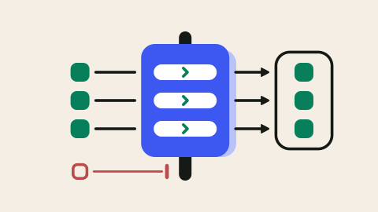
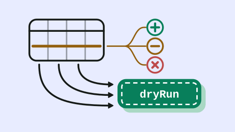
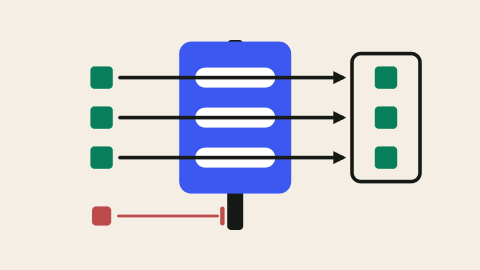

# Blog cover style (cover spec v2)

Ruled by the maintainer on #430 (2026-11-14: 「同意按建议定稿」). It replaces
the cover part of the #340 ruling ("the title is at least 56px"); the rest of
#340 stands. AGENTS.md carries the short rule; this page holds the detail.
`scripts/cover-spec.mjs` enforces what a machine can check, in `pnpm build`,
for posts dated on or after 2026-11-17. Covers of earlier posts are
grandfathered until the redraw card replaces them.

**Why no title.** The post's title is already printed beside the cover on
every card and above it on the page, so a title on the cover says it twice.
Of 14 peer blogs surveyed, 11 put no title on the cover. The best of them
(Linear, Airtable, Notion, Stripe, Supabase) use one visual language, one idea
per image, and one strong shape that still reads at card size (about 344px
wide).

## The spec

1. **No title, subtitle or sentence on the cover.** The title lives in the page only.
2. **One mechanism picture in line art.** At most about 5 objects; ink line art with a 9 stroke on the 1200×675 canvas.
3. **One solid, saturated hero** (brand indigo `#3d58f0` or green `#087f5b`) covering about 22–35% of the art box. It may carry a lighter same-hue offset tint tile behind it for depth, and may tilt 2–3°, but only for tiles, never for structural shapes such as walls or doors.
4. **Rounded:** round caps and joins, large corner radii (about 22–44), and curved connectors where meaning allows.
5. **Minimal faces** (dot eyes, a small smile arc) only on person or agent glyphs, only where people are the subject. No mascots, no limbs, no decorative sparkles.
6. **Ground = the post's topic tint** (table below). The art box is about x 150–1050 and y 100–575, with even margins.
7. **Labels: 0 by default, at most 1**: ≤ 8 characters, monospace bold, ≥ 28px (56px in the samples). Use a code token only where the picture can't say it.
8. **Red is status only:** a thin refused path plus a stop bar, never the protagonist.
9. **No overlapping strokes:** no line crossing a filled shape, a white detail or another line unless the crossing is the meaning; no arrowhead touching a stroke; no connector running under an object.
10. **Line art only.** No product screenshots on covers: tested, they turn to texture at card size. Real UI belongs in the body. No AI 3D renders.
11. **The dark variant is generated at build time** (`scripts/cover-dark.mjs`). Draw the light cover only.

**One cover for every locale.** A cover carries no natural-language text (its
one label, if any, is a code token such as `dryRun`), so a post has one
`cover.svg` and every locale's frontmatter says `cover: ./cover.svg`. There is
no `cover-en.svg`. The page renders the cover with the post's localized title
as its alt text, so the SVG's `aria-label` is one short neutral English
sentence that nothing depends on. Body diagrams that carry text keep the
`*-en.svg` + Chinese pair.

### What the gate checks

| Rule | Limit | Spec item |
|:--|:--|:--|
| `runs` | at most 1 `<text>` run; a cover with no text passes | 1, 7 |
| `chars` | at most 8 characters in it | 7 |
| `sizes`, `min` | 1 font size, none under 28px | 7 |
| `fills` | at most 6 distinct fill colours, ground and white included; strokes are not counted | 2, 3 |
| `ground` | the first full-canvas rect is the post's topic tint, light value | 6 |
| `shared` | every locale's `cover` is `./cover.svg`; no other cover file in the folder | one cover |

The fill limit is measured: the six samples below paint 4 to 6 fill colours.
Items 2–5 and 8–10 are judgement; the review checklist at the end covers them.

## Topic tints

The ground of a cover is its topic's tint, and the topic chip on the post's
card and page is the same tint with a same-hue ink, so a card's chip and its
cover read as one colour. Tokens: `--topic-SLUG` and `--topic-SLUG-ink` in
`src/layouts/Base.astro`; the same values, with the dark pair that
`cover-dark` maps each ground to, in `scripts/lib/cover-colors.mjs`
(`TOPIC_TINTS`). `pnpm build` fails when the two disagree.

| Topic | Ground (light) | Chip ink (light) | Contrast | Ground (dark) | Chip ink (dark) | Contrast |
|:--|:--|:--|--:|:--|:--|--:|
| integration-data | `#e8ecff` | `#3d58f0` | 4.64 | `#272a38` | `#91a3ff` | 6.03 |
| governance | `#e2f0e6` | `#06704f` | 5.19 | `#222d26` | `#3fbf8f` | 6.16 |
| app-building | `#f4eee4` | `#7d5210` | 5.90 | `#2d2921` | `#e3a54a` | 6.72 |
| ai-agents | `#f8e7fa` | `#8d4998` | 5.03 | `#322534` | `#d58de0` | 6.01 |
| automation | `#daf2f7` | `#056f7f` | 5.03 | `#1b2e32` | `#5bb6c7` | 6.04 |
| modernization | `#edf0d8` | `#656925` | 5.01 | `#2b2c19` | `#a9ae6a` | 6.06 |
| customer-stories | `#fee7e0` | `#9b4e36` | 5.01 | `#382520` | `#e79277` | 6.04 |

The first three were sampled with the maintainer. The other four share their
OKLCH lightness and chroma on the hues left free: violet (brand indigo turned
toward magenta), teal (between green and indigo), olive (between amber and
green) and apricot (amber turned warm, kept 15° clear of the status red).
Chip text is 12px bold, so WCAG AA asks 4.5:1; every pair clears it.

## The six samples

Rendered small from `scripts/covers/specs/`; each post ships its own cover.

| | |
|:--:|:--:|
|  |  |
| Anonymous form: the door is the hero (app-building) | Business layer: the band is the hero (integration-data) |
|  |  |
| Federate or copy: the copy is the hero (integration-data) | View auditing: the log is the hero (governance) |
|  |  |
| Projections: the definition is the hero (app-building) | Spreadsheet import: the one label, `dryRun` (integration-data) |

## Do and don't

| Don't | Do |
|:--:|:--:|
|  |  |
| **Overlapping lines.** The arrows cross the hero and its white slots (the maintainer: 「感觉有些线条叠起来了」). | Connectors stop short of the hero; the slot's chevron says "passes". |
|  |  |
| **A title on the cover.** The card already prints it beside the image (the maintainer: 「文章有标题，你的配图也有标题」). | One mechanism, no words. |
|  |  |
| **A product screenshot.** Tested on the import post: at card size it turns to texture. Real UI goes in the body. | The same idea as line art, with one code token. |

## Making a cover

Use the kit in `scripts/covers/` (its README has the details):

```sh
# write scripts/covers/specs/SLUG.mjs from the closest sample, then:
node scripts/covers/cover.mjs scripts/covers/specs/SLUG.mjs
```

That writes `content/blog/SLUG/cover.svg` on the post's topic ground and runs
the gate on it. Commit the spec with the post.

## Review checklist

The gate passes covers that still break the judgement items. Before a cover
merges, look at it at native size and at card size, light and dark, and check:

- one mechanism, at most about 5 objects, and the hero is obvious at 344px;
- the hero is the only solid saturated shape, about a quarter to a third of the art box;
- only tiles tilt; walls, doors and bands are square to the canvas;
- no stroke crosses a fill, a white detail or another stroke unless that is the point; arrowheads stop at least 10px short;
- red appears only as a refused path and its stop bar;
- faces only on people or agents, and only where people are the subject;
- the art sits in the box x 150–1050, y 100–575 with even margins.
